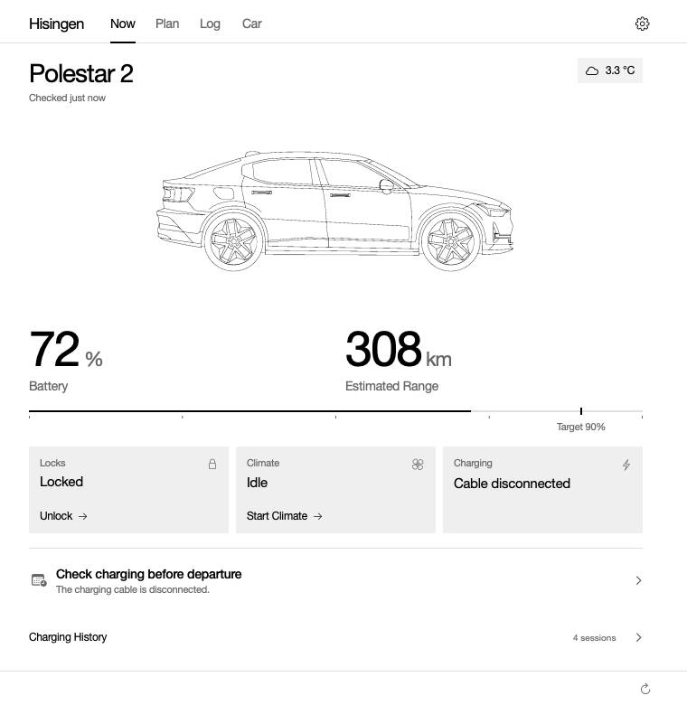
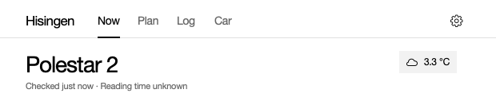
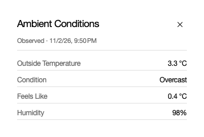
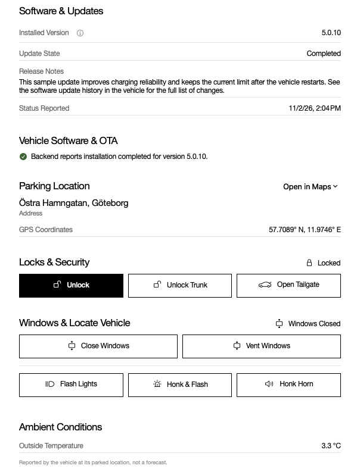
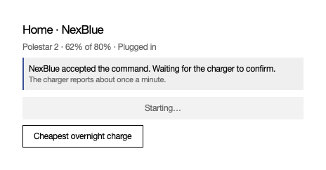
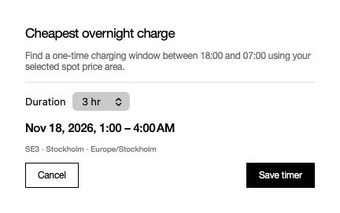
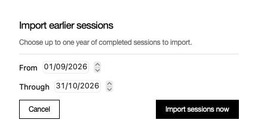
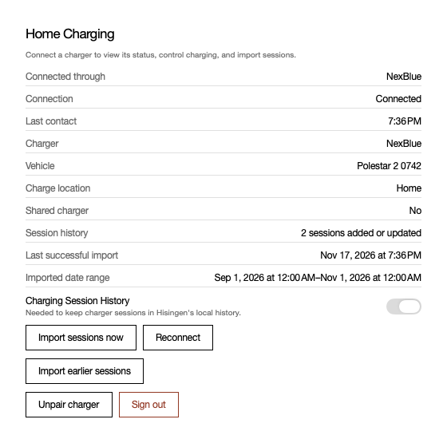

# Changelog

All notable changes to Hisingen are documented in this file. The project follows
[Semantic Versioning](https://semver.org/spec/v2.0.0.html).

## [Unreleased]

### Added

- **Idle and overstay fees, and price threshold alerts.** A charging session that stays plugged in
  after it finishes can now carry its own fee line in History. Rules are set per charger or per
  location in Settings, Electricity, with a grace period and a per-hour or per-minute rate. The fee
  is shown only where the paired charger recorded the session running past the charge's end, so a
  session without that record keeps no fee rather than an assumed one. The fee is a separate line
  and is never folded into the energy cost, which still comes from the rate policy.

  A new price threshold alert posts once when the current or next hour's price rises above a level
  the reader sets, then stays quiet for a configurable period so a volatile quarter-hour series
  cannot fill the notification list. It compares the price after the reader's rate policy, and it
  posts nothing at all when the series is missing or does not cover the hour in question.
- **GPX and XLSX exports.** The History export menu now offers an XLSX workbook beside every CSV
  entry and a GPX track file for trips. The workbook carries the CSV's rows on a data sheet with
  real numeric cells, so a spreadsheet can sum energy, distance, duration and cost without
  re-typing them, plus a summary sheet with the dataset, vehicle, scope, row count, rows with
  coordinates and totals for columns every row carries. GPX 1.1 writes one track segment per trip
  with a recorded start or end position; a trip with no position produces no track at all rather
  than a point at 0,0, and a trip with only one recorded end keeps that single point.

- **A command line for remote commands.** `hisingen cli vehicles` lists every vehicle this Mac
  knows, which one is selected, how old its reading is and what each command's capability gate
  answer is, with the gate's own sentence for anything blocked. `hisingen cli send` sends one
  command to one vehicle through the same gate, confirmation, provider, audit and receipt path as
  the app, the deep links and the Shortcuts intents; `--confirm` answers the confirmation the app
  would ask for, `--json` prints one object for scripting, and a refusal exits non-zero with the
  app's own wording. See [the command line](docs/remote-controls.md#command-line).

- A **Norway grid-tariff preset** for Elvia: day 46.40 and night 31.40 øre per kWh, weekdays
  06–22 as the day window, with VAT, elavgift and Enova included exactly as on the invoice.
  Research into the other three markets says they cannot be expressed by this model at all — Denmark
  needs three periods and seasonal rates, Germany has no national tariff, and the Netherlands bills
  capacity rather than energy — so those keep custom entry and the existing notice.

- **The Charging Planner stops at the end of its cheap window.** When auto-start sends the
  charge-now override, the window's end is recorded at that moment. If the car is still charging
  when the window closes, Hisingen resumes the charging schedule instead of letting the override
  run on to the charge limit in the next, more expensive hours. The window's end stays fixed even
  when a slower-than-planned charge would otherwise push a recomputed plan past it.

- **Opt-in sleep prevention for the Charging Planner.** A new toggle in the planner's automation
  settings keeps the Mac from going to idle sleep while a planned window is waiting or running,
  so the minute tick can send the start and the stop. It is off by default, only applies while
  Auto-Start Charging in the Window is on, and the UI says plainly that Hisingen cannot wake a Mac
  that is already asleep — scheduling a wake needs root and a privileged helper, which this app
  does not ship.

- **Multiple accounts per brand.** Accounts now have their own record and exported Keychain
  credential bundle, so two Polestar accounts can be added and switched without re-entering the
  other's session. The active account keeps the existing fixed Keychain slots, which means every
  provider and sign-out path continues to read one account at a time; switching swaps the
  bundles. Existing single-account installs migrate to their first account without a Keychain
  prompt and without touching the stored session.

- **Demo mode.** A local sample Polestar renders every tab with no provider session, no garage
  scan, no price or charger traffic, and no remote commands sent. Settings → Accounts carries
  the switch and says a relaunch applies it.

- **Real Control Center actions.** Unlock, Honk and Flash, Charge Now and Start Cabin
  Pre-Cleaning are now controls that dispatch through Hisingen's shared intents. Each one opens
  the app and runs in its process, so the command takes the same capability gate, confirmation
  and audit path as the Controls tab, and a refusal is shown instead of disappearing. Lock and
  Start Climate keep their existing `hisingen://` URL launchers, so those routes and their tests
  still work. All six controls are macOS 26 or later.

- **Interactive widget buttons.** The vehicle status widget now carries lock, unlock, start
  climate and refresh in a square action row under the data, when a snapshot names a car. Each
  button is an App Intent that opens Hisingen and runs in the app process, so it takes the same
  vehicle resolution, capability gate, confirmation and audit path as the Controls tab instead
  of a side channel. A refused command returns the gate's sentence, which the intent presents
  as a dialog while the app files its normal result banner.

- **Shared intents target.** The widget extension and the app now link `HisingenIntents`, a small
  target holding the widget-facing App Intent types and the command router the app registers at
  launch. An extension cannot link the app executable, so the intent types could not live in the
  app; each intent runs with `openAppWhenRun` in the app, through the same capability gates,
  confirmation and audit path as the panel. The extension's own `Metadata.appintents` is built by
  folding that module in as a static dependency and installed in `HisingenWidget.appex`, so
  interactive widget buttons and real Control Center actions have something to resolve. No button
  uses the intents yet — this is the platform for that change.

- Accessibility pass for VoiceOver and keyboard use. Every History, diagnostics and price chart
  now exposes the chart rotor as well as its spoken summary, including the ones whose X axis is
  minutes, temperature or an hour of day. The Now charge and current limit cards answer the
  standard increment and decrement gestures (increment matches the card's press, decrement steps
  back), joined by the heating steppers and live charging curve that already did. The panel and
  Settings declare focus sections in the order they are drawn, so Tab moves through the tab bar,
  the cards and the footer rather than jumping around, and the sidebar and destination column
  keep their listed order. Chart motion resolves through Reduce Motion.

- The menu bar's right-click menu gains **Timers**, **Software Updates** and **Charge Locations**.
  A reported charging window or cabin timer can be paused and resumed, an update the car has
  already downloaded can be installed now or scheduled for two, eight or twelve hours, a
  scheduled installation can be cancelled, the car's current position can be saved as a charge
  location, and optimised charging can be switched at a saved location. Every row is built from
  the same capability gate as the Controls tab, so it is dimmed with that gate's reason instead
  of failing after the click, and the rows are reachable with the keyboard and through the
  VoiceOver Actions rotor. Values that need typing or a slider stay in the Controls tab.

- **A second charger.** An install can now hold two pairings: pair another charger from Settings →
  Home Charging → Add another charger. Both are listed with their own vehicle, saved location, last
  reading and plan record; one holds the live connection (the other keeps its last reading, aged,
  and is read every few minutes), selecting a row switches the connection, and the charging card
  follows the car — it shows the charger at that car's saved location and its commands switch to
  that charger first. An existing single pairing loads unchanged; its stored value is read as a list
  of one and the per-charger plan record is adopted by the charger that wrote it.

- **Reports.** History gains a **Period Report** card: pick a week or a month (and step back through
  past windows) and read distance, energy, trip cost, charging cost, the maintenance log and
  depreciation, then copy or export it as text. Trip costs are distance × the consumption the car
  reported × your electricity rate — the same rate policy the charging figures use, with the fixed
  tariff named when no market series covers the window. Maintenance entries are your own local log
  (date, kind, what was done, odometer, cost). Depreciation is arithmetic on the purchase price,
  purchase date and annual decline you enter, and the report prints that assumption instead of
  estimating a market value. An opt-in **Recurring Report** (Settings → Automations) posts one
  banner per completed week or month with the same figures.

- **Automations.** Settings → Automations gains scheduled actions, arrival and departure triggers,
  and a one-tap broadcast to every configured vehicle. A scheduled action runs once per occurrence
  on the days you pick, catches up a tick that lands late, and skips rather than replays a schedule
  missed by hours. Arrival and departure triggers compare the position Hisingen already reads from
  the car with the saved charge locations, so no Location Services permission is asked for. Every
  unattended send crosses one queue, so two triggers firing together do not collide, and a repeat
  inside a per-command cooldown is refused with the wait in the message. Only actions that need no
  confirmation can be scheduled or triggered; everything else stays a deliberate tap.

- **Volvo endpoint evidence.** Seven sanitized fixtures now prove the decoding of every Volvo
  GET resource the adapter calls: engine diagnostics, brakes, warnings, engine-status, command
  accessibility, the advertised command list, and the VOC subscription. An opt-in live sweep
  walks the same inventory through `VolvoAPI`'s own decode path instead of a hand-maintained
  endpoint list that had kept four endpoints the app no longer calls and missed all seven of
  these. A test pins the fixture set and records the called endpoints that deliberately have no
  file fixture: the command POST (state-changing, covered by inline response tests), token
  revocation (no body), image CDN bytes, and the external OIDC documents.

- **Volvo access, stated honestly.** The Info tab's capability section gains a provider access
  inspector: it shows which Volvo scopes the token response granted, which requested scopes were
  refused or never asked for, and, per feature, the provider's own `status` and
  `unavailableReason` when a field came back without a value instead of a generic unavailable.
  Developer Portal (`dataPortal`) mode gains a Polestar ID fallback: a revoked grant, a spent
  daily quota or a missing credential no longer leaves every card dark, and the inspector names
  the channel, the domains it can read and any fallback that served the refresh. The entitlement
  probe and domain-support map live with the provider layer. New strings are translated in all
  14 locales.

- **Public charging sessions and a home-versus-public cost split.** The Charging Sessions card
  gains **Add Session**, which logs a charge by hand with its place (home or public), location,
  start and end time, energy, and a price as a total, a per-kWh figure, or both. A stored session
  can be edited from its context menu or the pencil in its detail card, so a public charge the car
  recorded without a price can be corrected. **Charging Trends** now shows **Home Charging** and
  **Public Charging** cost as separate lines that add up to the existing total. The place is a new
  column with an additive migration: existing rows read as home and every stored total is
  unchanged. Everything is local; no provider call is added.

- **Solar forecast and live grid carbon.** When Open-Meteo answers, the Charging Planner draws a
  solar-radiation line for the next day at the car's location and names the peak time; it is
  radiation, not panel output, and never becomes a kWh figure. A token saved under Settings →
  Electricity → Live grid carbon adds a live carbon-intensity line from Electricity Maps with the
  provider named beneath it. Without a token, or when the provider fails or returns a malformed
  body, the line is absent rather than replaced by the typed intensity; that setting still drives
  the History emissions estimate. The token lives in the macOS Keychain.

- **Home Assistant charger discovery beyond NexBlue.** With an administrator token, Hisingen now
  reads Home Assistant's device registry for the NexBlue, Easee and Zaptec integrations, groups
  each charger's entities by device, and maps its status, power, session and lifetime energy,
  current limit, cable lock and switch. A charging switch is added only when every option of the
  device's status sensor is a state Hisingen can confirm a command from; a charger with
  unrecognised states is still listed for its readings, with the switch left for manual mapping.
  Without the device list, NexBlue's entity names are still matched as before. The setup copy now
  says which chargers need the administrator token. No new vendor endpoint or write is added.

- **Home charger current limit.** A charger mapped in Home Assistant can now have its charging
  current set from the charger card: map the integration's writable `number` entity under
  Settings → Home Charging → Entities → Writable current limit, and the card shows a stepper with
  Apply. This is the only charger write beyond charge/pause, chosen because it needs no vendor API —
  the spike that checked Easee, Zaptec and NexBlue found Zaptec warns against amp overrides and the
  other two publish nothing usable. The entity is kept separate from the read-only current-limit
  sensor, because reading and writing are different entities in most integrations.

- Shortcuts covers the rest of the command surface: **tailgate open/close**, **window
  open/close**, **install/cancel software update**, **set charging timer**, **set climate timer**
  and **list saved charge locations**. Timers take `HH:MM` strings and refuse anything else with a
  message instead of guessing, and every one of these routes through the same command path,
  capability gates and vehicle resolution as the Controls tab.

- Notification banners carry **Unlock**, **Start Climate** and **View Details** next to the
  existing Lock and Mute. Unlock and climate require device authentication like every other
  command button, and they take the same capability gates as the app. Climate uses the saved
  comfort setpoint, because a banner has no room to ask for one. View Details opens the car and
  never sends anything to it.

- `hisingen://` now reaches the **timers and saved charge locations**, the last commands that had
  no link: `charge-timer/set`, `climate-timer/set`, `climate-timer/delete`, `charge-location/add`,
  `charge-location/alias`, `charge-location/amps`, `charge-location/soc`,
  `charge-location/optimised` and `charge-location/delete`. Times are `HH:MM` and weekdays accept
  numbers or names; a malformed time is refused locally with a notice rather than nudged to a
  neighbouring hour, and values are clamped to the ranges the app itself accepts. The charging
  routes stay Polestar-only, matching the in-app surface.

- **Every intent now carries copy.** Flash and honk-and-flash gained descriptions, and the charge
  target, current and engine-runtime parameters gained parameter descriptions, so Shortcuts shows
  what each field means instead of a bare title.

- The release build produces **App Intents metadata**, so Shortcuts, Siri and the Focus filter can
  finally see the app's 24 intents and 10 App Shortcut groups. SwiftPM has no setting that asks the
  compiler for the constant values the processor reads, so `make app` replays the module's own
  compile command with `-emit-const-values-path` into a throwaway directory, runs the processor, and
  installs `Metadata.appintents` in the bundle. `SKIP_APPINTENTS=1 make app` skips it, and
  `Scripts/validate-release.sh --artifacts` refuses a release whose metadata is missing or empty.

- The desktop widget has a **large** size. It is the medium layout with room to breathe — the
  same battery, range, charging and departure values the app last read, not a second model.

- Hisingen's main menu now carries **Services**, **Window** and **Help**. Text selected in a
  Settings field can be handed to another app, the Settings window gets the standard Minimize and
  Bring All to Front items, and Help opens the published help page.

- `hisingen://` links gain **`lock-reduced-guard`** and **`horn`**. The existing `honk` link stays
  an alias for honk-and-flash, so older links keep working; `horn` is the horn-only action that
  previously had no route.

- Settings → Features → Vehicle Capability Matrix now lists the **commands the vehicle reports**
  in its own command list. It is a read-only diagnostic: Hisingen still refuses anything outside
  the commands it implements, and the list is what tells us which extra ones (such as a sunroof or
  window command) a particular car actually offers.

### Changed

- The widget snapshot's wire format now has **one definition** in
  `Sources/HisingenIntents/VehicleWidgetSnapshot.swift`, compiled into both the app and the
  extension. The app's writer and the widget's reader used to carry hand-kept copies of the
  same structs, so a field could be changed on one side only; the round-trip tests still write
  with the app and read with the widget, and the files they exchange are the real ones.

- The deterministic test suite no longer reaches into state a developer already owns.
  `LocalDataEraser` takes an injectable `clearAccounts` hook beside its widget and memory-cache
  hooks, so an erase test can never block on a Keychain prompt; the default path still clears
  real accounts and is covered by `LocalDataEraserTests`. Reminder tests own a scoped defaults
  suite that removes itself, and the portal hardening suite releases the quota store it
  injects. The few inspection suites that read `PreferencesStore.shared` do so because the
  views do; that is recorded in the testing strategy instead of being hidden behind a skip.

- Market prices, the automatic rate and the **Charging Planner** now follow the selected
  electricity supplier instead of the country. A connected Tibber home is a price source in every
  market Tibber serves, and the Swedish spot series remains one when Sweden is selected. With
  neither, the planner and automatic pricing stay off and the Electricity page says what to
  connect; a saved Tibber home does not silently price a different supplier.

- **Dock Icon** (Appearance → Menu Bar) shows Hisingen in the Dock and the app switcher. The
  warning badge needed this switch: it sat in Notifications while the Dock tile it paints was
  permanently hidden by the bundle, so a reader could turn on a badge that never appeared. The
  badge row now names what it needs, the tile stays blank while the Dock icon is off, and the
  count returns the moment the icon is back.
- The Electricity Supplier card now shows the house's energy next to the connection: the last 30
  days of whole-home consumption and production by day, the twelve months up to now by month, and
  the price levels of the prices published for today and tomorrow as hours at each of Tibber's five
  levels. Days and months the meter has not reported stay out instead of reading as zero, a home
  without a production metering point shows no production, and a read that fails keeps the last
  good answer and names the reason.
- Saved charge locations now say what the backend offers at each place: the optimised
  charging mode it can run while the switch is still off, in the same words the active mode
  uses, and whether the location supports bidirectional charging when the vehicle reports it.
- Reading Freshness names the transport that answered each reading — Portal, gRPC, Live or
  Weather — whenever it is not the usual Polestar app transport, and stays silent when it is.
  In Developer Portal mode this explains a stale domain sitting next to a fresh one.
- Volvo's approved permissions are now tracked per scope instead of all-or-nothing. When Volvo
  rejects a sign-in over one unapproved scope, Hisingen first retries without `location:read` —
  the permission developer applications most often lack — so a car without location approval
  keeps remote locks, engine start, and honk/flash instead of losing every remote control. The
  token response echoes the scope set Volvo actually granted, and each control now asks about
  its own scope: a missing location approval no longer dims the lock cards or stands the
  vehicle-location read down for an hour. The Approved Volvo permissions row in Settings shows
  which of the five permissions the current session carries.

### Fixed

- **A history database written by a newer Hisingen is refused instead of read with the wrong
  schema.** Opening a store whose `PRAGMA user_version` is past this build's ceiling now closes
  the handle before any ledger reads it, so the app cannot show half-decoded rows or migrate a
  file it does not understand. Settings → SQLite Storage & Data says the data is untouched and
  that updating Hisingen will read it. A damaged store (one that fails `PRAGMA quick_check`, or
  is not a SQLite file at all) is moved aside with its `-wal`/`-shm` siblings and the app starts
  clean, keeping the bytes recoverable rather than disabling persistence or recreating an empty
  store over them.

- The test suite now pins the SQLite schema end to end. `VehicleDatabaseSchemaParityTests`
  compares a fresh install with a checked-in schema fixture and with a store built from the
  pre-`user_version` fixture schema, and checks every table and column the persistence layer
  writes against that upgraded store; `VehicleDatabaseOpenGuardTests` covers the downgrade
  refusal and both quarantine paths; `SparkleFeedTests` drives Sparkle's real updater against
  fixture appcasts served over loopback, for a newer version and a malformed feed.
- The **Volvo command list** behind the remote controls now has an age rule. Past fifteen minutes
  Hisingen re-reads the car's `/commands` list before using it to decide whether lock, climate,
  engine and honk/flash are offered, instead of gating on a copy that could be an hour old. A read
  that fails keeps the last known list rather than dropping it, so one failed request no longer
  makes a control the car supports look unsupported; the capability matrix says the answers may be
  out of date. The list that gates a control and the endpoint dispatch posts to also come from the
  same catalog now, so the two cannot disagree.

- A **Volvo sign-in callback** is checked against the registered scheme, host and path before its
  code is exchanged. The browser presenter resumed on any HTTPS URL and matched the callback path
  by prefix, so a crafted redirect could take the place of the genuine one; the exchange now
  applies the same rule itself instead of trusting that gate. A refused callback is named in the
  log by the component that did not match, never the query that carries the code.

- Volvo's **capability probe and command dispatch** now read one table instead of two hand-written
  lists of endpoint names. A typo in either used to promise a control that failed at dispatch with
  nothing comparing them; the catalog is the single answer for which endpoint a command posts to and
  which advertised names mean the car offers it. Five tests pin the mapping, including that
  commands Volvo's public API cannot run have no endpoint.

- The **Reading Freshness** rows now name the service each value came from — the portal, the
  Polestar cloud, a live stream, or Volvo's cloud. The snapshot already recorded an observation for
  live-stream readings but never for a normal refresh, so most rows could not say where the value
  came from. An assembler now stamps its own producer, a live-stream observation keeps its more
  specific source, and a reading the refresh did not carry stays unknown instead of inheriting one.

- The **Cloud Connectivity** row now shows the reason the provider gives — "car is asleep",
  "subscription lapsed" — instead of only the status word. That reason is the part a reader can act
  on, and both providers were already sending it.

- The charging card now says what happened when **Charge Now** was sent on a provider that cannot
  report the override back, instead of going silent. The note names the action and the gap — it
  never claims the override is still active — and appears only within 12 hours of a sent start or
  stop, so it explains a recent press rather than nagging permanently.

- A **Spotlight** result now opens the car it was indexed from. The index stores a digest rather
  than a VIN, and activation used to ignore it, so two indexed cars both landed on whichever car
  was already active.

- A Volvo sign-in that falls back to **data and climate** now clears the **Approved Volvo
  permissions** state, so lock, unlock, engine start and honk/flash show as unavailable with the
  explanation the sign-in notice already gave, instead of staying enabled and failing with 403 on
  every tap. Previously only the narrowest fallback cleared it.

- A Volvo sign-in no longer requests `conve:connectivity_status` or `conve:environment`. Nothing
  reads either endpoint, and Volvo rejects the whole authorization when one requested scope is
  unapproved, so an unread scope could push a valid sign-in down a tier.

- Polestar no longer claims **remote engine start** or **lock with reduced guard**. Both used to
  read as supported — engine start fell through the Polestar model table's default branch, and a
  car reporting `lock_type` 3 advertised reduced guard — even though no invocation exists for
  either. The capability inspector and the Settings matrix now say not available, matching what
  the command catalog and transport already refused.

- Volvo no longer offers **climate timers** or **charging schedules**. Volvo's public API has
  neither a timer resource nor a schedule write, so the climate-timer button and a permanently
  dimmed Charging Controls card could only fail; the capability profile now marks both
  unavailable.

- The Polestar Info tab no longer presents the fixed panoramic glass roof as a **sunroof remote
  control**. The row reports the roof the car describes, without promising a control the app
  cannot offer.

- The car-image loader falls back to the front three-quarter or side render when the car's pool
  does not carry the requested angle. The fallback existed but was only exercised by tests, so a
  partial pool rendered no image; bytes are cached under the angle actually served.

- **Erase local data** now also removes the desktop widget's App Group snapshot. Previously only
  the sign-out path removed it, so a Settings wipe could leave the VIN, nickname, charge level and
  next departure readable by the widget.

- The widget extension is declared as an `XPC!` app extension instead of an application. Release
  validation now asserts the appex exists, is typed correctly, declares the WidgetKit extension
  point and passes a strict signature check, so a hand-assembled bundle cannot ship with a widget
  PlugInKit ignores.

- `PRIVACY.md` now matches the code: signing out clears cached snapshots, charging baselines and
  command receipts, and clears the vehicle-history database only when **Erase local history on
  sign out** is enabled (off by default).

- The desktop widget is now configurable per car. Its Edit sheet lists every car the app has
  readings for, and a widget pinned to one car keeps showing that car even when another is
  active in the app; the choice is WidgetKit-persisted per widget instance. If the chosen car
  later leaves the account, the widget falls back to the active car and says so in a line under
  its status; an unconfigured widget behaves exactly as before, following the active car. The
  car list comes from a garage snapshot the app writes beside the single-car snapshot after
  each completed refresh, in the same shared App Group container as before. The per-widget
  picker uses a `WidgetConfigurationIntent`, which resolves inside the extension process and
  so ships without the App Intents metadata a SwiftPM build cannot emit — that metadata remains
  parked for Shortcuts and Siri discovery only.

### Changed

- A release now opens a reviewable PR that syncs the checked-in `site/updates/appcast.xml`
  seed with the feed the release just published. The seed had stayed behind since 2.0.10,
  and the fallback Pages path could have served it after a rollback or a new checkout. The
  live feed itself already deploys from the release artifact and needs no merge.

- The App Intents surface resolves through `L10n` like every other part of the app: the
  intent titles and descriptions, the parameter titles, the Focus filter's display strings
  and the Shortcuts short titles read the selected interface language instead of English
  (MAINT-02). The eleven known-unkeyed literals — the Focus filter's two AppIntents strings
  plus nine sign-in and data-freshness strings — gained keys and translations in all 14
  locales and left the usage baseline, so the commit-time localization gates now run at zero
  known-unkeyed. `AppShortcuts.strings` stays parked on the `Metadata.appintents` blocker.

## [3.0.2] - 2026-11-21

### Added

- A charging session the home charger measured now shows its **Average Price** (kr/kWh) beside the
  total, **Plugged In** when the cable stayed in well beyond the charge, and **Charging Loss**: the
  charger's energy minus the battery-side energy, as a share, left out when the battery side is a
  low-confidence estimate. **Could Have Saved** appears when the session was priced per interval
  from Tibber: the same energy in the cheapest slots while the cable was in, at the car's peak
  rate, against what it cost. Those slots are shaded on the price chart, and a note counts any
  that fall outside the time the chart covers. The price chart's scrub readout gives Tibber's own
  rating of the slot (Cheap, Expensive), and an empty price chart now says why. **Selected Session
  Prices (CSV)** exports one row per price slot, and the charging-sessions export has a charger
  average-price column.

- The API request log in Settings now shows which partition an exchange belonged to, `account` or
  a vehicle digest, and the support export carries the same field. The digest is opaque, so the
  VIN still never appears in either.
- Volvo vehicle details now fill in Drive Type, Engine Power, Gross Weight and Seats on the Info
  tab, from the specifications Volvo already sent. Gross Weight shows only when the over-the-air
  weight row is absent, since both are the same figure.
- A charge target or current limit that Volvo last changed more than 30 days ago now shows "Last
  changed" with that date on the charging card. On one car the target of 100% dated from May 2025
  and the 32 A limit from July 2026, and both looked like fresh readings. A value you just sent
  shows no note.
- A desktop widget shows battery, range, charging state and the next departure in small and medium
  sizes. The app writes a snapshot into a shared App Group container after each completed
  refresh, the widget shows the reading's age and draws a placeholder when nothing is on file,
  and tapping it opens the car in Hisingen: the widget itself never sends a command. Lock and
  Start Climate controls in Control Center open Hisingen with the command ready to confirm. The
  extension is a new SwiftPM target that `make app` assembles into PlugIns and signs with its App
  Group entitlement.
- A Tibber home with a production metering point gets a **House Production** row in Log, Charging
  Trends, from the hourly production Tibber reports over the same hours; a home that reports none
  gets no row. A home with a Pulse or Watty reader gets a live house-load line on the charging
  card, and the production the stream reports while the home produces, under the same
  three-minute last-known rule as the Perific lines. A connected Perific meter keeps its house
  lines, because its HAN port sees no production. Without a reader the line stays absent and
  Settings, Electricity Supplier says **No Pulse paired**. The stream follows Tibber's documented
  subscription protocol and has not been checked against a real Pulse here.
- The service, tyre and low-battery warning cards each offer an **Add Reminder** action, and the
  plug-in alert can write its reminder automatically once you opt in under its notification row
  and grant Reminders access; the prompt never appears on its own from a background check. A
  schedule on the Plan tab offers **Add to Calendar…**, one event per schedule, kept from landing
  twice by a note Hisingen writes into the event. Hisingen never deletes the events or reminders
  it creates, because the car can remove a schedule with no local signal. Reminders and calendar
  writes stay on your Mac through EventKit and are never sent anywhere.
- The report menu on the Car tab gains **Share Vehicle Report…**, which shares the report as a PDF
  through the macOS share sheet. The PDF follows Screenshot Privacy exactly as the text report
  does: the VIN is masked, the registration and parking location left out, and the file name
  carries the model and date. Both formats come from one builder, so they cannot drift.
- The weather readout shows wind, gusts and precipitation from Open-Meteo beside the temperature,
  fetched in the same request as before, and adds one line of climate advice before a departure
  it can name when the forecast hour is cold, wet or windy. The departure is the sooner of the
  car's own timers and the calendar preconditioning schedule, and a climate timer that covers it
  keeps the line quiet. An information button names the thresholds.

- Volvo premium subscription state is read from the Energy API's `voc-subscription` endpoint and
  kept on the vehicle snapshot for diagnosis, never raised as a warning. Volvo documents the field
  as applying only to PHEV Classic vehicles, so it says nothing about a BEV: the `false` this car
  returned was not a lapse. The request is now skipped for every powertrain except plug-in hybrid,
  and the read stands itself down after a 404 instead of re-asking on every refresh.

### Changed

- Cards that have a summary and a full form now carry a **Card view** choice in Settings → Tabs &
  Cards. On Now the summary still links to the full card, but choosing **Full** draws the planner,
  home charger, departure check, doors and location cards in place, with the information their
  full form carries, so the reader no longer has to open another tab to read it. The choice
  belongs to that tab's placement: the same card can stay compact on Now and complete on a tab of
  the reader's own. A card on the tab its summary would open keeps the full form only.

- NexBlue sessions are now priced by when their energy flowed. The session list gives only a total,
  so each session used to be priced at the average price over every hour the cable was in, idle
  hours included. The charger's hourly energy readings now place the energy in the hours that drew
  it, spread evenly within each hour, and the cost note says so. If the readings are unavailable
  or do not match the session (two sessions in one hour), the session keeps the old estimate.
  Sessions from the last 30 days, the reach of Tibber's prices, are priced again once, the first
  time the app imports after updating; the imported range shown in Settings is unchanged. On the
  one session checked, 57.2 kWh on 18 November, the total fell from 173.83 to about 165.6 kr: the
  prices were high all evening, so the idle hours moved it by about 5%.
- The 15-minute or hourly price setting now applies to Tibber's prices in session costs and in the
  price chart. It already applied to the planner and to market prices. An hourly contract is
  billed at the hour's average, as the planner already read it.
- Volvo sign-in works with Volvo's new Volvo ID system. Hisingen now ships keys for the new
  system and picks the sign-in server from the client ID: `vid-` goes to the new server, `dc-`
  to the original one, so a client ID you typed into Settings keeps working. Volvo says the
  original system stops accepting applications after 31 January 2027, a date taken from the
  community `volvo-cars-api` library because Volvo's developer portal would not load for us.
  Everyone who was signed in to Volvo has to sign in again once after updating: a session from
  the original system does not work on the new one, so Hisingen drops it without sending a
  request. On the new system, tick "Remember me" when signing in or the session ends with the
  browser login. Remote locks and locate still need the approval described in Settings.
- A new-system sign-in also asks for the connectivity and environment read scopes. Nothing reads
  them yet, because the endpoints behind them are not documented anywhere we could reach. They
  are left out of the minimal fallback, so an application not approved for them still signs in
  with vehicle data only. The navigation scope is not requested, since nothing would use it and
  it may expose destinations.
- When the saved Volvo session came from the original sign-in system, Hisingen now says "Volvo
  moved to a new sign-in system. Sign in again to keep your vehicle data." instead of the generic
  "Sign in is required.", and does not retry on its own.
- Signing out of Volvo on the new system now revokes the session at Volvo as well as deleting it
  here. The revocation is best effort and never delays sign-out. The original system has no
  revocation endpoint we could confirm, so signing out there only deletes the local session.
- Signing out no longer drops you at the login screen while another car can carry the session.
  On an account with more than one car, the active car is signed out and the next car becomes
  active; the account stays signed in, and Settings → Accounts → Garage & Fleet lists the
  signed-out car with **Bring Back**. Bring Back keeps the car's name and colour; its snapshot,
  command receipts and charging baseline were cleared because that session ended. The same
  confirmation offers **Sign Out Entire Account…** when more than one car is connected, and the
  last car falls back to another connected brand. Only when no other vehicle is registered does
  Hisingen show the login screen, with Settings closed.

- A `hisingen://` link now asks you to confirm before it sends any command, including routine ones
  such as lock, close windows, close tailgate, climate and charging. Until now only unlock, trunk,
  tailgate open, windows open, horn, engine start and software commands asked, so any app or web
  page that opened a link could close the windows or lower the charge target without a prompt.
  Commands you send from the panel, from a notification button or from Shortcuts behave as before.
- The home-charger card, its sign-in flow, the charger details and the Perific house meter no longer
  fall back to English in the other thirteen languages. The charger status and error notes, the
  pairing, import and entity-mapping controls, the circuit fuse and per-phase rows, and the house
  meter readouts were translated into da, de, es, fi, fr, it, ko, nb, nl, nn, pl, pt and zh, about
  170 strings per language, and the untranslated ratchet was re-baselined from 424/420/401/394/427/
  412/379/413/428/413/405/402/382 down to 255/251/232/225/259/243/211/244/260/244/236/233/214. The
  Circuit Blue theme name was translated where the other theme names already are; ko and zh keep
  their shipped names. Two slips in the morning's drafts were fixed (Danish "login-system" and its
  passive voice, Finnish "Kirjaudu uudelleen sisään" word order), and a Norwegian "Book service
  for %@" that had shipped as the English words now reads "Bestill service for %@". The feature
  work added seventy more keys, drafted in English and Swedish by each feature and translated
  into the thirteen other languages; every new value is listed for a native read in
  `docs/operations/l10n-native-review.md`, alongside the Swedish the owner should verify himself.
  Swedish stays with its owner: the home-charging strings that still read English in Swedish are
  listed there too. Eleven literals remain unkeyed: nine from the parallel sign-out and
  credential work, which need their Swedish from the owner, and the Focus filter's two AppIntents
  titles, which localize through the App Intents lane instead. They are recorded in a usage
  baseline that only shrinks, so the check now passes at commit time and fails only on a new
  unkeyed literal.
- The Polestar Data Portal sends the charge target's mode, Daily, Long trip or Custom, and when it
  was set; Hisingen decoded both and showed neither. The mode now sits beside the charge target,
  and its timestamp fills the slot Volvo's target date uses, so the "Last changed" note works for
  Polestar too. That note now appears wherever the two settings show: both Limit steppers, the
  Charging Controls card and the Info tab's report, with the same 30-day rule, so a months-old
  setting no longer reads as fresh on one surface only.
- Volvo's energy-capabilities response says, per car, which energy fields it can report, and
  Hisingen probed two of the ten flags it decodes. Every flag is probed now, so a field the car
  does not report hides its charging-card row instead of showing whatever happened to decode, and
  the Info capabilities sheet lists each field with the car's own answer.
- Zaptec chargers fill the Charger details list from the states Zaptec documents: voltage and
  current of each phase, cable rating, phases in use, and how the charger reaches the cloud.
  Easee adds cable rating, phase mode and connection type. Neither vendor documents a session
  start or end reason, a circuit fuse, or a named Easee phase reading, so those rows stay off and
  docs/home-charging.md lists the live checks for a real charger.
- Several Polestar readings were decoded and never shown: the main climate's running word, whether
  a timer fired the last climate start, the network and signal strength behind the bars, the air
  quality's cycle times, and the warranty status beside its dates. Each has its row now. The
  charge limit's own set time fills the current-limit "Last changed" note, and a light failure
  above the named IDs, or an air-quality field Hisingen has no wording for, is kept raw with its
  field number instead of being dropped, so a new backend field is seen rather than lost.
- Polestar's driving-journal flags were investigated and the read stays unimplemented: no public
  source documents a cloud method, and the journal is now an app in the car that emails CSV or
  XLSX exports. A research note records every candidate read path, with sources, and the
  owner-authorized capture that would settle it.
- A Focus filter intent applies the chosen vehicle and that vehicle's notification mute when a
  Focus turns on. Shortcuts and Focus cannot discover it yet, the same App Intents metadata gap
  below, so it compiles and its mapping is unit-tested but stays dormant.
- The weather advice line states its thresholds in an information button: the departure hour at
  or below 0 °C, any rain or snow, wind or gusts from 40 km/h, and a climate timer starting within
  two hours before the departure counting as cover. Tests pin those same numbers.
- Committing now runs the checks that used to fail only in review. `make hooks` installs the
  tracked pre-commit gate, which catches a string used through `L10n` with no key in the English
  table, a new unkeyed literal, a parity break and a broken documentation link. The usage check
  gained a baseline for keys that genuinely cannot be keyed yet, and that baseline refuses to
  grow, so a new literal has to be keyed rather than waived.
- When the shared test target will not compile, `sh Scripts/test-compile-check.sh` names the
  offending files and their errors in one step. SwiftPM compiles the whole target at once, so one
  half-written test file blocks every suite; the script turns that wait into a readable list,
  optionally filtered to one file.
- App Intents metadata still does not ship. A SwiftPM build produces no compiler const values,
  and the extractor says so itself before writing nothing; Shortcuts, Siri and the Focus filter
  therefore see no intents. The measurements, the reproduction and the two ways out are in
  `docs/development/app-intents-metadata.md`, and `Scripts/appintents-metadata-status.sh`
  re-checks the state in one step.
- `make ci` runs green again. The Focus filter's settings summary no longer binds a VIN it never
  reads, the test target's stale `var`, redundant `try` and deprecated EventKit `.authorized`
  checks are gone, and `Scripts/appintents-metadata-status.sh` quotes its source list.
- `THIRD_PARTY_NOTICES.md` now names `auth.volvocars.com`, which Volvo's newer sign-in uses, and
  credits Tibber's own .NET SDK for the live-measurement frame shapes Hisingen reimplements.

### Fixed

- Signing out before the first refresh could remove a second car on the same account. The
  account's discovered VINs are now stored per brand, so the sign-out decision knows the siblings
  even when no session has refreshed yet.
- A remote revocation failure during a fallback sign-out was dropped by the brand switch. It now
  produces a notice naming the account, so a server-side grant that survived is not silent.
- A deep link, notification or Shortcut that named a signed-out car used to re-add it silently.
  Selecting a signed-out VIN now does nothing; Bring Back is the explicit path.
- A charger paired to a car that was signed out kept the Home Charging card pointed at a hidden
  vehicle. Signing out one car now unpairs that charger and says so; its credentials stay, so you
  can pair it again after Bring Back.
- The panel header said "Checked 5 min ago" whenever Hisingen had fetched, even when the car's own
  data was hours old. It now reports the vehicle's time instead once that trails the fetch by more
  than ten minutes, so the line above the readings describes the readings.
- The shared reading age now includes odometer, location and health. It used to cover only locks,
  climate, battery, charging and range, so it could agree on "3 hr ago" beside an odometer from the
  previous day. Readings a provider does not timestamp no longer count as a disagreement.
- A new banner names the readings the vehicle reported hours ago, with the oldest of them, when the
  newest refresh carried them but their own report time is old. The existing last-known banner
  covers only fields the refresh left out, which is why a day-old odometer went unlabelled.
- A session that stopped polling now says so in the panel, above the last-known values, and in the
  menu-bar tooltip. Before, the failure was drawn only in the empty-state placeholder, so once a
  snapshot existed the panel kept showing it with nothing to say the account had stopped
  refreshing.
- A Volvo reading no longer shows the newest timestamp in the refresh instead of its own. Volvo
  updates each resource on its own schedule, and on one account the doors carried today's time
  while the odometer, tyres and diagnostics sat a day behind and the location two. Every card took
  the newest of them, so a day-old odometer read as fresh. Each reading now reports the age of the
  value it shows.
- Volvo refusing the app's own client ID now says so. Hisingen reported "Add your Volvo Developer
  Portal client ID…" as if nothing had been entered, which sent you back to retype the same
  credentials after Volvo retired the original `dc-` applications, and the retry loop continued
  until the new sign-in system was used.
- A Volvo sign-in that completed no longer reports "sign-in failed" when macOS cannot store the
  credentials. The token and the vehicles were already live at that point, and the browser flow had
  succeeded; a full disk returning ENOSPC on the Keychain write discarded a working session. The
  session is now kept, and the notice says the credentials were not saved and a restart will ask
  for sign-in again.
- Signing in again with the Volvo credentials already on file no longer rewrites the Keychain item
  for nothing. The write can fail for reasons that have nothing to do with sign-in, and skipping it
  removes a needless way to lose a completed session.
- Volvo's manual trip average speed was dropped and the automatic one showed in its place. Both
  now fill their own fields, and the combined figure still prefers the automatic trip.
- Altitude no longer reads "0 m" for a Volvo that has none to report. Volvo fills the third
  coordinate with exactly 0.0 in that case, so a zero is treated as missing.
- A Volvo reading's own timestamp, such as the time the doors or the availability were reported,
  was dropped, and the availability time was lost on every refresh. Both are kept now.
- Volvo timestamps with fractional seconds, such as 08:43:22.647Z, could decode as missing on
  macOS releases whose date decoder rejects them, which also lost the whole location reading. They
  decode on every release now.
- A Volvo field that reports an error, such as charging power with PROPERTY_NOT_FOUND, now keeps
  its error code as the reason instead of discarding the field entirely.
- An endpoint Volvo answers with 410 Gone, as it does for removed API versions, now stands down for
  an hour like a 404, instead of being retried every five minutes.
- A Volvo command that Volvo answers with a 422 now shows Volvo's own reason, for example that the
  car is already locked, instead of "Volvo rejected the request. Open Settings if this continues."
  Settings cannot fix that kind of refusal.
- A charging session the car was observed for only 70 to 90% of its length reported 70 to 90% of
  its energy. The integrated power covers the observed time only, so the missing stretch counted
  as zero. A session on 18 November showed 38.5 kWh for a charge that took 54.8 kWh from the
  battery and 57.2 kWh from the charger. When the integration falls below 85% of what the change
  in charge level implies, the charge-level figure is used. Sessions already stored with this
  error are corrected on the next launch, their saved cost scaled with the energy and their
  market-price cost cleared so it is worked out again.
- A Volvo command that times out, loses its connection, gets a server error or returns an answer
  Hisingen cannot read no longer says it failed and is "Retrying automatically." It now says the
  command may have reached the vehicle and to check its status before trying again, as it already
  did for Polestar. Commands are never retried automatically, so the old wording was wrong and
  invited a second horn or flash.
- A reading from an older poll no longer replaces a newer one that arrived over the live stream.
  Before, the lock, doors, battery or charging state could show its earlier value, for example
  "Unlocked" after a confirmed lock, until the next change. A reading is kept only when both
  carry a report time and the one already shown is later.
- A command that finishes after you sign out no longer files a receipt for the vehicle you signed
  out of, and adds no history row when "Erase history on sign out" is on.
- A command sent for a named vehicle (a link with a VIN, a Shortcut, or a notification button) is
  held back with "The target vehicle could not be loaded." if a different vehicle is loaded when
  it is about to send.

- A Volvo command result of `NOT_SUPPORTED`, `EXPIRED`, `CAR_IN_SLEEP_MODE`, `DELIVERY_TIMEOUT`,
  `CAR_TIMEOUT` or `INVOCATION_SPECIFIC_ERROR` fell through to the accepted fallback and read as a
  command the car had taken. All 22 documented statuses now map to an outcome or a reason, and
  `SENT` counts as in progress.
- Every Volvo request now carries `traceparent` and `vcc-api-operationid`, and the local request
  log records the same id, so a log line can be quoted to Volvo support instead of described.
- A Volvo response that came back with readable values no longer records a `property:unavailable`
  semantic error for an optional field the car lacks. The energy state answers every poll with the
  battery filled in and `chargingPower` missing, which used to flag all of them.
- Polling a sleeping car backs off to the 30 minute interval once its availability frame is more
  than 30 minutes old. A parked Volvo keeps answering with the frame it last sent, and the app
  spent about 100 requests in 8 hours learning nothing new.

- Notarization was rejected because Sparkle's bundled helpers (`Autoupdate`, `Updater.app`, both
  XPC services and the framework binary) ship ad-hoc signed, so Apple found no Developer ID
  signature and no secure timestamp on any of them. A production build now re-signs that nested
  code inside out before signing the app, and the archive notarizes and staples.

- Climate on a Volvo no longer reads "Unavailable". Volvo reports no climate status, so the Now
  control fell back to that word forever and always offered Start Climate: a climate started from
  the app could not be stopped. Activity now comes from the command ledger when the car reports no
  status, so Start flips to Stop, the fan spins, and the climate polling cadence engages.
- The charge target and current limit are read-only where the vehicle service has no write for
  them. Volvo's public API reports both values and cannot change either, so the controls rendered
  as sliders that were reachable and permanently disabled. They now show the value with one line
  saying it cannot be changed here.

- The "Showing last-known values" banner no longer pins itself on a domain the provider never
  serves. Volvo reports software updates, vehicle weather and charging schedules as unavailable on
  every refresh; those were unioned into the retained set unconditionally, so the banner sat on
  data from hours earlier and could not clear because nothing could ever refresh it. A retained
  mark now requires the previous snapshot to hold a value for that domain.

- Location errors now follow Volvo's documented meanings. A 403 is "scopes missing in the Bearer
  token", so it means `location:read` was not granted and the fix is the approved-permissions
  switch, not a regional restriction as the app used to claim. A 404 is "No location found for
  vin", which resolves as soon as the car parks somewhere, so it no longer stands the endpoint
  down for an hour.
- A Zaptec charger that reports its network mode as "none" used to hide the connection row,
  because that value resolved to nothing instead of to the state the charger reported. It now
  reads **Not connected**, like every other mode.
- The line the charging card shows when a vehicle service can report a charge target or current
  limit but has no write for either stayed English in every other language. It is translated in
  all 14 locales now, and two obsolete Volvo subscription strings are gone from each file.

## [3.0.1] - 2026-11-19

### Added

- The home charger is a card of its own. It sits right after Charging on Now and Plan by default, and
  Car or a tab of your own can take it from Add Cards, so you can move, hide or reorder it like any
  other card. It shows only while you are signed in to the charger's service (the saved NexBlue,
  Easee or Zaptec login, or the Home Assistant token). Without one it does not draw and Add Cards
  does not offer it. A card you placed earlier reads "Sign in required" in Settings until you sign
  in, and a tab you had arranged keeps the charger beside Charging after the update.

- The Charging Planner now follows the contract set in Settings → Electricity instead of always
  planning in whole hours. A 15-minute contract plans in quarter-hour steps, so a charge that needs
  an hour and a half no longer waits for two whole hours. A fixed rate is priced from your own rate
  instead of the market, and honours the night tariff when you have one switched on, so a cheap
  night still wins. The card hides the market source and the elprisetjustnu.se line while the rate
  mode is fixed, because neither applies.

- Choose the country your grid company bills in, then the tariff within it. Settings →
  Electricity → Grid Tariff adds a Country row offering Sweden, Norway, Denmark, Germany and the
  Netherlands. The country your connected Tibber home sits in is offered beside the picker, read
  from the home's time zone, so it rarely needs choosing. Sweden is the only one whose published
  rates ship with the app, so the other four say so and ask you to copy the fee from your invoice
  as a custom tariff. Changing country keeps
  the high-load window and clears the rates and the fixed fee, because a rate written in one
  country's currency is a different number in another's.

- Settings → Electricity → Grid Tariff says when the selected Vattenfall tariff belongs to a grid
  company other than yours. Vattenfall Eldistribution is one of several Swedish operators, and
  applying its transfer fee to another operator's meter would put a wrong price under every cost
  the app shows.

- When a NexBlue charger reports that charging is disabled, its card says so and **Charge now**
  stays disabled until charging is turned back on in myNexBlue. A reading older than the usual ten
  minutes is not trusted for this.

- Connect a Perific house meter in Settings → Electricity → House Meter. Sign in with your Perific
  account and the charger card shows what the whole house draws; while the car charges it splits
  that into the car and the rest of the house. A House Meter list gives voltage and current in each
  phase and today's imported energy. Car Share of House Load in Log reads the meter's hourly import
  when Tibber is not connected. It is read only: Hisingen never changes anything in Perific and the
  charger's load balancing stays as it is. Power is worked out from current and voltage, so it can
  read slightly above what your supplier bills, and a reading older than three minutes is shown as
  last known. Perific has no public interface, so this uses the same cloud as the Perific app and
  could stop working if Perific changes it. The new wording is translated into Swedish; the other
  languages show English for these strings until they are translated.

- See how each NexBlue charging session began and ended. Open a session in Log and its details add
  Started (at the charger, remotely, by schedule, by an administrator, on plug-in or after an
  error) and Ended (cable unplugged, charge complete, remotely, by schedule, held by load
  balancing, and others). A power loss or an emergency stop is marked with a warning. Sessions
  imported earlier gain their reasons the next time they are imported.
- Read the NexBlue charger's supply on the charger card. A new Charger details list shows voltage
  and current in each phase, the current limit, the cable rating, the circuit fuse, the phase mode
  and the charger's network. While charging, a line under the session figure shows each phase's
  current against the limit. The limit row says when the cable or the circuit fuse is lower than
  the limit you set. Home Assistant and the other direct chargers report none of this, so their
  card is unchanged. The new wording is translated into Swedish; the other languages show English
  for these strings until they are translated.

- Switch saved charge locations on or off in Settings → Features → Charging & Energy. It is off
  by default, including after an update. While it is off, Hisingen does not read the places saved
  on the car, so the saved-locations list on Plan and the Car card stay empty, and the
  Home Charging place picker has nothing to offer. This covers both the Polestar ID and the Data
  Portal connection. Turning it off clears the locations already on screen.
- Plan charging from your Tibber prices. With Tibber connected in Settings → Electricity, the
  Charging Planner and the charge-to-target estimate read Tibber's 15-minute prices first. They
  fall back to Elpriser (elprisetjustnu.se) when Tibber is not connected, does not answer, or has
  less than an hour of prices ahead. After a failure Tibber is asked again at most every 15
  minutes. Tibber's price already includes taxes and its markup, so your markup and VAT settings
  apply to Elpriser prices only.
- Add your network fee to Tibber's prices. Settings → Electricity → Electricity Supplier has a
  "Network fee, öre per kWh" field. The planner adds it to Tibber's price, and charger sessions use
  it when the charger has no fee of its own. A fee set on the paired charger still wins. Costs of
  past sessions priced from market prices do not use it.
- Read Tibber's price level in the Charging Planner. With Tibber connected, "Now" and "Planned
  average" add Tibber's own rating of that price, from very cheap to very expensive. The planned
  window shows the level most of its quarter-hours sit at. Elpriser prices carry no level.
- Show how much of the house's electricity the car used. With Tibber connected and a home charger
  measuring sessions, Log → Charging Trends adds Car Share of House Load, House Consumption, Car at
  Home and Rest of the House for the selected period, from Tibber's hourly meter readings. Only
  charger-measured home sessions count, because charging elsewhere never reaches the house meter.
  Hours Tibber has no reading for are left out instead of counted as zero.
- Show your Tibber home's price area and grid company in Settings → Electricity. When the price
  area differs from the zone the planner reads market prices for, Settings offers to switch to it.
- Show where the planner's prices come from. A Prices row under the Charging Planner header reads
  Tibber or Elpriser. When Tibber is connected but did not answer, it reads "Elpriser, Tibber
  unavailable" in the warning colour, and its info button gives the reason.
- Show missing prices on the planner's chart. Once tomorrow's prices are due and have not arrived,
  the chart keeps room for them and marks it "Not published yet", where it used to end early.

- Log keeps three more readings and draws them. Battery level is stored whenever it moves a point,
  when the plug state changes, or after half an hour of quiet, and Battery Health now shows it with
  the stretches spent plugged in shaded and any software update marked. **Lost While Parked** gives
  the average loss per day, counted only between two unplugged readings with no trip in between, so
  it is a floor. The software version is logged when it changes. The energy used since the last
  charge, split into driving, climate, battery and other, is stored hourly and charted as **Energy
  Use by Month**. All of it follows the charging-history switch except the software version, and
  all of it is erased and pruned with the rest of the vehicle's history (a year, or your sample
  retention).
- The charging curve card is rebuilt around one shared time axis. Charge level, power, current and
  voltage are separate charts with the same plot width and one scrub cursor through all four, a
  charge-target line, an average-power line, a shaded 10 to 80% span, shaded observation gaps and
  shaded stretches where the car reported zero power. A voltage reading far from the rest stays on
  the chart as a labelled dot instead of stretching the axis. The figures (energy, added, duration,
  peak, price) now sit above the charts, and what the charger itself measured and billed is
  shown with the battery-side energy, any unpriced energy and the cost assumptions.
- The charging curve card draws the price per kWh through the session as a stepped line on the
  shared time axis, with the scrub cursor reading it out. A dashed line marks the average weighted
  by the energy that flowed in each slot, so idle time costs nothing. With Tibber connected the price
  is Tibber's 15-minute price plus the grid transfer fee, as the session cost uses. Without Tibber,
  or past the month Tibber keeps, it is the spot price for your zone, with your rate settings added
  when the rate is automatic. A line under the chart names which one it is.
- A charging session the home charger measured now leads with **Total Price**: the charger's energy
  priced at Tibber's rate with the grid fee. It replaces **Tariff Cost**, which priced the
  battery-side energy at the typed-in rate and could show half the real amount. Sessions with no
  charger reading say **Estimated Cost** instead. The sessions list shows the same figure. A
  **Pricing** row says whether the price was worked out per 15 minutes or from the session total.
- Overlay previous session now has a legend and compares power as well as charge level.
- When a home charger is paired, the power it reports is stored once a minute during a session and
  drawn over the car's own power curve.
- Each charging session takes a short note, shown in the sessions list.
- Charging Trends adds **Saved vs Fixed Rate** (market-priced sessions against your fixed rate), a
  peak-power-by-session chart and energy by time of day. Efficiency adds **Cost per 100 km or
  mi**. Distance adds consumption against temperature, and consumption normalised to 15 °C by
  month. Each trip shows its energy in kWh. Overview adds **Recording Coverage**, the hours per
  day Hisingen was running, so a quiet day is not mistaken for an idle car. This Month vs Last
  shows what the month comes to at the current pace, and Odometer shows battery warranty
  distance remaining and when the limit is reached at your pace.

### Changed

- Now puts actionable warnings above the vehicle and the departure link directly below the quick
  controls. Live charging power and the estimated finish appear together on the Charging control.
  Open Vehicle details for the latest charging session, the planner, parking and other readings.
- Plan starts with departure and schedules. Log moves charging sessions and recent activity above
  longer-term trends. Car puts parking, access, tyres and service ahead of specifications.

- The links on Now that take you to another place (Open in Plan, Battery Diagnostics, Latest
  Charging Session, the departure check, Details, Open in Maps) are rows with a chevron, like
  Charger Details, instead of outlined boxes in four widths. Outlined boxes are kept for buttons
  that act. "Open Charging Controls" and "Open Charging Planner" both said "Controls" or "Planner"
  for a tab called Plan, and now read "Open in Plan".
  The same rows now serve Car, Plan and Settings, and "Open History" reads "Open in Log".
- Command receipts show the green check only when a reading matches; an acknowledged command gets a
  plain outline. A finished charge says "Charging complete" instead of "Not charging". The charger's
  Pause, Charge Now and Resume stay on Now beside the link to Plan, and Edit plan is a row. The car
  chips mark the chosen car with an underline and no longer shift on selection, and the footer's
  vehicle menu steps aside on Now while the chips list every car. The temperature shows beside the
  weather symbol. Disclosure rows say whether they are expanded, the footer's update button reads
  "Update to v…" in the panel's button style, and open doors no longer pulse.
- Now keeps live readings and quick controls together. Open the full charging planner or departure
  check in Plan, the latest saved charging session in Log, and parking or battery details in Car.
  Custom tabs use the same vehicle overview as Now. The tyre schematic defaults to Car. If you
  placed it on Now or a custom tab, it stays there.
- Plan puts vehicle timers, Home Assistant charging plans and NexBlue schedules in one list, labelled
  by where they run. Vehicle and home charger controls keep their own status and actions. Calendar
  preconditioning, charging auto-start and command routines sit together under Automation.
- Log groups charging, driving, energy and fuel, cabin readings, and activity. Open a charging
  session from the list to see its curve, or open the sessions behind a location summary. The export
  menu distinguishes the selected period, full history and samples from the selected session.
- Car groups parking and access, vehicle software, battery details, specifications and service.
  Recent activity opens the full record in Log.
- Settings search shows the matching cards. Account permissions, sign-out and per-car
  preferences are under Accounts. Electricity has one price-zone picker, and planner alerts are
  under Notifications. Tabs & Cards holds layout choices, including Controls on Now. Privacy & Data
  holds redaction, command authentication, retention and backups. Hiding a card now leaves its
  data-fetch preference alone.

- Start the main fuse on a Vattenfall grid tariff from the fuse your Tibber home reports, instead
  of the usual 25 A. It can still be changed, and the fixed yearly fee follows it.

- Name a NexBlue charger by its model in the pairing list and Settings, such as "NexBlue Edge 2",
  instead of its serial number. Two chargers of the same model keep a short serial suffix.
- Hide the overnight timer when a charger is shared with your account by invitation. NexBlue lets
  only the owner read or write a charger's schedule, so the button used to lead to a refusal.
- Open Settings → All faster and scroll it more smoothly. The cards are built as they come into
  view instead of all at once.
- Start the Smart Charging Planner's one-minute timer only when the planner is available, instead
  of on every launch.
- Delete the old car-image folder under Caches once instead of reading it as a fallback. A render
  that only existed there is downloaded again.
- Run the theme-rename migration once at launch. Importing settings still applies it every time.
- Normalise a VIN in one helper instead of 42 inline copies. Nothing about how VINs match changes.
- Redraw the Charging Planner so the prices are easy to read. The cheapest window leads as the
  largest time, with its day and the energy it charges underneath. The planned average and the
  price now sit as figures over labels, in kr/kWh, followed by what waiting saves. They used to be
  part of one sentence.
- The planner's price chart draws a bar per slot the contract settles at: one per hour for an hourly
  contract, one per quarter hour for a 15-minute one, with quarter-hour prices averaged into the
  hour when the contract is hourly. Bars start at zero and are all one grey. The planned hours take the live
  colour, amber in Monochrome Precision, on a faint band of the same colour, where they used to be
  green. Height is the only thing that shows price, so the chart no longer depends on colour or
  opacity. Gridlines carry real kr values, a hairline and the weekday mark each midnight, and a
  tick marks now. Hover a bar to read its hour and price, as before. A negative spot price extends
  below zero.
- The planner's charge sentence now reads "Charge 45.4 kWh over 7 h to reach 90%". Its average and
  current price moved into the figures above it.
- Add the "Planned average" label and the shorter charge sentence in all 15 languages. The Chinese
  charge sentence was untranslated English and is now translated.
- The Current price row in Settings → Electricity shows the price from the source in use, with a
  line saying where it comes from. With Tibber connected, the markup fields below do not change
  it.
- The new Tibber, network fee and price-source texts are translated to Swedish. The other 13
  languages show the English text until they are translated.

The remaining entries here are code cleanup. Nothing on screen changes, and the CSV, JSON and
backup files keep their columns, number formats and quoting.

- Build the trip and charging-session CSV columns in one place. Exporting the full history and
  exporting the selected period still differ as before: the full export writes plain numbers and
  turns commas in a location name into spaces, and the period export uses your language's number
  format and quotes cells. The period trip export no longer quotes the trip ID and VIN twice,
  which only differs for a value containing a comma or a quote.
- Share one ISO 8601 date formatter and one ISO JSON coder across the exports, the backup and
  the diagnostic report, in place of 18 formatters and 4 coder variants.
- Route 11 of the 12 save panels (CSV and JSON exports, settings export, vehicle report,
  charging history, capability matrix, diagnostic report) through one helper. The Factory
  Passport, history-tab and diagnostic exports still wait on the panel as before. The vehicle
  image save keeps its own panel because it writes on a background task.
- Replace the nested fallback chains behind the vehicle title with one ordered list per label
  format.
- Share one cancellation check across the Polestar provider's catch blocks and map an
  unrecognized error without a per-brand switch whose two branches were identical.

- Every Log chart uses one time axis that follows the Time Format setting (it printed bare hour
  numbers before), one trailing value axis with the unit above it, flat fills and square bars. The
  scrub cursor is on most time-series charts instead of four, and it no longer redraws the whole
  dashboard.
- The charging curve draws every series as a step that holds its last reported value. Power used to
  be drawn linearly, which drew dips to zero between two samples that looked like real events.
- Consumption and fuel charts plot in the unit you chose. They plotted kWh/100 km and L/100 km
  under a header already converted to mi/kWh or mpg.
- The Charge level trace draws each charge from where it started to where it ended and fits its
  range to the data when the charges cover less than 60 points.
- Tyre lines draw rear tyres dashed and front solid, and the tyre the leak check suspects heavier,
  because two of the four theme colours are near-identical greys in Monochrome Precision.
- Charging charts use one colour per quantity (charge level, power, current, voltage).

### Fixed

- Daily charging timers now appear on Plan and save without sending weekday selections the car
  rejects.
- The sign-out confirmation now says when signing out will erase local vehicle history.

- Fixed a sign-in prompt that could appear after a restart or app update while Hisingen restored
  a saved Polestar or Volvo session. If you open the menu bar panel while it connects, it shows
  the last known vehicle data when available or a connecting message.

- Stop a NexBlue charger that is delivering power from reading "Waiting for the car to start
  drawing power". A current power reading now wins over a waiting charging state.
- Make Settings → Tabs & Cards list the cards each tab actually draws. The six Now cards that
  moved into Car in 3.0 no longer appear as rows on Now, and an older layout keeps the lock,
  windows and software controls that moved to Car. Plan's Routines card is listed and can be
  switched off, and the card count leaves out section headers. The picker on a shipped tab offers
  its own cards and any card that stands on its own from another tab; a borrowed card draws below
  that tab's own cards. Cards that own a tab's own state stay on the tab that gives them that
  state.
- Finish the per-tab contract. Switching a card off on one of your own tabs hides it there only,
  and a card switched off on its own tab can still be placed on one of yours. Removing a card from
  one of your tabs leaves the card on the tab it came from. A row says "Not reported" when the car
  has not sent the reading, "Not supported" when the vehicle cannot support it, and "Data off"
  when its reading is switched off. The pane reopens on the tab you were arranging, marks hidden
  tabs in the strip, and gives the reorder arrows a larger target.
- Keep a charger login that was saved before pairing. Signing in to NexBlue, Easee or Zaptec saves
  the login, but a charger is only paired with "Pair charger". Leaving Settings first sent you back
  to the Home Assistant choice and an empty sign-in form, so the login looked lost. Settings now
  opens on the vendor with a saved login, reads its chargers again, and shows "Signed in to
  NexBlue" with a Sign out button. If the vendor no longer accepts the login, you are asked to
  sign in again.
- Stop a failing Polestar software-schedule read from holding every refresh for about six seconds.
  When `GetSchedule` fails with an invalid response, it is skipped for six hours on routine
  refreshes. Command verification still asks for it.
- Request Polestar charge locations once per refresh instead of twice. The schedules read and the
  locations read now share one request.
- Make the Live API Diagnostics list scroll and search without stalling. It no longer rebuilds
  every row each second, searches large payloads without copying them, and filters off the main
  thread. Requests that share a timestamp are separate rows, so expanding one no longer opens the
  others.

- The "Limited data" warning no longer appears on every charging curve. It judged a session of a
  few hours by a rule that needs two weeks.
- Cabin temperature breaks at stretches with no readings, as its caption says, and its setpoint has
  a legend.
- The hour-of-day histogram no longer cuts its first and last bars in half.
- Chart legends and the data-confidence note moved up from 8pt to 10pt.

### Removed

- Remove `ServiceErrorPolicy`, a wrapper that returned the error it was given. Callers use
  `VehicleServiceError.map` directly.
- Remove helpers nothing in the app called: the stable state-of-health wrapper, the range
  against WLTP percentage, the charging-by-departure message wrapper and the status item's
  context-action list. The wallbox read helpers that only tests used moved into the test target.
- Remove the unused `isConfigured` and `hasDataPortalCredentials` flags from the generated
  Polestar secrets file and its generator. The release-script fixture test now checks that the
  client secret is empty instead.
- Remove protocol doc comments in `VehicleProviding` that described members declared elsewhere.

## [3.0.0] - 2026-11-16

### Added

- Redraw the panel around four reading surfaces. Now answers what the car last reported and what
  you can do next, with quick controls for locks, climate and charging under the car. Plan opens
  with the departure time and a 24-hour ruler of charge windows and climate timers. Log opens with
  the period and a trace of recorded charging. Car reads as a type plate.
- Now shows the outside temperature and a weather icon beside the vehicle name. Click it to see
  the condition, feels-like temperature, humidity and observation time. The weather card labels
  cached data “Last known readings”.
- Choose which control cards sit under the car on Now, and in what order, in Settings →
  Appearance: locks, climate, charging, charge limit, current limit, air cleaning, windows, honk and
  flash, and tailgate. Each choice is a tile shaped like its card, numbered by its place on Now, and
  a tile that cannot draw says why. A card draws only when its remote feature is on and the car
  reports the capability.
- Charge Limit and Current Limit cards on Now. Each press raises the limit one step and the card
  names the result, for example "Raise to 85%". Choose a 5% or 10% step in Settings → Appearance →
  Controls on Now → Limit step. The step is a share of the highest value your car allows, so 5 or
  10 points of charge target and about 2 or 3 A of a 32 A cap. A press builds on a limit the car has
  not applied yet, and the card says so until it does. At the maximum the next press restarts the
  limit at 40% of the highest value your car allows, so you can work your way up again, and a pencil
  on each card opens a field to type the value.
- Type the current limit in Plan, and set a saved charge location's amp limit by typing it or by
  stepping it with the same restart at 40% after the maximum.
- The Climate card counts down the time the car reported, redrawn once a minute, until the next
  reading arrives.
- Motion on every Now card: the cards arrive in order, changing values roll, the fan turns while
  climate runs, the symbol breathes while the car charges or the air is cleaned, and a card's symbol
  pulses while a command waits for the car. Reduce Motion turns the continuous motion off.
- Make a theme from an accent and a light and a dark background. Hisingen moves the picked colours
  only as far as they need to go for text to stay readable in both appearances, previews the
  result, and offers the theme beside the shipped ones, including per-brand and per-vehicle
  choices. Themes are kept in the local database, so they survive app updates, a reinstalled app
  and reset preferences, and they travel with database backups and settings exports.
- Connect Tibber in Settings → Electricity → Electricity Supplier with an access token, and
  Hisingen prices charger sessions from Tibber's own 15-minute prices with no Home Assistant. A
  missing price slot is shown as missing, the network fee is the only addition to Tibber's all-in
  price, and a Tibber failure falls back to your electricity settings without stopping the import.
  The token is kept in the macOS Keychain only.
- Connect an Easee or Zaptec charger directly, with the account you use in the vendor's app and
  no Home Assistant. The charging card shows status, wall power and delivered energy, Charge now
  and Pause stay pending until a charger reading confirms them, and finished sessions come from
  the vendor's own list into History with the charger-measured kWh. Plans, Edit plan and the
  Hisingen component stay with Home Assistant, so a direct charger offers status, controls and
  history. The account and password are kept in the macOS Keychain only and are deleted when you
  sign out or erase data.
- Connect NexBlue directly from **Settings → Electricity → Home Charging** with your myNexBlue
  account. Hisingen keeps the refresh token in the macOS Keychain.
  - **Charge now** and **Pause** require fresh charger status. Accepted commands wait for
    charger confirmation, and refusals such as disabled charging have specific messages.
  - **Cheapest overnight charge** previews a one-time window using Swedish spot prices and the
    charger's time zone. Save it to an eligible charger with an owner account and an open schedule
    slot. Hisingen reads the timer back after saving.
  - **Import earlier sessions** checks a date range of up to one year. Settings shows the last
    successful import time and range. Repeat imports keep one copy of each session, including
    separate sessions reported before and after a pause.
- Connect a charger that Home Assistant manages, such as NexBlue, to see what it reports beside
  the car's own charging state, run its charging plan, and record the energy and cost it measured
  with each session. Charger figures appear in History rows, the CSV exports and the handover
  pack. The long-lived token stays in the Keychain and is never exported.
- Home Charging in Settings → Electricity: enter the Home Assistant address and token, let Hisingen
  find a NexBlue charger or map its entities by hand, and pair it with one car and one saved
  location. Pairing is always your choice. A shared charger, or a car that is merely nearby, is
  never treated as proof. Home Charging is optional and nothing changes away from home. Hisingen
  still opens when Home Assistant is unreachable and shows the last reading with its age, then
  refreshes when the Mac wakes. macOS asks once to allow access to the local network.
- The home charger card shows battery, target, charger status, wall power and the energy of the
  session. It says whether the cable is confirmed by the charger or inferred from the car, shows
  "Waiting for available power" when a load balancer holds the charger back, and flags a charger
  that is enabled but delivering no power. Charge now and Pause stay pending until a charger
  reading taken after the command confirms them, and the card reports a rejection or a result it
  could not confirm.
- Plan home charging with Add X kWh by a time, or Reach X% by a time when a fresh battery sensor
  exists that does not come from the charger. The plan picks the cheapest 15-minute Tibber windows,
  prefers one unbroken stretch, learns your charging rate from recent sessions, plans again from the
  energy delivered, and says when the target is unlikely. Deadlines show in your home time zone.
  Plans live in a small Home Assistant component, `hisingen_home_charging`, so they survive a
  Home Assistant restart. Charge now overrides a plan,
  Pause holds it until you resume, and the car's own limit stays the ceiling. While Home Assistant
  owns a plan, Hisingen's own scheduler stands down, and the editor lists what else may compete: car
  schedules, optimised charging, a charger delayed start and automations that use the charger.
- Charger-measured energy sits on the same History row as the car's record, with its source and
  time, apart from the battery-based estimate. Repeated syncs, reconnects and Mac sleep add no
  rows, a session is matched to a car by the charger and the time it overlaps, and a session that
  could belong to more than one car stays unassigned. The component records sessions that finish
  while Hisingen is closed. Cost uses Tibber 15-minute prices when they exist and otherwise an
  estimate that names its method. A missing interval is shown as missing, and the network fee is
  added only where the price source leaves it out. This follows Settings → Privacy → Store charging
  history, which is off until you turn it on.

### Changed

- Replace the translucent card surfaces with an opaque canvas, studio fills and hairline rules,
  and give the Hisingen theme neutral grey in both appearances with a functional orange signal
  colour.
- Fill an active control card (running climate or air cleaning, a charge in progress) and the
  charge line with the theme's own accent, written in the canvas colour for contrast. Monochrome
  Precision, whose accent is ink, uses a warm amber.
- Move lock, window and locate, and software install controls from Plan to Car, beside parking
  location and software. Start Climate lives on Now, which now starts climate with the
  temperature, seat and steering-wheel settings saved on Plan. A control you placed on Plan
  yourself, or one your Car layout does not show, stays on Plan.
- Show the last check below the vehicle name on Now, with a shared reading age when the
  readings agree.
- On Car, give Lock and Unlock a solid button and group window controls separately from the
  light and horn commands. The groups stack when space is tight, and the reported lock and
  window states stay readable while a command is sending.
- Put the street address first in Parking Location and show a menu indicator on Open in Maps.
  Software release notes now read across the full width, and installation messages use body text.
- Include the Now control choice and your own themes in settings exports.
- Show the current-limit and charge-target presets in Plan as underlined choices with the reported
  limit marked, in place of the small outlined buttons, and drop the warning colour from the
  charging sliders.
- Rename two themes to Charcoal Gold and Circuit Blue and update their descriptions. Colours are
  unchanged, and a theme you already chose carries over, including from a settings archive
  exported before the rename.

### Fixed

- Stop offering Charge Now on a car that is already charging on its own schedule, or whose cable
  is disconnected. During a charge-now override the card offers Resume Schedule.
- Show Windows Closed only when the vehicle reports every side window closed.

### Screenshots

Screenshots use sample vehicle data.

#### NexBlue

These screenshots use a sample NexBlue charger.

## [2.0.14] - 2026-11-09

### Added

- Reorder the tabs themselves. Drag a tab in Settings → Tabs & Cards, or use Move to First, Move
  Left and Move Right from its context menu or the arrows beside the selected tab's name, so a
  tab you just built can sit first instead of always landing last. Restore Tab Order puts the
  shipped order back and leaves each tab's cards where you put them.

### Fixed

- Read Polestar target state of charge, amp limit, software status and climate timers from the
  first streamed reply instead of waiting for the closing status, which the chronos and OTA
  services hold back until the deadline. Climate timers no longer fail reply validation over
  their packed weekday list.
- Note an unconfigured Developer Portal once instead of warning on every refresh.
- Show when the app last checked a sleeping car's reading.
- Estimate a range-based state of health for the XC40 Twin Engine from its own electric WLTP
  figure and pack (45 km, 10.7 kWh) instead of the battery-electric XC40's 570 km and 75 kWh.

## [2.0.13] - 2026-11-02

### Fixed

- Keep active telemetry reads running when a connection test restores the current Polestar session.
- Retry provider-cancelled refreshes instead of reporting a network error.
- Limit optional software-status reads so an unresponsive service does not delay vehicle refreshes for a minute.
- Include redacted Data Portal failure details in diagnostic logs.

## [2.0.12] - 2026-11-01

### Added

- decode the Polestar C3 per-period energy breakdown (driving, climate, battery, other), battery
  discharge power limit, manual preconditioning and cold-battery status, and climate warnings;
  show them in Battery Diagnostics and Needs Attention, and post a notice once per climate
  session when the run time is nearly used up or the battery is too low
- show "Not reported by this vehicle" on the software card when the car does not report update
  status, instead of an unavailable badge
- keep a local tyre-pressure history with a four-tyre chart and a possible-slow-leak hint, and a
  warning timeline that records when each warning first appeared and when a covering report
  cleared it
- estimate the next service date from the last 30 days of driving, and hint at frost or a cold
  battery before a scheduled departure using an hourly Open-Meteo forecast fetched in the same
  request as current weather
- show "At <location> since <time>" when the car is within 150 m of a saved charge location, and a
  per-location charging cost table grouped by currency in History
- offer Retry on a failed command when the failure proves it did not run, Undo on a reversible
  command for 30 seconds, and saved command routines that run steps in order and stop at the first
  failure
- add opt-in notifications for a car left in convenience mode and a daily summary, plus Lock and
  Mute This Vehicle actions on vehicle alerts
- add URL routes for cabin cleaning, windows, tailgate, trunk, charge-current limit, charging
  override, OTA and engine commands, through the same confirmation and capability checks
- add VoiceOver actions to the menu bar item and an hour-and-price readout on the price curve
- export a handover pack for selling the car: summary, charging and trip CSVs without locations,
  an optional VIN, and a checklist of the steps that happen in the manufacturer app or car
- pace Polestar Data Portal polling so a day stays under 9,000 of the 10,000 daily calls, and show
  the projected count in Settings
- name individual failed lamps under the exterior lighting row

- document the recovered Polestar `GetMyCars` protobuf schema, with every tag of the app's own
  `car_information` classes, its enum tables and the verification against a captured frame, in
  docs/research/polestar-protobuf-field-decode.md
- decode the Polestar `GetMyCars` lock, unlock, climatization and charge-timer enums and the gross
  vehicle weight rating, and gate remote locking, remote unlocking, preconditioning and saved
  charge locations on what the car reports instead of the model table
- keep the tailgate control on cars whose unlock type is trunk-only, and explain a disabled
  Unlock on cars whose unlock type is none instead of promising an unlock that cannot happen
- show the reported climatization type and maximum preconditioning runtime on the climate card
  instead of a fixed claim that fits every car
- surface the per-location charge timer and departure-time limits from `GetMyCars` in the Info
  capabilities inspector under "Backend Control Settings"
- show the reported gross vehicle weight on the Info specs card as well as the capabilities card
  and the factory passport export, localized in every supported language
- claim plug and charge on the Info capabilities card only when the backend also sends the
  plug-and-charge identifier; the wire flag and the REST projection disagree on this car
- name the vehicle type, front grille variant and model year groups of the Polestar
  `visual_id` string on the Info specs card, and keep the other groups positional until their
  code table is verified
- show reported vehicle usage mode in Info connectivity details, including vehicles without
  separate network diagnostics
- decode Polestar charging-status V2 and automatic-trip consumption from reconstructed
  descriptors, correct climate seat/wheel requests and normalize their heating levels
- add opt-in read-only field research and anonymized idle/active capture regression fixtures
- decode Polestar C3 vehicle usage mode, use range in miles when kilometre range is absent,
  and show separate manual-trip and automatic-trip energy totals in Battery Diagnostics
- document accepted Polestar wire mappings and remaining evidence gaps in
  docs/research/POLESTAR_FIELDS.md and docs/research/polestar-live-decoding-2026-10-30.md
- add THIRD_PARTY_NOTICES.md crediting Polaris, pypolestar and polestar_api, Sparkle,
  Open-Meteo and Elpriset just nu.se; the app bundle now carries it with LICENSE and
  Sparkle's own license
- add regression coverage for privacy erasure, legacy migration failures, charging planner
  cancellation and vehicle switching, electricity price coverage, notifications and gestures
- show whether scheduled charging will finish, including "cannot complete" and "smart charging
  will not finish", instead of collapsing every plan to "Scheduled"
- add since-charge distance and average speed to the trip computer from the C3 odometer reading
- compare measured tyre pressures with the car's reported reference pressures
- explain why a climate session started or failed, including the reported error reasons
- show "Update status not reported" on cars that do not advertise update status, instead of
  claiming that no update is available
- offer windows, Charge Now / Resume Schedule and pre-cleaning from the menu-bar Quick Controls
- erase cached car artwork from memory, disk and SQLite on sign-out and on "Erase local vehicle
  data"
- estimate battery health from high-confidence charging sessions in addition to the 100% range
  reading, and show a fused value when both methods agree within tolerance instead of hiding
  a method conflict behind one number
- keep the uncapped range-based health figure alongside the displayed value capped at 100%,
  so an understated WLTP reference stays visible instead of flattening to 100%
- fit the health trend with a median-based slope that ignores a single bad range reading,
  and report the median of recent milestones as the stable figure
- document every backend field Hisingen does not yet wire, with wire type, enum table, the
  live capture evidence behind it and the public cross-client sources, in
  docs/api/polestar-unwired-fields.md
- decode the remaining named GetMyCars tags into the capabilities inspector: the reporting
  flags, notification matrix, end-of-ownership actions, account linking, parking assistance
  type, trip reporting, device pairing, bidirectional charging and the preconditioning
  duration appear as equipment rows and a new Backend Reporting disclosure, shrinking the raw
  "Unwired Backend Fields" list to Charging 35.43, the one field no client schema names
- caption the climate card with the reported heater type and with whether the car heats seats
  and the steering wheel on its own in cold weather
- read back the repeats-weekly flag on climate timers that Hisingen itself already writes,
  instead of inferring repetition only from the weekday list
- retain unknown wire fields on the air-quality, charge-target and amp-limit reads as
  hidden-until-data rows, so a new backend field stays visible instead of being dropped
- render retained raw binary fields as their decoded wire structure (for example
  "1: 1787835643") instead of a hex dump, so backend fields no client schema names stay
  readable until they are identified

### Fixed

- stop Polestar climate start and charge-level changes from failing with "The command may have
  reached the vehicle" when the car had answered: the backend keeps these streams open after
  replying, so the call deadline ended them, and a complete reply followed by that deadline was
  reported as an unknown outcome; it is now accepted, while a deadline inside a frame or before
  any reply still reports an unknown outcome
- wait at most 15 seconds for a Polestar command to close instead of 60, and report a call
  deadline on the HTTP/2 connection as a deadline instead of a cancellation, which callers
  could mistake for the user cancelling
- replace the Siri phrase value "undefined" in 14 locales and fail the localization check on any
  placeholder value
- decode Volvo `INITIALIZATION`, `POWER_AVAILABLE_BUT_NOT_ACTIVATED` and
  `OTA_INSTALLATION_IN_PROGRESS`, read location speed, and stop fuel and engine-status reads for
  battery-electric Volvos
- advance the database migration cursor after the v5 step, which left later migrations unreachable
- stop a Data Portal health report without tyre fields from counting as a tyre all-clear
- make sign-out stay signed out: an explicit per-brand flag now suppresses auto-restore
  from built-in developer credentials plus the lingering server-side grant, and relaunch
  no longer re-discovers the vehicle until an explicit save or sign-in clears it
- clear all brand credentials on sign-out (email, portal IDs, Volvo custom app, VIN,
  Keychain items, memory cache) and invalidate the session cache, so deleting
  credentials and restarting does not auto-login
- keep password and command grants across a cancelled or failed sign-in: authenticate
  and web authorization no longer wipe the warm session to open the window, and a
  dismissed login restores the prior session
- scope dead-grant clearing to the grant the IdP refused: a dead web session no longer
  deletes the independent command grant, and password re-login preserves and re-verifies
  it instead of deleting it
- discover OIDC before reporting command authorization state, persist a fresh command
  grant before verification and only discard it on definitive account mismatch, and
  require `maximumAge: 600` on web callbacks
- pair custom portal credentials (custom ID requires custom secret, no builtin mixing),
  remove the never-read portal token Keychain write, single-flight portal test grants,
  retry portal 401 once through the lifecycle with an epoch guard, and clear portal
  weather cache on reset
- pass the refused Volvo token to the lifecycle for precise dedupe and skip the forced
  grant on restore when the live grant is already active
- stop counting manual-VIN fallback as a warm session and invalidate the resumable-session
  cache on every VIN write, including the plain setter
- harden Keychain presence mirrors for tests, delete corrupt Volvo bundles instead of
  throwing forever, and add memory-cache invalidation plus presence resync after deletes
- block resume while explicitly signed out, suppress replay of rejected passwords even
  when deletion fails, guard background email resolution by generation, and lift
  suppression only on explicit save or successful sign-in
- make clearing email or portal client-ID fields delete the stored credentials (VIN
  independent) instead of silent no-ops, and stop lighting "Configured" from unsaved
  draft secrets; keep mode toggles local until Save
- fix authenticate windows on menu-bar installs: floating frontmost sign-in window with
  spinner and load-failure handling, improved command-sheet anchor, 5-minute browser
  fallback and Volvo timeouts, debounced re-entrancy with restart feedback, strict
  Volvo callback validation, silent window-close cancel, and mapped Volvo errors
- put the remote-command authorization step in Settings → Accounts as well as under Remote
  Controls, beside the account session it depends on, and make Settings search find it by
  "authorize", "authorization" or "remote command": typing "authorize" previously matched no
  section at all, so the one step that unblocks remote commands was the hardest one to reach
- offer that authorization step on the refusal banner itself when a command is blocked for a
  missing grant, instead of a sentence telling the reader to go find a control in another
  section, and keep the banner up until it is answered or dismissed
- answer "Authorize Remote Commands" in the window instead of only through a system notification:
  the step is refused up front when the account session behind it cannot be refreshed, so the
  browser no longer opens for a grant that verification would throw away, and every failure of the
  flow now shows an alert saying which step failed and what fixes it instead of reading as a
  button that did nothing
- stop the live stream retrying a refused token exchange in the background all day: when the
  authorization refresh itself fails with an expired session, or the server refuses a second
  refreshed token, the stream now parks instead of cycling a 5 s retry and a 30 minute circuit,
  the footer marks it as needing a sign-in rather than as reconnecting, and scheduled polling
  keeps telemetry fresh until new credentials arrive
- report reduced-guard locking where the car advertises it instead of hiding it behind the
  Polestar 2 reference table, while keeping the control Volvo-only: the Polestar gRPC transport
  has no reduced-guard command, so offering it would only fail on send
- distinguish unspecified heater requests from explicit off values in the cabin overview;
  label them as requests and explain that automatic heating may differ
- prevent queued history, snapshot and activity writes from restoring erased vehicle data;
  keep recording paused for the affected vehicles until database and local cleanup finish
- retain legacy snapshots, charging baselines and command receipts when migration fails,
  and roll back partially written migrations before retrying
- make session-data deletion transactional and report local erasure failures separately
  from credential-storage failures
- preserve fresh snapshots during expired-cache cleanup and report SQLite read failures
  instead of returning partial results or exporting an incomplete backup
- stop stale charging planner evaluations after settings or vehicle changes, and bind
  automatic charging commands to the vehicle used to calculate the plan
- fetch missing historical electricity prices, retain recent history during daily refresh,
  and schedule price refreshes independently for each zone
- calculate tomorrow's electricity prices using Stockholm calendar days across daylight
  saving changes
- respect provider rate-limit deadlines when the Mac wakes or the network reconnects
- let newly enabled sustained alerts notify about ongoing conditions, and preserve their
  elapsed warning time across app restarts
- deduplicate charging anomaly alerts per vehicle and respect mute, notification permission
  and quiet-hours settings
- fix the Korean History formatting crash and restore damaged translations, including
  hidden-trip labels and counts, in every non-English locale
- cancel pull-to-refresh when the drag reverses or leaves the scroll top, and evaluate
  the final release position instead of a stale pull distance
- fix the extracted AppDelegate protocol conformance that failed concurrency compilation
- parse NUL-delimited Git paths correctly in the source-inventory check, including filenames
  containing spaces, newlines or non-UTF-8 bytes
- retain ambiguous battery field 12 as raw data instead of treating it as pack capacity;
  keep unverified breakdown fields, unknown usage modes and future battery tags inspectable
- keep Data Portal trip energy totals separate from energy used since charge, and retain
  raw battery fields when live stream updates replace diagnostics
- show Polestar battery, availability, target charge and amp limit as unknown when a gRPC
  reply is malformed or cut off, instead of a partial state that looks real
- skip unrelated URLs on the Polestar sign-in page instead of posting the password to the
  first match; the target must now be a same-host resume path
- reject a C3 discovery host that is not a plain domain name or has an invalid port
- keep the other car renders when one render in the image list has an unexpected field
- stop discarding Volvo charging data when `fuelType` is `NONE`; the energy endpoints are now
  queried for those cars, while the fuel read still runs so a combustion car loses nothing
- stop treating Volvo `UNSPECIFIED` as an active service or fluid warning
- require the Approved-permissions scope for Volvo engine start and stop, not only for lock and
  honk; the control could previously be tapped and then fail with a 403
- stop offering climate setpoints, windows, trunk and charging controls on EX30, EX90 and ES90
  that the public API cannot perform
- carry OTA capability data through snapshot merges instead of dropping it after one refresh
- budget Data Portal calls across the remaining UTC day, so the 120 s charging cadence no longer
  exhausts the 10 000/day quota before midnight and leaves the app dark until reset
- treat only `AUTHZ_VIN_UNAUTHORIZED` as revoked VIN access; a body-less 403 no longer arms the
  hour-long block that suppressed every other portal domain
- keep the VIN out of the Spotlight index and honour Screenshot Privacy Mode on the hero
  registration plate
- keep the odometer's 0.1 km precision instead of truncating the C3 metre reading
- retain unknown climate error codes in the raw field list while decoding the known ones
- restrict the range-based health estimate to battery-electric cars with a known model
  reference, instead of scoring plug-in hybrids and unknown models against a borrowed WLTP
  figure; a VIN-specific reference in Settings still covers trims the table never learned

### Changed

- keep the remaining Polestar `GetMyCars` tags inspectable as raw wire records; the Info raw
  field list drops the ten tags that now decode and keeps its other eighteen
- rename the Info capabilities disclosure to "Unwired Backend Fields", because those tags are
  decoded now and only lack a control; the specs climate list keeps the "Undecoded" wording for
  the tag the app schema still does not name
- give custom-tab icons descriptive VoiceOver labels in every supported language
- reject blank translations, mismatched format arguments and newly untranslated keys in
  localization checks; lower the regression baselines to the current translation backlog
- run UI, surface and localization-usage checks in CI and local CI, with regression tests
  for the validators and parallel packaging order
- wait for stream events and advance test scheduling explicitly instead of using fixed
  sleeps or polling in coordinator stream tests
- build the app before creating a DMG under parallel make; use `make package-dmg` in CI
  and release workflows to package an existing signed bundle without rebuilding it
- build every Polestar gRPC request and read every reply through one shared builder and
  frame reader; all calls now send `TE: trailers` and `grpc-accept-encoding: identity`
- look up the Polestar C3 host again every 12 hours, keeping the last working host if the
  lookup fails
- decode the Polestar battery message from a field table instead of a hand-written switch

### Removed

- the `charging/is-at-charge-location` read and everything built on it, including the Charge
  Location row and the "Here"/location pills. The backend answered `DATA_NOT_AVAILABLE` on
  every call for this car (323 of 323 reads in one day of diagnostics), so the poll only
  produced error traffic; the charge-location list it joined against is unchanged.

## [2.0.10] - 2026-10-19

### Added

^-

### Fixed

- retry transient stapler network failures

### Changed

^-

## [2.0.9] - 2026-10-19

### Added

^-

### Fixed

- retry transient notarization validation failures

### Changed

^-

## [2.0.8] - 2026-10-19

### Added

- add configurable electricity rates

### Fixed

^-

### Changed

^-

## [2.0.7] - 2026-10-19

### Added

^-

### Fixed

^-

### Changed

- test: make Volvo renewability setup deterministic
- chore(updates): publish v2.0.6 appcast

## [2.0.6] - 2026-10-02

### Added

^-

### Fixed

- keep vehicle preparation probes off the live network

### Changed

- Updated to 2.0.6
- chore(updates): publish v2.0.5 appcast

## [2.0.6] - 2026-10-01

### Fixed

- accept Volvo's app callback URI after the HTTPS redirect bridge so OAuth errors such as
  `invalid_scope` reach scope-recovery handling instead of being rejected as forged callbacks

### Changed

- use a thinner translucent material for the light-mode panel so more of the desktop shows
  through; dark mode keeps its regular material

## [2.0.5] - 2026-09-21

### Added

- classify pending Keychain consent (`errSecInteractionRequired`) as its own, parked state
  with its own message, instead of reporting it as a failed sign-in or storage error
- keep the first Keychain read of a launch off the main thread, so an unanswerable ACL
  approval can no longer hang the panel before it draws
- show a one-sentence verdict of what the car is doing (charging with its finish time,
  climate running) at the top of the Vehicle instrument, built only from reported signals
- offer Verify now on an acknowledged command receipt, which refreshes so the receipt can
  settle against a fresh vehicle reading
- place the Smart Charging Planner on the Controls tab by default (feature- and
  powertrain-gated as on Vehicle; a rearranged Controls tab keeps its own layout and gains
  the planner through Tabs & Cards)
- add a selected-trip detail line to the History overview's trip bars, pointer- and
  keyboard-reachable
- state which credential served a refresh: a snapshot the consumer Polestar ID session
  delivered on the Developer Portal's behalf is labelled next to its age
- drag card reordering as a real gesture: the dragged card tracks the pointer one-to-one
  from where the handle took hold, siblings part as it crosses them, and release settles
  it into its slot on the flick spring
- lift unselected chips (garage, climate presets, charge presets, schedule days) under the
  pointer, so every clickable answers the pointer before the click
- tick the pull-to-refresh control when a pull crosses its threshold; hysteresis below the
  line keeps a pull hovering at the edge from stuttering the haptic

### Fixed

- settle a tab swipe's page on the flick spring from wherever the drag left it, instead of
  snapping the offset back with no animation when the swipe lands where it started
- give the floating charging panel's close button a 24pt target and press feedback; it was
  an 18pt plain-styled icon that answered no press
- sweep the Info tab's refresh glyph forward on a cumulative angle instead of spinning it
  visibly in reverse when a refresh ended

### Changed

- stop the "Showing last-known values" banner from pinning forever: readings carried forward
  expire after seven days, so a domain the current provider can never serve (Developer
  Portal software and connectivity) ages out instead of holding the banner up indefinitely
- validate the fuel fill-up form inline and state what is wrong per field; Save was
  previously a silent no-op on invalid input
- draw no fake gauge on the Controls instrument map: the climate capsule filled a constant
  width and the charge blocks showed the target setting, not progress; the charge rail now
  fills only from real progress while actually charging
- state both retention horizons with real numbers on the storage card
- move the account card's decisions behind one model: connected, renewable and expired are
  classified from typed failure kinds instead of matched message text, and the credential
  draft lives with the sheet that edits it instead of a process-wide store, so typed
  secrets no longer outlive the Settings window
- route every History surface through one workspace: dashboard loading, capacity, edits and
  exports reach the history ledgers through a single interface, and no panel view holds the
  database directly any more

### Changed

- localize the App Intents surface: titles, parameters and dialogs now have keys in every
  locale, AppShortcuts.strings exists for all sixteen languages (Swedish and German
  translated; other locales keep English entries where translation is still pending)
- add `Scripts/audit-l10n-literals.mjs` with a committed baseline, so new user-facing
  strings cannot ship without an English key again; 322 pre-existing unkeyed literals are
  recorded there for retirement
- settle the pull-to-refresh chip's collapse on the flick spring, the gesture-carried
  spring, rather than a fixed fade
- roll the climate target temperature between steps like every other value on the panel

## [2.0.4] - 2026-09-18

### Added

- make Vehicle's lock, climate, and charging status cells quick controls backed by the same
  capability, confirmation, and in-flight command gate as the Controls tab
- add semantic motion to Vehicle quick controls: immediate press feedback, rotating in-flight
  acknowledgement, lock morphing, active climate fan motion, and a restrained charging pulse
- refine the Vehicle instrument with separately scaled values and units, baseline-aligned
  telemetry, charge-target rail context, semantic battery states, and rolling updates
- wire the award concept into all four production destinations at the default panel width:
  Vehicle instrument, Info passport, History period instrument, and spatial Controls
- use cached factory vehicle artwork in the new focal compositions, with the model silhouette as
  the no-image fallback
- replace the Controls twin-ring layout with a climate / vehicle-lock / charge-target cockpit
- make the header responsive: labels at Standard and wider, all four icon destinations at Compact
- add a resizable desktop Settings window with persistent sidebar navigation
- redesign the panel as a live instrument
- surface consumer identity, truthful 404s and timer offsets
- surface portal schedules, climate faults and charging estimates
- unify polestar sign-in credential selection
- display usage mode tire delta and trips
- expand portal models and trip mapping
- add eu data act telemetry and controls
- add data portal fixtures and fix tests
- expand Polestar Developer Portal support
- add account id header and live portal tests
- add polestar developer portal provider

### Fixed

- stop expanded charging curves from clipping their endpoint glow and hover content, give the
  plot a readable height, separate its metric picker from the title, and remove duplicate quality
  metadata from the session details
- lazily build History sections so off-screen charts no longer burden every scroll frame
- replace the decorative rail beneath the factory car with a compact state badge in the vehicle header
- harden snapshot merging and command confirmation
- add force-login path for polestar command sign-in
- make polestar augmented session and fallback resilient
- fix charger status and expand v2 states
- rethrow primary error on fallback fail
- support augmented mode in session resume
- fix steering heat default and departure
- clean duplicate tooltip and add a11y hint
- refine control sizes and tab drag metadata
- mark updater delegate methods nonisolated
- synchronize climate button gate with command
- default wire temperature to 22C for auto climate

### Changed

- simplify Vehicle into an at-a-glance surface by moving its duplicate More detail into Info
- reduce the Hisingen header mark and wordmark so navigation owns the limited popover width
- keep the menu-bar dropdown compact with four primary tabs and one Settings launcher
- make battery the sole primary Vehicle figure, keep range deliberately secondary, group both
  readings to the car's right, and keep the charge target with the charging rail
- test: create the renders directory the data-portal render refreshes
- docs: add AGENTS.md and DESIGN.md
- chore(l10n): add portal wiring strings to all locales
- docs(docs): update polestar developer portal url
- docs(changelog): update polestar data portal notes
- test(tests): add polestar 2 e2e test and sendable fixes
- test(tests): update decode verification target
- docs(docs): update 2.0.3 changelog with climate fix

## [2.0.3] - 2026-09-17

### Added

- **Polestar Developer Portal (EU Data Act M2M) integration.** Dedicated machine-to-machine integration using credentials from the official Polestar Data Portal (`data-portal.polestar.com`).
  - **Two-tier primary with fallback architecture**: `PolestarDataPortalAPI` serves as the primary data provider for all 15 vehicle endpoints (battery, charging, odometer, location, exterior, health, climate, and pre-cleaning), with automatic transparent failover to consumer Polestar ID credentials upon rate limiting (HTTP 429), token expiration, or upstream outages.
  - **Augmented dual-stack mode**: Combines official EU Data Act high-precision telemetry with consumer Polestar ID remote actuation commands for door locks (`lock`, `unlock`) and visual alerts (`flashLights`).
  - **Isolated credential management**: Developer credentials (Account ID, Client ID, Client Secret, OAuth Bearer tokens) are isolated in separate Keychain storage from consumer Polestar ID credentials, enabling seamless switching between connection modes without credential conflicts or session invalidation.
  - **Live connection testing & vehicle linking guidance**: Dedicated "Test Connection" button verifies token issuance and vehicle discovery, guiding users when an account is authenticated but pending VIN linking in the portal.
  - **Daily quota tracking**: Built-in tracking for the portal's 10,000 requests/day quota with UTC calendar rollover and live meter display in Settings.
  - **Official OpenAPI 3.1.0 specification & documentation**: Bundled complete OpenAPI schema and step-by-step onboarding guide (`docs/api/polestar-developer-portal.md`) with co-located portal screenshots for landing, API credentials overview, and M2M key management.
  - **Build-time secret injection tooling**: `Scripts/inject-secrets.sh` obfuscates developer credentials and compiles fallback accessors in `BuiltinPolestarSecrets`.
- **EU Data Act telemetry and smart energy expansion.** Complete integration of all telemetry fields and remote charging management capabilities from the official Polestar OpenAPI 3.1.0 specification:
  - **Battery & Smart Energy**:
    - Bidirectional / V2X power sharing monitoring (`isBidirectionalChargingEnabled`) with vehicle-enforced `minimumSoc` discharge thresholds.
    - Dynamic spot-price optimization indicators (`isOptimizedChargingEnabled`, `availableOptimizedCharging`).
    - Milestone charging duration estimates for departure readiness (`estimatedChargingTimeMinutesToMinimumSoc`) and target distance (`estimatedChargingTimeMinutesToTargetDistance`).
    - Cold-weather battery discharge limits (`dischargeInfo.powerLimit`, `energyAvailable`, and `energyAvailableIncrease` restored once warm).
    - DC fast-charge preconditioning tracking (`manualPreconditioning` running status, countdown timer, and unavailability reason).
    - 3-way drive cycle energy breakdowns (driving, climate, battery conditioning, other) across automatic drive, since last charge, and manual trip meters.
    - "Charge Now" remote override status and schedule resumption (`/charging/charge-now` and `/charging/override-charge-timer`).
  - **Climate & Air Quality**:
    - Multi-zone seat heating status across all 4 seating positions (`requestedFrontLeftSeat`, `requestedFrontRightSeat`, `requestedRearLeftSeat`, `requestedRearRightSeat`) and steering wheel heating.
    - Live cabin thermal delta tracking comparing interior compartment temperature against requested setpoint with active ventilation mode.
    - Precision PM2.5 particulate air quality gauge (`measuredParticulateMatter25` in µg/m³) with air cleaning cycle completion and validity tracking.
  - **Diagnostics & Vehicle Health**:
    - 38-point precision exterior lighting inspector mapping all lamp failure warnings in `lightWarnings` into vehicle health details.
    - Factory recommended tyre reference pressure comparison (`frontTyresReferencePressureKpa`, `rearTyresReferencePressureKpa`) displaying exact pressure deviations.
    - 12V low-voltage auxiliary battery warning tracking (`lowVoltageBatteryWarning`).
    - Service countdown tracking for operating hours, days, and distance (`engineHoursToService`, `daysToService`, `distanceToServiceKm`).
  - **Trip Computers & Navigation**:
    - Sub-kilometer high-precision odometer (`odometerMeters`).
    - Triple trip computers (manual, automatic, and since last charge) with corresponding average speeds.
    - Altimeter elevation (`altitude`), ground speed (`speed`), and compass heading (`heading`).
  - **Closures & Geofencing**:
    - Charge flap open warning (`exterior.tankLid`), sunroof closure state (`exterior.sunroof`), and vehicle alarm state (`exterior.alarm`).
    - Recognized charging location presence and dwell tracking (`is-at-charge-location`, `locationId`, `arrivedAtTimestamp`).
    - Vehicle operational usage mode tracking (`availability.usageMode`).
  - **Direct M2M Remote Actuation**:
    - Direct REST API actuation for climate (`startClimate`, `stopClimate`), cabin air purification (`startPreCleaning`, `stopPreCleaning`), target state of charge (`setChargeTarget`), current limits (`setAmpLimit`), schedule override (`startChargingOverride`, `stopChargingOverride`), charging schedules (`setGlobalChargeTimer`), departure timers (`setClimateTimer`, `deleteClimateTimer`), and saved charge locations (`createChargeLocationAtCar`, `updateChargeLocationAlias`, `updateChargeLocationAmpLimit`, `updateChargeLocationMinimumSoc`, `setChargeLocationOptimisedCharging`, `deleteChargeLocation`).

### Fixed

- **Polestar 2 remote climate actuation.** When starting preconditioning on Polestar 2 (where cabin temperature is vehicle-managed), the remote command now explicitly provides the 22.0 °C comfort default on the wire. Omitting the temperature field previously caused the vehicle's climate control module (CCM) to quietly drop the command, leaving the cabin unconditioned while optimistic UI state masked the refusal.
- **Climate card button gating & overlay synchronization.** The Start Climate button's disabled state and in-flight spinner overlay now track the actual command being dispatched rather than the probe command, keeping the button interactive and showing clear in-flight progress.
- **Sparkle updater Swift 6 concurrency.** Conformed `UpdateService` to `SPUStandardUserDriverDelegate` with `nonisolated` delegate methods to prevent protocol isolation errors under Swift 6 strict concurrency.
- **Web sign-in window teardown.** Cleaned up WKWebView and window references upon dismissal to prevent retained views during re-authentication.

### Changed

- chore(updates): publish v2.0.2 appcast
- test: serialize the suite at every gate, not just ci.yml

## [2.0.2] - 2026-09-16

### Added

- **Polestar 3 and Polestar 4 owners see their own car in the doors and tyres cards.** Both
  drew the Polestar 2 outline, so the panels, windows, wheels and lamps lit up wherever a
  Polestar 2 has them — the wrong car, and further off the more the two differ. Each model
  now carries its own silhouette and its own geometry read off that artwork: the doors,
  windows, hood, tailgate and charge flap follow its own panel lines, the glass roof its own
  roofline, and the tyre rings and lamp glows sit on its own wheels and lights. The three
  outlines are drawn at a matched size, so switching cars no longer changes how large the
  car is in the card. Polestar 1, 2, 5 and 6 and every Volvo keep the outline they had.
- **Tabs & Cards: every card is now the reader's to place.** A new Settings pane
  (Settings → Tabs & Cards) lists every card, section and banner in the app, per tab,
  and lets each one be switched off, moved — by button or by dragging it onto another
  card — or removed. The order the pane shows is the order the tab draws, and the
  shipped tabs read the same layout record, so what Settings shows is what the panel
  draws.
- **Tabs of your own.** Build a tab from anything in Hisingen: name it, pick an icon,
  and add cards from any of the shipped tabs — the charging card beside the lock
  controls, the render beside the tyre schematic. Cards are drawn by the same views
  the shipped tabs use, so a card behaves and looks the same wherever it is placed.
  Cards that own a tab's own state (the History charts, the Info section bars) stay on
  the tab that gives them that state, and are named as such instead of silently
  missing.
- **Shipped tabs can be hidden.** Any of Vehicle, Info, History and Controls can be
  hidden from the tab bar; Settings is always there, because it is where the list is
  managed.
- **Card switches double as data switches.** A card's own setting is a feature the
  provider fetch already consulted, so switching a card off is also the instruction to
  stop requesting the telemetry behind it — but only once no card the reader can still
  see needs that reading, and never for a reading they switched on by hand. Switching a
  card back on resumes the fetch, and the app is told the feature selection moved rather
  than guessing.
- An installation that predates this reads its existing feature toggles once as its
  starting layout, so a card that was already switched off does not reappear. From
  then on the layout is the reader's, and the feature list no longer moves cards.
- A card shown while its reading is switched off is labelled **Data off** in the pane
  with the reason, instead of drawing empty with no explanation.
- A tab emptied on purpose stays empty. "Hide All" switches the cards off where they
  live rather than discarding the arrangement, so "Show All" is one click away and a
  tab you arranged yourself never has cards reappear in it that you did not put there.
  A tab you have never rearranged does keep receiving cards added in later versions.

### Fixed

- **Cards no longer render as a black field in dark mode.** A card was filled with the canvas
  — the panel's own colour — so in a dark appearance the cards, the panel and the desktop
  behind them composited into one near-black surface, and only a hairline said where a card
  ended. A card is a raised surface now: lifted toward white in the dark and off the tinted
  canvas in the light, with the chip fill inset from it in turn. The contrast check models the
  card surface it actually renders on rather than the canvas it used to sit on, and covers
  both appearances for every theme.
- **The footer gear no longer kicks the panel back to another tab.** Settings was reachable
  two ways at once — a controller-owned mode and a tab — and the two could disagree: with the
  Settings tab already selected, tapping the gear flipped the mode off and the panel fell back
  to whichever tab was stored behind it. Settings is one tab now, and every route to it (the
  tab, the gear, `⌘,`, the menu-bar item, a sign-in that ends inside Settings) writes that one
  selection, so the two cannot disagree. Backing out returns to the tab Settings was opened
  over.
- **Settings draws the same header navigation as every other tab again.** The Settings
  screen replaced the panel's tab bar with a header of its own — a back button, a centred
  title and a close button — so the one navigation a reader had learned disappeared the
  moment they opened Settings. Settings is a tab like the others now: the tab bar stays on
  screen and marks the current tab exactly as it does everywhere else. Settings keeps its
  own header only before sign-in, where there is no tab bar to leave by.
- **The card list in Settings → Tabs & Cards no longer appears twice.** The card rows were
  rendered once by the tab's controls and again by the page below them.
- **A rejected password no longer replays on every launch.** With a password saved, Hisingen
  offered it again at each launch even after the sign-in service had refused it, because the
  "can resume" flag counted any stored password as a way in. A credential the IdP actually
  rejects is dropped now, so the app asks instead of repeating a failed sign-in against
  PingFederate's per-client attempt budget. A transient refusal — a 5xx, a timeout — still
  keeps the session, so an outage never costs you a sign-in.
- **A restriction learned on one car no longer switches off the same reading on another.**
  Volvo stand-downs were recorded under the endpoint alone, so a vehicle that answered
  "region restricted" for, say, the environment reading made Hisingen skip that reading on
  every other car in the garage for the rest of the stand-down. It is scoped to the vehicle
  that earned it now.
- **One slow vehicle service no longer holds up the whole refresh.** The PCCS readings are
  optional, and a hung one was allowed the full ten-second session budget before giving up;
  they now give up at six, and that service stands down instead of every other reading
  waiting on it.
- **The C3 discovery fallback is no longer recorded as a failure.** Every launch wrote one
  error for a request that then succeeded: the version-shape rejection that makes Hisingen
  fall back is the fallback working, not a fault. It is classified as expected now, so a
  support export shows the failures that actually matter.

### Changed

- **Authorizing remote commands no longer leaves a browser tab behind.** The sign-in for
  remote commands now runs in a system browser sheet that dismisses itself the moment the
  grant is issued, instead of opening a tab you had to close yourself. It is the same
  Polestar sign-in page, still loaded outside Hisingen, so the app never sees the Polestar
  ID password, and it shares the browser session you already have — which is why a sign-in
  you have already completed finishes in a blink. Declining the sheet is not treated as a
  failure, and if the sheet cannot be presented at all Hisingen falls back to opening the
  page in your own browser as before.
- **Settings is one entry point again.** The Settings tab in the tab bar and the gear
  in the footer now take the same path into Settings and the same path back out, so
  neither can leave the panel in a state the other cannot leave.
- **The section row inside Settings reads like the tab bar.** The destinations
  (All, Accounts, Appearance, …) wore accent-filled pills of their own; they now use the
  tab bar's icon-and-label treatment, its ink emphasis and the same indicator moving under
  the current section, so the two navigation rows speak one language. The row still
  scrolls, so no section label is truncated at the narrowest panel width.
- Switching a card off releases its reading only when nothing else you can see needs
  it, and a reading you switched on yourself in Settings → Features is never taken
  away by moving a card. When a card's reading is released, Hisingen tells the rest of
  the app the feature selection moved, so notifications, update checks, the charging
  planner and the live stream re-configure instead of running against a selection that
  no longer exists.
- The Vehicle tab's two side-by-side rows follow the layout: hiding or moving one of a
  pair no longer leaves a card trying to share a row with something that is not there.
- **Diagnostics name the failure rather than the code.** A non-zero gRPC status now keeps
  its status and the server's own message next to a stable operation name, the token
  endpoint's OAuth error code is recorded without retaining the response body, a request
  that never reached the server is marked as a transport failure instead of a missing
  status, and older entries report where their version is unknown. Existing archives still
  load, and the export carries a schema version.

## [2.0.1] - 2026-09-13

### Added

- **First-run setup pass.** The first successful sign-in now opens a one-time
  "Set up Hisingen" pass instead of dropping the user straight onto the dashboard.
  It offers two quick-setup presets, *Enable All Safe Features* (recommended) and
  *Enable Remote Controls* (with an explicit confirmation spelling out what remote
  features can change), plus the one-time Polestar remote-command browser
  authorization, reachable from the same screen. Everything it touches can be
  changed later in Settings → Features. Completing (or skipping) the pass is
  remembered; the flag deliberately stays out of the settings archive, so an
  archive restored on a new Mac is a first run there and sees the pass. An install
  that upgrades with session material already on the Keychain counts as past the
  pass, and a popover closed mid-pass reopens onto it instead of skipping it.
- **Start Cabin Pre-Cleaning from Shortcuts.** The new App Intent dispatches through
  the normal command path, so a vehicle without the pre-cleaning capability answers
  with the same refusal the in-app control gets.
- Refreshing from Shortcuts no longer rides the remote-command pipeline. A refresh
  intent gets its own action, and one firing before composition has finished reports
  that instead of waiting on a handler that would never arrive.

### Changed

- **The remote-command internals were deepened around one descriptor table.** Every
  fact a command needs (which display field its optimistic result owns, which
  telemetry reading proves it, which conflict group it supersedes in, what its
  optimistic patch writes) is declared once, and the optimistic patch, telemetry
  confirmation, receipt supersession, and presentation logic all read the same row.
  Adding a command becomes one table row instead of coordinated edits across four
  files.
- **Command receipts have a single ledger owner.** The pending-receipt records,
  confirmation deadlines, suspension across sleep and brand switches, relaunch
  restore, timeouts, and persistence moved into one module. Receipts for a vehicle
  that is not the currently selected one are recorded under that vehicle's VIN by
  the same ledger instead of hand-written persistence in the app shell, so they
  survive relaunch and supersede correctly when that vehicle is selected later.
- **Vehicle state snapshots merge per cluster.** Each snapshot (energy and charging,
  identity, maintenance and health, freshness, trip computer, fuel system) carries
  its own merge and freshness policy, and the in-progress charging-sample buffer
  lives with the energy snapshot instead of inside the state-wide merge. Encoded
  state is unchanged; older persisted snapshots decode as before.
- **Live streaming sits behind one engine.** The connection task, reconnect loop
  with backoff and circuit breaker, authorization recovery, and stream metrics moved
  out of the refresh coordinator, whose hand-maintained reset lists could (and did)
  drift apart. Switching vehicles now fully resets stream state.
- **History tables page through one shared section.** The six hand-wired pagers
  (trips, fuel, charging sessions, command log, air-cleaning, observed changes)
  collapsed into one paginated section that owns page state, display-safe clamping,
  and the footer. Behavior is unchanged: filter edits, period switches, and fresh
  data return a list to its first page, and a shrinking list never shows an empty
  page.
- Vehicle weather now comes from a dedicated Open-Meteo client instead of an HTTP
  call buried in gRPC capability plumbing; Polestar's own weather reports share its
  WMO code table.
- **History loading does less work for the period on screen.** Dashboard queries now
  apply their comparison horizon in SQLite, trip derivation has a 12,000-row input
  ceiling, and presentation aggregates are prepared away from the main actor. Filter
  edits reuse the loaded dashboard instead of querying the database again.
- **Snapshot persistence is bounded and no longer occupies the main actor.** One
  serial writer keeps only the newest pending observation per VIN while preserving
  vehicle order. SQLite dashboard reads use a separate WAL read connection, so a
  history write does not make the History tab wait for the writer handle.
- **Live updates keep the popover's SwiftUI root in place.** Telemetry now updates one
  observable snapshot instead of replacing the hosting controller's root view.
  Identical stream frames are discarded, and presentation comparisons use image
  identity and byte counts instead of comparing the image data itself.
- Background garage scans request only the fields used by fleet cards and warning
  badges. Vehicle images, location, weather, trip meters, software, and command
  capabilities remain part of the selected vehicle's interactive refresh.
- Vehicle images now use SQLite as their single durable cache. Legacy cache files
  migrate after a successful database write, while image persistence, PNG conversion,
  and exports run on utility tasks.
- Refresh admission, trip segmentation, command confirmation, and local-data erasure
  each have one owner with focused tests. Settings database maintenance now performs
  long-running SQL work away from the main actor and keeps SQLite, preference mirrors,
  and the in-memory image cache in a defined order.

### Fixed

- The Charging Planner posted its cheap-window banner once a minute instead of once
  per window. When charging immediately is the cheapest option, the recomputed plan
  starts at "now", so its start slid a minute forward on every planner tick and the
  notification dedupe, which compared stored plan starts, never matched. The dedupe
  now remembers when the last announced window ends and stays quiet until a plan
  begins at or after that moment, so each cheap stretch earns exactly one banner.
  The banner's lead time is also user-settable for the first time: the previously
  hard-coded fifteen minutes is now a "Lead Time" picker under the window
  notification toggle (at window open, 15 or 30 minutes, or 1 hour before).
- Controls could disagree with command dispatch during a brand switch. Availability
  was decided through two wirings of the capability gate that sourced the brand
  differently (Settings preference versus live session), so a control could appear
  enabled and then be refused, or vice versa, in the window while a brand switch
  rebuilt the session. Both now answer through one gate fed by the live session's
  brand: a dimmed control always means dispatch would refuse it too.
- Battery level colors now share the same critical, low, charging, and nearly-full
  thresholds across the menu bar, hero gauge, charging panel, and status cards. A
  critically low battery stays critical while plugged in instead of turning green.
- Capacity calculations now identify the source they actually use. State-of-health
  prefers a VIN-specific override, then a provider-reported reference, then the model
  table; charging-energy and cost estimates use the override or stable model reference
  and are no longer shifted by partial provider capacity values.
- Remote-command audit rows now use the time dispatch began, and receipts for a
  non-selected vehicle pass through the same confirmation clock and ledger as receipts
  for the vehicle on screen.

## [2.0.0] - 2026-09-12

Version 2.0 changes what a remote command means: Hisingen no longer takes the
provider's "accepted" at face value; it waits until fresh vehicle telemetry proves
the requested outcome before calling a command confirmed. The old spot-price
recommendation is reworked into an opt-in Smart Charging Planner, the battery-health
estimate is replaced by one auditable calculation, the vehicle state model is
reorganized into named clusters, and two provider integrations that never worked in
practice are gone.

### Added

- **Smart Charging Planner** (opt-in feature, replaces the old spot-price card). It
  fetches Swedish day-ahead spot prices (elprisetjustnu.se, zones SE1 Luleå – SE4
  Malmö) and shows the cheapest contiguous whole-hour window that covers the energy
  still needed between the current battery level and the set charge limit, with the
  window's average price, the price of charging right now, and the estimated saving.
  The planner works with both hourly and quarterly price series, always recommends
  whole hours, and hides itself entirely once the battery is at the limit.
  - Prices are fetched once a day any time after 14:15 Stockholm time (when tomorrow's
    file is published), covering today plus tomorrow. The series persists in the SQLite
    database, so a relaunch mid-day serves from disk without touching the network;
    concurrent requests share one fetch, and a late publication is retried a bounded
    number of times during the evening instead of waiting a full day.
  - New Settings card picks the price zone (defaults to SE3, so a first run is one tap
    away) and the charger output used to turn missing energy into whole charging hours
    (1–250 kW, default 7.4 kW). While the car is charging, the live rate is used
    instead. When the vehicle reports a GPS position, Settings suggests the
    approximate zone from its latitude: a one-tap "Use" hint, never an automatic
    assignment.
  - The card tells "tomorrow's prices arrive after 14:15" apart from "this charge is
    longer than the whole price outlook" instead of showing a generic failure, and a
    48-hour price outlook chart shades each interval by cost with the planned window
    highlighted. A footnote shows when prices were fetched, and a hint appears when
    the car carries its own charging schedules the planner does not use.
  - Needed energy includes an estimated AC charging-loss factor, so recommended hours
    and cost figures reflect grid-side energy, what the meter actually sees.
  - Optional notifications: one banner per planned window (from 15 minutes before it
    opens until it ends, respecting quiet hours, with a "plug in" variant when the
    car is unplugged), and an opt-in daily banner when tomorrow's prices arrive,
    including the cheapest hour.
  - **Auto-start (separate explicit consent).** When enabled, Hisingen sends the same
    start-charging command as the Controls tab while the planned window runs, and only
    when the vehicle is plugged in, not already charging, and below its charge limit,
    and only while the Charging Controls feature is on. Auto-start is not part of any
    bulk-enable action and never transfers through a settings archive.
- **Market-price session costs.** Completed charging sessions are priced against the
  actual spot price of every interval they covered (charging power integrated across
  price slots, split at rate boundaries, scaled to the session's authoritative energy),
  backfilled after each daily price fetch, and shown as "Market Price Cost" on the
  session row next to the tariff estimate. Sessions outside the price coverage stay
  uncosted rather than being priced with invented rates; spot prices exclude taxes and
  grid fees, and the database migrates legacy installs to the new column on first
  launch.
- **Climate commands confirm from telemetry.** Start/Stop Climate receipts are
  confirmed when a fresh climate-status reading shows the requested state, and hidden
  once confirmed because the climate activity itself is the durable confirmation.
- **Acknowledged, a new receipt outcome for providers without telemetry proof.** When
  a provider accepts a command but exposes no reading that could verify it (currently
  Volvo's climate status), the receipt finishes as *acknowledged by the vehicle
  service* rather than silently polling until timeout.
- **Nothing the Polestar backend sends is silently dropped.** Every `GetMyCars` wire
  field Hisingen has not decoded, top-level or nested (shown as "Field 35.5"), is
  retained raw and listed under a new "Undecoded Backend Fields" disclosure in the
  capability inspector, mirroring what the battery parser already did. The same
  retention now covers the climate-status fields Hisingen reads but has not decoded
  (surfaced in the same disclosure on the Interior & Cabin card) and the
  availability frame's timestamp plus its undecoded field, retained on the identity
  snapshot.
- Factory content codes (paint, wheels, trim groups) are decoded from the `GetMyCars`
  content-code string and shown in the equipment details and Factory Passport.
- Climate sessions now carry their real start and end times (wire fields 14 and 16);
  a running session shows "Session Started" and "Cycle Ends" rows on the Specs card.
- Air-quality readings carry when the cabin air was last *measured* (wire field 2,
  verified live: the sensor also samples on vehicle wakes, not only during
  purification), shown as an "Observed" row and distinct from the frame report time.
- **Charging sessions carry their market-price cost.** Every recorded session is
  priced against the hourly spot-price series for the configured zone: recorded
  charging power is integrated per interval and priced at that interval's rate, then
  scaled to the session's own energy figure. Sessions are priced by a backfill pass
  once price coverage reaches them; historical day files are fetched lazily,
  bounded to the seven most recent uncovered days, and a session the price series
  does not fully cover stays uncosted rather than being priced with invented rates.
  The session detail shows "Spot Cost" as a clearly-labelled estimate next to the
  flat-tariff "Estimated Cost", and the session summary prefers the spot figure.

### Changed

- **The command-receipt system was rebuilt end to end.**
  - `RefreshCoordinator` is the single owner of every receipt's lifecycle from
    awaiting through acknowledged, confirmed, or timed out. Confirmation is
    state-driven: a 2-second first check, then a 3-second targeted poll or stream,
    exact cadence, no jitter, for at most five minutes.
  - Only provider-authored state is persisted, entered into history, indexed for
    Spotlight, or used as notification evidence. Optimistic command values now live in
    a separate display projection that is rebuilt on every refresh and cleared on
    relaunch, instead of being patched into the stored snapshot.
  - Receipts freeze their target: the VIN and provider captured at approval stay fixed
    until the command finishes, even if the visible vehicle selection changes, and a
    dispatch for another vehicle is stored under that VIN rather than leaking into the
    active one.
  - Opposing commands share a conflict group, so sending Stop Climate supersedes a
    pending Start Climate (and likewise for locks, windows, tailgate, pre-cleaning,
    charge target, and more) instead of leaving two receipts racing each other.
  - Multiple commands in flight keep independent receipts with their own deadlines,
    dismissal, and relaunch behavior. Receipts are stored per VIN, survive relaunch
    without resending, resume their remaining confirmation window, and are restored as
    timed out when the deadline passed while the app was closed.
  - Confirmation selections bypass the normal 15–90 second capability caches, which
    otherwise kept answering confirmation polls with the pre-command value.
  - Diagnostic exports include every receipt's state, audit correlation IDs are
    written through to the SQLite command log, and the unified log records each
    lifecycle step.
- **Shortcuts, deep links, and menu-bar actions target vehicles directly.** A command
  from Shortcuts or a `hisingen://` link resolves and prepares its named vehicle
  through one awaited boundary (up to 30 seconds) instead of a racy select-then-send,
  and reports "Command accepted; waiting for the vehicle to report the result"
  instead of claiming the outcome. The menu-bar lock and resume-schedule actions send
  against their own vehicle without switching the selection.
- **Calendar preconditioning awaits the dispatch outcome.** A deferred command (for
  example, no session yet) leaves the occurrence scheduled for retry instead of being
  consumed, and a refused one is consumed with the reason recorded.
- **Notifications no longer react to command echoes.** The optimistic display
  projection cannot advance transition baselines or post alerts, a pending Start
  Climate cannot trigger a stray "Climate stopped", and a climate stop now requires
  two consecutive vehicle-timestamped readings before notifying.
- **Battery state of health is one auditable number:** the vehicle-reported range at
  100% charge divided by the configured WLTP range. Hisingen remembers the result and
  updates it only after another 100% reading. The multi-signal weighted estimate and
  its smoothing are gone. Range estimation needs to be in Standard and not dynamic in car for this to be as close to accurate as possible
- **The vehicle state snapshot is organized into named clusters** (identity, energy
  and charging, exterior, health, and snapshot freshness) with the vocabulary
  documented in the glossary, replacing flat struct sprawl.
- **The main SwiftUI screens now compose dedicated card views.** Vehicle status,
  remote controls, and Settings cards moved out of `VehicleTabView`,
  `ControlsTabView`, and `SettingsView`. Each extracted Settings card owns its local
  draft state and validation, while `PreferenceBinder` remains the shared path for
  persisted preference writes and change notifications. Control drafts and command
  gating now live beside their cards; command receipts, unavailable-feature states,
  registration badges, and charging-history export are reusable components. Card
  order, availability rules, command behavior, and displayed data are unchanged.
- **The charging bar's motion is now a particle flow, not a loading sweep.** While
  the vehicle actively charges, the filled section of the battery gauge carries a few
  small GPU-driven light points (a Core Animation emitter, ~4 visible at a time) that
  drift left → right toward the charge edge and fade out, over a faint dark-to-bright
  gradient in the fill, with a slow breathing glow at the edge, replacing the white
  highlight that swept the whole filled bar like a generic loading indicator.
  Particles are clipped exactly to the filled portion and can never render into the
  unfilled remainder; the flow drains and fades within ~0.3 s when charging stops;
  100 % settles into a static bar with a single brief completion pulse; a connected
  but paused vehicle stays fully static; and Reduce Motion (and the flat Polestar
  theme) disables all motion for a plain bar. SoC calculation and bar layout are
  unchanged.
- **Tyre presentation on iTPMS vehicles (Polestar 2 and other warning-only cars)
  reflects an owner decision:** an unflagged reading *is* the all-clear the system can
  give, so quiet tyres now render green "OK" instead of a neutral "unknown", while a
  TPMS hardware fault gets its own distinct warning state.
- Charging-settings confirmations poll faster: the first check lands 2 seconds after
  the command and the targeted repeat runs every 3 seconds (previously 12 and 15).
- C3 host discovery requests the version-dependent document with the v2 Accept header
  first and falls back to v1 on any version-shape rejection, so a future removal of
  the v1 document cannot take vehicle telemetry discovery down with it.
- **Custom menu-bar icon set.** The SF-Symbol glyphs are replaced by the bundled
  Hisingen artwork (`menubar-hisingen-*.png`, downscaled from the `icons/` originals):
  a car front that picks up a plug cable, charging bolt, completion checkmark,
  preconditioning airflow, or warning triangle, plus a dedicated glyph for offline or
  stale data. Glyph choice follows the existing priority machine (warning → charging →
  completion → climate → plugged-in → normal; a remote command shimmers the current
  glyph instead of replacing it), warnings now surface even with Charging details
  turned off, and the artwork renders as template images so it adapts to light and
  dark menu bars. "Tint menu bar icon" recolors the whole glyph using the same rules
  as before (green while charging, orange when low or warned, accent otherwise).
  Combustion-only and engine-running hybrids keep their fuel-pump/engine SF Symbols,
  the Settings preview shows the new artwork, and a matching SF fallback keeps the
  menu bar populated if the resources are missing.

### Fixed

- Active climatization sessions could render as "Ventilating": the climate parser
  read wire field 6, an unresolved activity marker (3 while idle, 2 during a
  verified live heating session), as a ventilation flag. A running session now
  classifies as active, heating, or cooling from the reported and requested
  temperatures instead of the unknown enum.
- Confirmation polls could read stale pre-command values from capability caches (for
  example, the charge target kept reporting the old percentage with a fresh local
  timestamp). Confirmation selections now bypass those caches entirely.
- Empty VDMS discovery results no longer replace vehicles returned by primary
  discovery, and the merged record keeps the primary source's authoritative fields
  (PNO34, structure week) instead of losing them.
- Command receipts survived neither refreshes nor suspension reliably; they can now be
  dismissed without reappearing when the tab is rebuilt, tolerate up to two seconds of
  provider timestamp skew while still rejecting older telemetry, and use injectable
  time sources so deadlines behave deterministically in tests.
- A climate-status reading without its own vehicle timestamp (ParkingClimatization
  carries none) is now stamped with the fetch time so freshness checks treat it as the
  fresh observation it is.

### Removed

- The old always-on spot-price recommendation card and its service, replaced by the
  opt-in Smart Charging Planner described above.
- The Chronos Vehicle Errors integration. Its server-streaming endpoint requires the
  command client but did not produce a response frame during live verification, so it
  only generated authorization failures and backoff noise.
- The unsupported VDMS factory-option fields for exterior colour, upholstery, wheels,
  and packages, which the backend no longer returns reliably.
- Six dead verification and release scripts removed after an audit confirmed nothing
  references them: `bump-version.sh` (superseded by the version bumping in
  `release.sh` and `auto-release.sh`), `verify-release-1.2.5.mjs` (pinned to one
  released version), `verify-settings-overhaul.mjs` (still asserted pre-overhaul
  behavior), `verify-polestar-features.mjs` (every assertion it made is already
  covered by `PolestarFeatureWiringTests` in the CI suite), and
  `verify-polestar-live-data.mjs` plus `verify-updater-package.sh` (one-off checks
  for work that has since shipped). The coverage audit and live-decode verifiers
  referenced by the current acceptance gates are untouched.

## [1.3.5] - 2026-09-10

### Added

^-

### Fixed

- run auto release on macOS
- only apply skip release to HEAD commit
- pass the tag explicitly to the publish action [skip release]
- keep the Sparkle private key file in its native base64 format [skip release]

### Changed

- chore: checkpoint current work before vehicle state refactor
- chore(updates): publish v1.3.4 appcast

## [1.3.5] - 2026-09-10

### Fixed

- Remote controls re-render again after a successful command: the coordinator
  extraction had dropped the optimistic state patch, so the fan animation, Start/Stop
  Climate button, lock icon, and charge-target slider kept showing the pre-command
  state until a later telemetry refresh carried the car's answer. A successful command
  now patches the visible state immediately and holds it against stale telemetry for
  90 seconds via `optimisticCommandLockUntil`, which the merge logic already honored.
- The restored patch corrects two quirks the pre-refactor code had: a trunk-only
  unlock no longer claims the car is centrally unlocked, and pre-cleaning updates the
  air-cleaning reading its button displays instead of synthesizing a climatization
  session (which surfaced a "Stop Climate" button that did not target pre-cleaning).
- Polestar metadata discovery no longer requests the removed VDMS `packages` field,
  which rejected the whole GraphQL query and triggered a 24-hour backoff.
- Chronos error-service authorization failures now enter capability backoff instead
  of being cached as empty results and retried every five minutes.
- Network tests now inject an in-memory API diagnostic store instead of clearing and
  writing fixture traffic to the user's persisted diagnostic archive.

## [1.3.4] - 2026-09-09

### Fixed

- CI documentation-link validation: the glossary's ADR-0012 target is committed, and
  the docs checker now catches files that exist locally but were never committed
  before they can break the CI job.
- The vehicle connection layer is more stable and makes fewer requests: one persistent
  stream per vehicle instead of separate connections per reading, reconnects happen
  only when the server closes the stream or the session actually expires, and
  background telemetry polls less often.

### Changed

- Vehicle history persistence deepened behind ChargingSessionLedger and
  VehicleHistoryLedger.
- Remote Command dispatch is unified: the Controls tab, `hisingen://` deep links, and
  Shortcuts intents cross one awaited dispatch authority with brand policy in the
  capability gate (ADR-0012). Deep-link remote commands now work on Polestar, and
  Shortcuts intents return the awaited provider outcome instead of polling.

### Added

- `make ci` mirrors every CI job locally (workflows, scripts, localization, docs
  links, build, tests, bundle and DMG validation), so a sync cannot fail on checks
  that only run on GitHub.
- Local Developer ID builds are notarized and stapled automatically when notarization
  credentials are configured, and `make notarize` staples an existing build.
- Releases cut themselves: after a green CI run on main the patch version bumps, a
  changelog entry is generated from commit history, and the release workflow is
  dispatched automatically. `[skip release]` in a commit message opts out.

## [1.3.3] - 2026-09-09

### Changed

- Charging updates arrive over one persistent stream per vehicle instead of separate
  connections per reading, and the stream runs only while the vehicle is charging or a
  remote command awaits confirmation. Climate activity keeps the normal polling cadence,
  because the available stream carries battery state and cannot make climate fresher.
- Streaming no longer reconnects on a two-minute cycle. Reconnects happen when the server
  closes the stream, the network changes, the selected vehicle changes, or the session
  actually expires, with increasing delays from 5 seconds to 5 minutes that respect
  server-provided retry windows.
- Repeated authorization, unsupported-service, or incompatible-schema failures pause that
  stream capability for hours instead of reconnecting indefinitely. An authentication
  failure reuses the shared single-flight token refresh once before any circuit opens.
- Routine telemetry polling pauses while the stream is healthy, falls back to the normal
  cadence while it reconnects, and the stream closes when charging ends or the vehicle
  reports itself unavailable.
- Background telemetry polls are less frequent: 120 seconds while charging or climate is
  active, 10 minutes while idle, and a 30-minute floor while the vehicle reports itself
  unavailable, reducing request volume against the provider.
- Command-confirmation streams close when their two-minute window lapses, even when the
  vehicle pushes no updates, so an expired confirmation cannot keep a connection open.
- Access tokens are reused until their real renewal window; starting a stream no longer
  acquires a token, and diagnostics exports report stream connection duration, disconnect
  reasons, reconnect attempts, message counts, token refreshes, fallback polls, and
  concurrent stream counts.
- Live-account testing gains a configurable stream soak (`HISINGEN_SOAK_SECONDS`) that
  verifies the single-stream, no-reconnect, and no-amplification invariants over
  sustained time against the real backend.

### Changed

- Remote commands from deep links and Shortcuts now go through the same single dispatch as the Controls tab, so all three surfaces answer identically about what a vehicle accepts. Deep links like `hisingen://lock` work on Polestar vehicles (they previously showed a "paired mobile devices only" notice while the Controls tab dispatched the same command), and Shortcuts return the vehicle's actual result immediately instead of waiting up to 60 seconds for a database poll.
- Lock/unlock/locate commands on Volvo now require the Approved permissions scope to be enabled everywhere; the Controls tab refuses with the same explanation Shortcuts always used, instead of letting the provider reject the command after the fact.

### Internal

- Charging history lives behind a single Charging Session ledger: the session state machine, sample integration, and its gap-tolerance policies now have one home, so the write-time summary and the read-time estimates (charging loss, tariff cost) can no longer disagree about what a "continuous charging period" means. Legacy summary reconciliation runs once per launch instead of re-scanning up to 1,000 rows on every vehicle refresh.
- All other local history reads (battery health, air quality, telemetry, trips, command audit, connectivity, cabin climate, fuel) go through one Vehicle History read interface; dashboard row caps and date-range filtering are decided in one place instead of per view.
- The app now uses exactly one SQLite database handle process-wide (previously up to three parallel connections to the same file from the app, Shortcuts intents, and image caching).
- Vehicle History CSV exports are unchanged in format; charging session, trip, telemetry, and air-quality exports now read through the ledgers above.

### Added

- A check-frequency choice in Settings → Updates. Automatic update checks now run hourly,
  every six hours, daily, weekly or monthly instead of the fixed daily cadence, and the
  choice is included in exported settings archives.

### Fixed

- Indirect TPMS vehicles (Polestar 2 and other warning-level-only cars) no longer present
  an unflagged reading as a verified all-clear. The tyre card, per-tyre dots, silhouette
  wheel rings and the Info diagnostics row stay neutral until the vehicle reports an issue
  or a real pressure measurement, and explain that the status comes from the vehicle's API
  and changes only when an issue is reported.

## [1.3.2] - 2026-09-09

### Added

- Polestar MyCars equipment details in Info and Factory Passport exports: charge-port
  location, drivetrain, engine, driver side, doors, infotainment, digital-key compatibility,
  NFC support, air-quality sensor coverage and advertised pre-cleaning runtime.
- Advertised daily charging targets appear as labeled presets in Controls, including
  targets that fall between the standard presets.
- Supported exterior-light warning coverage and a notice when MyCars software-version
  fields disagree, shown in Info.
- Per-reading timestamps in Info, plus observed warning, software, charging, lock and
  air-cleaning changes in Info and History. Activity is stored per vehicle and follows
  the existing history-retention and deletion settings.
- Departure and parking checks using fresh readings, with a charging estimate for a
  chosen departure time. Missing and stale readings remain unknown.
- Historical range estimates based on recorded electric consumption, current battery
  charge and configured usable capacity. Fuel readings and other vehicles are excluded.
- Observed air-cleaning intervals in History, excluding incomplete pairs and long gaps.
- Charging-state explanations distinguish disconnected cables, scheduled or paused
  charging, faults and active charging without confirmed power delivery.
- Estimated parked charge loss in observed history, collected while Hisingen runs with
  charging history enabled. Requires fresh battery/charging/odometer observations,
  unchanged reported mileage and no gaps over 20 minutes; the result is explicitly an estimate.
- Effective capability details identify explicit vehicle flags, recent service responses
  and model defaults. Diagnostic errors are grouped by service, code and action with
  duplicate records removed and record identities available for inspection.

### Fixed

- Session restoration reads the Polestar password only when authentication needs it,
  avoiding an unnecessary Keychain request during successful token refreshes.
- Keychain migration preserves the legacy credential when data-protection storage is
  unavailable. Denied reads and writes stop instead of retrying another Keychain,
  and missing-item reads are cached to avoid repeated lookups.
- Local app packaging prefers a valid Developer ID identity over development
  certificates and verifies the finished signature. Explicit unavailable identities
  fail instead of provisioning an unrelated development certificate.

- Polestar MyCars charging settings now read the schema-confirmed amperage bounds and
  minimum charge target. Empty settings messages no longer enable unsupported controls.
- Battery-capacity selection prefers valid GraphQL data, then the battery service, then
  MyCars, rejecting missing, non-finite and non-positive values.
- Corrected honk/flash capability values and validated explicit control-setting support.
  Climate requests omit seat and steering-wheel settings the vehicle does not support.
- Target and full-charge estimates remain separate, including Volvo energy responses.
  Accepted commands no longer replace sensor readings with requested values.
- The waiting-for-vehicle command receipt displays without requiring an optimistic
  sensor-value update. Command acceptance does not imply a confirmed vehicle outcome.
- Polestar tyre pressure uses verified wheel fields only; reference pressures cannot
  appear as wheel readings. Nested exterior-light warnings are decoded individually.
- Fleet totals use fresh readings, and incomplete charging coverage no longer appears
  as an idle fleet.
- Empty health-warning coverage remains unknown in readiness checks. Missing warning
  fields cannot create a warning-cleared history event.
- Climate controls use advertised temperature limits and independent front/rear seat
  support. Location current controls use vehicle bounds, and schedule validation rejects
  invalid times before dispatch while allowing overnight charging windows.
- Command receipts survive refreshes. Lock, window and pre-cleaning outcomes require
  a matching reading newer than the command; outcomes without confirmation remain labeled
  unconfirmed instead of becoming assumed successes.
- Notification posting checks the relevant sensor's freshness for charging, battery,
  health and opening alerts. Unknown cable states no longer produce disconnection alerts.
- Connectivity details distinguish old or undated readings from current reachability;
  missing signal strength is excluded from the history chart instead of appearing as zero.

## [1.3.1] - 2026-09-08

### Added

- Factory Passport export: the Info tab's Factory Build & Identity card can now export the
  vehicle's factory identity and specification (VIN, model, year, registration, internal ID,
  PNO34, build week, market, paint, upholstery, wheels, and one row per factory package) as a
  CSV. Fields the backend did not report export as empty cells rather than placeholders.
- Polestar raw wire-field capture: every battery-service field the app does not yet decode
  semantically is preserved raw (`PolestarRawWireField`) into `BatteryDiagnostics` and shown in
  the battery-diagnostics card, so previously invisible backend data is diagnosable instead of
  silently dropped.
- Polestar battery pack capacity from the wire: the C3 battery field 12 (observed 78.0 kWh) and
  the GraphQL `reportedBatteryCapacityKwh` now feed `VehicleState.reportedBatteryCapacityKwh`,
  anchoring battery-health and charge-energy estimates to the backend's own figure.
- Polestar OTA release notes and build metadata: `CarSoftwareInfo` description short/long
  fields, `qb_code`, and the schedule originator are decoded and surfaced (long descriptions
  stripped of HTML) in the vehicle and Info software cards.
- Polestar OTA schedule countdown: SchedulerService `relative_time` (minutes until install)
  surfaces as an "Installs In" row; the backend's idle sentinel (−2) is never shown as a
  countdown.
- Polestar GetMyCars ownership and sunroof capabilities: `userIsLinked`, `userIsOwner`, the
  backend registration plate, and the Locks sunroof-remote-control flag are decoded (tri-state;
  absent flags never read as "unsupported") and shown in the capability inspector.
- Polestar Chronos error record identity: GetErrors outer record id and VIN are retained for
  support-bundle traceability, and the sub-error `Action` enum gets a human-readable label.
- Cabin thermal overview: a 2D matrix in the Interior & Cabin card showing driver/passenger
  seat and steering-wheel heating levels with the cabin-to-target temperature, including an
  accessibility summary.
- One-tap cabin pre-clean from the CleanZone air-quality card, routed through the standard
  remote-command authorization pipeline and gated on the backend-reported purifier state.
- Polestar owner gate: when GetMyCars explicitly reports `userIsOwner == false`, remote commands
  are refused with a distinct explanation. An absent flag (unknown ownership, Volvo, or older
  snapshots) never blocks a command.
- Polestar token diagnostics: `token_type` and `id_token` from the IdP response are decoded
  in-memory (never persisted or logged) so a grant-type change would be visible.
- Polestar availability reason 7 now renders as "Transport error", and any future unmapped
  availability reason renders as "Unknown reason (n)" instead of disappearing.
- Polestar VDMS discovery now requests factory packages (`packages { name }`), completing the
  exterior/interior/wheels metadata set.
- Polestar odometer average speeds (manual and automatic trip periods, km/h) from the
  schema-verified Odometer fields 5/6, shown per trip meter with unit conversion, plus a
  retained reading timestamp for odometer, health, and exterior responses.
- Polestar independent tailgate-lock status from the schema-verified Exterior field 16,
  displayed separately from the central lock and never inferred from the tailgate open state.
- Polestar engine-hours-to-service from the schema-verified Health field 2, with the
  health reading timestamp retained.
- Polestar MyCars model, model-year, and delivery-market fallbacks, with VIN-matched
  decoding and request ID/VIN fields in the request body.
- Polestar digital-twin alarm status, including explicit idle, triggered, and unknown states.

### Changed

- Centralized fleet membership and retained snapshots in `FleetStore`, session restoration
  in `SessionManager`, and credential-change handling in `VehicleSessionController`.
  Vehicle fetches prepare their own VIN-specific metadata.
- Polestar capability caches now follow the underlying reading across feature aliases.
  Exterior status, trip meters, connectivity, and charging-current limits refresh after
  30 seconds; climate status after 15 seconds; schedules after 60 seconds.
- Unsupported Polestar RPCs are remembered per backend and VIN for 24 hours. Old unscoped
  records are discarded, and unavailable status remains visible during capability backoff.

### Fixed

- Polestar exterior-light failure labels now match the upstream Health schema. The previous
  mapping named the wrong lamps (field 14 reported as "left low beam" instead of "left brake
  light") and labelled a field 29 that does not exist upstream.
- Superseded Polestar sign-in and refresh responses can no longer overwrite a newer
  session. Background restoration cannot replace an active interactive web login.
- Command authorization verifies that command and telemetry tokens identify the same
  account. Command-token storage failures reach callers, with rotated tokens retained
  in memory for recovery.
- Sign-out clears local credentials and displayed account state before remote revocation.
  A delayed revocation cannot clear a subsequent login.
- Replacing a Polestar browser sign-in closes the previous window and rejects stale
  callbacks. Website landings without the app's OAuth callback retry the original request
  once with the same login cookies, addressing the reported handoff in issue #19; live
  confirmation of that browser-specific failure remains outstanding.
- A saved Polestar password alone no longer marks the Settings account as connected.
- Optional Polestar reads reject results from superseded sessions, and cancellation no
  longer creates capability backoff. Location/weather fallbacks stop on authentication,
  rate limiting, cancellation, and transport failures; HTTP 429 retains `Retry-After`.
- MyCars installed software now reaches the software views even when OTA discovery is
  unavailable, and remains distinct from a pending update's target version.
- “No update available” is shown only after successful empty OTA and scheduler responses;
  failed requests retain unknown status.
- Keychain reads no longer return a newly written value from memory when its durable
  write failed.

## [1.3.0] - 2026-08-30

### Added

- Settings → Account has a one-click **Re-sign In** for each connected brand that renews the
  session without re-entering anything: Polestar through its interactive browser window (no
  Polestar ID password), Volvo by re-running the browser OAuth with the developer keys
  already saved. When a brand's session has expired but its credentials are still on file the
  card now says "Session Expired" and shows the Re-sign In button prominently, instead of
  reverting to the full "Not Connected" credential form.
- Spot-price charging recommendation on the Controls tab: fetches Swedish day-ahead
  electricity prices (elprisetjustnu.se, areas SE1–SE4), finds the cheapest contiguous
  window long enough to reach the charge target from the current state of charge, and
  shows that window with its estimated energy cost. Advisory only, it never changes the
  vehicle's own charging schedule, and prices are fetched once per area, then the window
  is re-solved locally as state of charge changes rather than re-fetched.
- Calendar preconditioning: Hisingen can start cabin climate a configurable lead time
  before timed events in calendars you choose (Settings → Features). It runs as a
  menu-bar scheduler that arms a single timer for the next event and re-checks on wake
  and on calendar changes, targets the active vehicle, and, being a preconfigured
  automation with nobody present to answer a prompt, dispatches the routine climate
  command without the interactive device-owner confirmation. Requires calendar access.
- Trip purpose tagging and a Monthly Mileage Report: mark detected trips **Business** or
  **Private** on the History tab and get a per-month business/private distance split with
  CSV export. Purposes are stored locally, per vehicle.
- Live API Diagnostics inspector (Settings → data & storage): a filterable,
  auto-refreshing view over the already-redacted API request/response ring buffer, which
  was previously export-only.
- Charge-target and current-limit sliders now use the minimum/maximum the vehicle
  advertises through its `GetMyCars` capabilities (both the older boolean and the newer
  settings-message wire shapes are accepted), falling back to the conservative
  40–100 % / 6–32 A ranges when the vehicle does not report them.

### Changed

- Minimum supported macOS is now **15 Sequoia** (was 14 Sonoma).
- The project builds in the **Swift 6 language mode** with complete concurrency
  checking declared in `Package.swift` (`swift-tools-version:6.0`); Xcode 16 or a
  Swift 6.0+ toolchain is now required to build from source. The strict-concurrency
  compiler flags previously passed only in CI are now enforced on every build.
- CI runs the build-and-test matrix on `macos-15` (the deployment target) instead
  of a `macos-14` + `macos-15` pair.
- Replaced the remaining `DispatchQueue.main.asyncAfter` timers in view and
  notification code with structured-concurrency `Task.sleep`.
- Broke the ~1,100-line `AppDelegate` "god object" apart into a composition root
  plus focused units, each talking to the shell through a narrow context
  protocol and with behaviour unchanged: `VehicleSessionController` (brand
  switching, stored-session resume, and the `RefreshCoordinator` lifecycle and
  callback wiring), `SignInCoordinator` (the three interactive OAuth flows and
  their callback routing), `URLCommandRouter` (`hisingen://` deep links plus the
  `GetURL` Apple Event), `GarageScanner` (the background fleet-refresh loop),
  `UpdateController`, `LaunchAtLoginController`, `MainMenuController`,
  `ConnectionTester`, `DockWarningBadge`, `RemoteResultPresenter`, and a
  `HistoryRetention` prune helper; the slow-charging anomaly check and the
  notification-authorization gate moved into `Notifier`. `AppDelegate` is now
  ~460 lines and does little beyond wiring its collaborators together.
- Finished migrating the test suite off XCTest assertions to Swift Testing
  (`#expect` / `#require`).
- Broke `SettingsView` (≈3,000 lines) into a composition root plus per-card views,
  `SettingsNotificationsCard`, `SettingsCapabilityMatrixCard`, `SettingsUpdatesCard`,
  `SettingsFleetCard`, `SettingsRemoteControlsCard`, `SettingsVehicleDataCard`,
  `SettingsChargingStatOrderCard`, and a shared `SettingsFeatureToggleRow`, each binding
  straight through `PreferencesStore` via a shared `PreferenceBinder` instead of a local
  `@State` mirror seeded in `.onAppear` and written back in `.onChange`.
- Reorganised `Sources/Hisingen/UI/` into feature folders (`Shell/`, `Vehicle/`,
  `Controls/`, `Info/`, `History/`, `Settings/`) alongside the existing `Components/` and
  `Theme/`.

### Fixed

- Hardened API diagnostics after an exhaustive support-bundle audit:
  - OAuth/token response bodies are now metadata-only, every JSON key ending in `_token`
    is redacted, and long OAuth transaction identifiers are removed from endpoint paths.
  - Each retained request carries app/build/process/launch provenance, an explicit payload
    omission reason, and a semantic outcome so GraphQL/property failures inside HTTP 200
    responses appear as errors in the live inspector.
  - The diagnostic export schema is now version 2 and garage scans report per-brand success,
    failure, and partial-pass state instead of presenting a failed dormant account as a
    healthy zero-vehicle scan.
- Coalesced simultaneous Polestar OIDC discovery and saved-charge-location requests, persisted
  negative gRPC service capabilities and VDMS backoff across relaunches, and stopped the empty
  odometer response from falling through to the unsupported Dashboard service.
- Added category-specific Volvo telemetry caching for slow-changing diagnostics, tyres,
  warnings, odometer, statistics, command lists, fuel, and location; preserved permission and
  market backoffs through session resets; and now distinguish a location market restriction
  from a missing permission on other endpoints.
- A second Hisingen process now activates the existing menu-bar instance and exits before it
  can race rotating refresh tokens, Keychain writes, or the persistent diagnostic ring.
- Remote controls now require a provider-backed state fetched within the last ten minutes,
  preventing commands from becoming active against a stale startup snapshot.
- Cut redundant background network traffic found in a diagnostic bundle:
  - The five-minute garage scan no longer re-restores a dormant brand's session every
    pass. It only re-establishes a session that has actually gone cold; a warm one already
    has everything `fetchVehicleState` needs, and its access token is renewed lazily. This
    removes a forced token grant and a full vehicle re-discovery per pass per dormant brand.
  - The Volvo token refresh is properly single-flighted: a grant that landed seconds ago is
    reused instead of every request in the ~20-endpoint telemetry fan-out (and every request
    that `401`s at once) starting its own, and the renewal threshold now scales to a
    short-lived token instead of treating it as perpetually stale.
  - Polestar reads now map gRPC status codes the way the command path already did: `12`
    UNIMPLEMENTED, `14` UNAVAILABLE, `16` UNAUTHENTICATED, instead of collapsing everything
    into "unexpected response". An unimplemented service (e.g. `GetLatestDashboard` on
    Polestar) is remembered and skipped for the rest of the session and backed off for
    hours, rather than re-called and re-failed every refresh; a `16` on a read now triggers
    re-authentication.
  - The app-backend "VDMS" discovery source (colour, upholstery, wheels, package names)
    started answering `426 Upgrade Required`: the spoofed `X-Polestar-Force-Update-Version`
    was `6.2.0`, which is below the backend's current floor and does not match any real
    Polestar app build (the Android app is on 5.x). It now sends `5.11.0` /
    `PolestarApp/5.11.0b1111 Android/14`, a value cross-checked against
    `kildahldev/unofficial-polestar-api`, which hit the identical 426 and fixed it with the
    same bump.
  - Past the 426, VDMS then rejected the token with "Could not validate the accessToken":
    the app-backend validates against the *command* client (`lp8dyrd_10`), not the web
    session token. VDMS discovery now uses the command-client token when remote commands are
    authorized, and is skipped entirely otherwise (rather than firing a request that is
    guaranteed to fail). A 426, an API-shape mismatch, or a token the app-backend refuses to
    validate now backs VDMS off for a day instead of being re-attempted on every discovery.
  - A Volvo refresh token the identity provider has declared dead (`invalid_grant` /
    `expired_token`) is now cleared from memory and the Keychain the moment it is rejected,
    so `hasResumableSession` flips to false and the resume / five-minute garage-scan loop
    stops replaying it; every replay was a failed login counting toward Volvo's per-client
    lockout. A bare 401, `invalid_client`, or a network error still leaves the credential
    untouched.
  - Stale `*.pre-vN.bak` database snapshots (a full-size `VACUUM INTO` copy written before
    each schema migration and never deleted, which left several ~20 MB files beside the live database
    after a few version bumps) are now pruned once the schema has fully reached the latest
    version.
  - Polestar location is fetched once per refresh: the weather lookup reused the location
    the telemetry sweep already fetched instead of issuing its own.
  - The Polestar OIDC well-known document is cached for six hours instead of re-fetched on
    every session restore / brand switch.
  - Volvo endpoint back-offs (e.g. a region-restricted `location` endpoint returning `403`)
    now persist across launches, so a known-unavailable endpoint is not re-probed once per
    launch forever.
  - Spotlight indexing stops retrying for the session once the system reports it is
    unavailable (`CSIndexErrorDomain` -1000), and cancelled requests (`URLError.cancelled`
    / -999, normal during teardown) are no longer written to the API diagnostic log as errors.
- The render-image cache (`vehicle_images`) is now pruned by the weekly retention job,
  dropping entries older than 120 days and capping at 24 rows, instead of growing unbounded;
  a full-resolution PNG plus thumbnail per (vin, angle) was the largest contributor to a
  multi-megabyte database.
- Diagnostic bundles now include a `garageScan` section (passes, last-pass duration,
  vehicles scanned). `refreshDiagnostics.refreshAttempts` only ever counted the active-brand
  refresh loop, so a bundle could show "7 refreshes" while the garage scan had quietly made
  hundreds of requests against the dormant brand.
- Polestar remote-command authorization is now surfaced and diagnosed properly. Settings →
  Remote Controls shows whether the command client is authorized and marks the exact
  toggles that need it (locks, climate, windows, cabin cleaning, locate); charging,
  timers and software installation, which work with the account sign-in alone, are no
  longer implied to need it. A failed command-token refresh now tells "not authorized,
  re-authorize in Settings" apart from "couldn't reach Polestar, try again", and a
  rejected refresh token is cleared instead of re-tried on every command. The
  authorization is refused if it comes back without a durable refresh token (it would
  otherwise expire silently after an hour), an abandoned browser flow can no longer be
  completed after 10 minutes, and the command-client token is threaded through each
  dispatch as a parameter instead of shared actor state that a concurrent command for
  another vehicle could overwrite mid-flight.
- `VehicleDatabase` no longer shares one `JSONEncoder` / `JSONDecoder` /
  `ISO8601DateFormatter` across operations: `saveSnapshot` encoded outside the SQLite
  lock and the backup path reconfigured a shared encoder, so a concurrent write raced an
  unsynchronised instance and could change the on-disk snapshot format. Each operation
  now uses its own.
- The v1 schema migration's `PRAGMA user_version` bump is now gated on the target columns
  existing and grouped with its data-migration statement, so a transient failure can no
  longer advance the schema version past the legacy-row quarantine (matching the v2
  block's guard).
- Volvo Connected Vehicle API v2 alignment, from a full endpoint-by-endpoint audit: every
  endpoint response shape below was verified against a live production vehicle:
  - Remote-command results now map every documented `invokeStatus` to a specific message.
    `VEHICLE_IN_SLEEP` reads as "try again in a few minutes" rather than a hard failure,
    privacy mode and wrong-usage-mode rejections say exactly that, and `UNKNOWN` is treated
    as "not confirmed yet" instead of a rejection.
  - Command POSTs are locally throttled to Volvo's 10-requests-per-minute command quota, so
    a rapid lock→unlock waits a few seconds instead of drawing an HTTP 429.
  - Command capability probing now reads each command's real invocation path from its `href`
    (the list labels honk+flash `HONK_AND_FLASH` while its endpoint is `honk-flash`), so the
    probe and the dispatch agree.
  - `descriptions.upholstery` (and other descriptor strings) arriving as the literal string
    `"null"` are now treated as absent instead of rendering "null" in the UI.
  - `chargerPowerStatus: "NO_POWER_AVAILABLE"` from `/energy/v2/state` now maps to "No power"
    instead of "Unknown"; a zero `estimatedChargingTimeToTarget` while parked no longer shows
    a "Time to Target: 0m" row.
  - The automatic-trip average consumption from `/statistics` (`averageEnergyConsumptionAutomatic`)
    is now shown as "Avg (Automatic Trip)" in Battery Diagnostics; it was fetched but never
    surfaced; the fuel equivalent (`averageFuelConsumptionAutomatic`) is decoded and used as a
    fallback.
  - `externalColours` (array form) is accepted in vehicle details alongside the flat
    `externalColour` string.
  - A tyre TPMS hardware fault (`NO_SENSOR` / `SYSTEM_FAULT`) is now a distinct "Sensor
    fault" state instead of being indistinguishable from "no data".
  - A `404` from an optional telemetry endpoint now backs off for an hour and persists,
    instead of being re-probed every few minutes. Confirmed there is no `/environment`,
    `/climatization-status` or software/OTA resource in v2 (all 404), and that Energy API v1
    and the Extended Vehicle API are gone (HTTP 410); Hisingen already used their v2
    replacements.
  - Removed the decoded-but-unused `commandId` (v2 commands are synchronous) and the
    per-field `code` / `message` slots.

## [1.2.5] - 2026-08-29

### Added

- Info tab cards for parking-location weather, OTA/software-update status
  (installed and available versions, update state, scheduled install, estimated
  duration, and failed-update warnings), Chronos vehicle errors, battery
  diagnostics, saved charge locations, and cabin-climate readings.
- Static model-family charge-port reference (connector standard, peak AC and DC
  power) on Powertrain & Specs, and a capability inspector for Volvo vehicles
  derived from the model capability profile rather than the Polestar-only
  GetMyCars flags.
- Info tab header showing data freshness / offline status, with a manual Refresh
  action, a jump-to-section menu, and Copy / Export of a plain-text vehicle
  report.
- Odometer-trend chart and a link into the History tab from the Info activity
  card, plus open-in-Preview, copy, and save actions on the hero render.
- History tab: a charging-sessions list that opens a session's curve on tap, a
  Charging by Location breakdown, a Charging by Month energy-and-cost chart, a
  Driving Patterns card (departures by hour, weekday vs weekend distance per
  day), an indicative Emissions vs Petrol estimate and, for combustion and
  hybrid vehicles, a fuel-consumption trend plus a tank-to-tank Fuel Economy
  card with a price-per-litre trend.
- Detected-trip rows expand to show start and end points with individual map
  pins and a start-to-end route link, and can be hidden per vehicle when
  odometer segmentation combined or invented them.
- 90-day and 1-year history periods and a year-to-date comparison row.
- Scrub-to-inspect on the distance, consumption, odometer, and battery-health
  charts, VoiceOver data descriptors for those charts, and legends on the
  consumption and particulate charts.
- Charging-curve additions: a day/night tariff energy split, a derated-charger
  warning when a session's peak is far below the usual for that location, a PM10
  particulate series, a cabin-filter replacement estimate, and an optional
  overlay of the previous session's curve.
- History exports for the automation log, fuel fill-ups, and cabin climate; an
  option to export the selected period instead of full history; and Copy Summary
  and Print / Save as PDF actions.
- Trip search and sort (newest, distance, duration), fuel fill-up pagination
  with running spend and volume totals, and a manual Refresh action on the
  History tab.
- Controls tab: schedule a downloaded OTA update for later (in 2 / 8 / 12 hours),
  add the vehicle's current position as a saved charge location, rename a saved
  location, and set a location's minimum charge level; rear-seat heating controls
  behind a disclosure in the climate card; a "Schedule departure preconditioning"
  shortcut; and a "Re-check what this vehicle supports" action shown under dimmed
  or unprobed cards.
- Controls tab charge-target presets extended to 50 / 60 / 70 / 80 / 90 / 100%
  and the slider floor lowered to 50%.
- Settings now has searchable section navigation for Accounts, Appearance,
  General, Features, Notifications, Privacy & Data, Updates, and About, plus a
  privacy dashboard and persistent garage ordering.
- Settings transfer can export, import, and reset an allowlisted preference
  archive without credentials, sessions, VINs, nicknames, history, precise
  location policy, device-owner authentication policy, or remote-command grants.
- Data management adds selectable 30 / 90 / 180 / 365-day sample retention,
  complete local-history JSON export, database statistics, and separately
  confirmed actions for pruning, clearing location history, and erasing local
  vehicle data.
- Feature controls expose the previously hidden vehicle switcher, app-update,
  vehicle-error, and real-time-update flags; capability results can be filtered
  and exported; and notification timing and battery thresholds are configurable.

### Changed

- The Info tab loads all of its local-history data (air quality, connectivity,
  charging sessions, the battery-health log, and telemetry) on a single
  background task instead of querying SQLite from inside the view body, and the
  parking-address lookup no longer re-runs on every redraw.
- Reordered Info cards so doors, tyres, fluids, errors, and software appear above
  cosmetic detail; unreported capability rows are collapsed behind a disclosure.
- The selected studio-render angle is now persisted, and the remaining
  hard-coded Info strings (compass headings, air-quality units, altitude) are
  localized.
- Card headers, charts, progress bars, and the hero image on the Info tab expose
  VoiceOver labels, values, and heading traits.
- The History tab splits its load into period-scoped and lifetime queries, so
  changing the range no longer re-runs the battery-health, odometer, and fuel
  history, and a loading skeleton shows on first open.
- The selected charging session is remembered per vehicle, the curve opens on
  demand instead of auto-selecting the newest session, and new telemetry
  refreshes the open History tab instead of leaving it stale.
- History numbers use the platform's decimal and grouping separators, chart
  series use the theme palette, chart heights track the system text size, and
  the three repeated "period selector doesn't apply here" captions were replaced
  by one note under the period picker.
- The month-over-month comparison measures the elapsed part of this month
  against the same number of days a month earlier instead of a partial month
  against a whole one, and its deltas are coloured good/bad only where a
  direction is meaningful.
- The automation & commands card reports command latency, a per-command
  breakdown, and recent failure reasons.
- Controls tab shows each remote-command outcome inline (successes clear
  themselves, failures stay until dismissed) so a result is visible even with
  system notifications off, marks the specific control that is mid-send with a
  "Sending…" badge, ticks a haptic on every dispatch, and warns when the vehicle
  is reported offline.
- Dimmed Controls cards now state why they are inert (feature off, unsupported,
  or provider-unimplemented) instead of only fading, and the "climate/charging/
  locks…" banner lists the features actually enabled rather than fixed copy.
- "Max Heat" no longer overwrites the saved steering-wheel setting as a side
  effect; the temperature steppers move in whole display units so a Fahrenheit
  setpoint never shows the same value twice; per-location charge sliders commit
  once on release instead of firing on every drag tick; the remote-engine-start
  runtime is remembered; charge-target, current, and location numbers use the
  platform's digits and units.
- Controls preset chips, steppers, sliders, and schedule-editor weekday buttons
  expose VoiceOver labels, values, and selected traits; the spinning-fan
  indicator holds still under Reduce Motion; and the schedule editor blocks a
  zero-length charging window and grows with the system text size.
- Settings feature opt-outs are authoritative across launches, bulk enablement
  excludes remote controls, remote controls require a separate confirmation,
  and unsupported controls are gated by the active vehicle capability profile.
- Database maintenance is awaited off the main thread, refreshes statistics on
  completion, and reports real SQLite or file-write failures instead of showing
  optimistic success. Settings import and reset now notify every affected app
  subsystem before the panel closes.
- Account, tariff, currency, VIN, battery-capacity, and reference-range inputs
  are validated before persistence; plaintext credential drafts are cleared
  after handoff and when the account form disappears; reusable controls expose
  additional VoiceOver labels and hints.
- Localization validation now requires exact key parity and unique keys across
  all 15 shipped locales.
- Signing out (and switching accounts) now keeps local charging, trip, and health
  history by default. A new Settings → Privacy & Data toggle, "Erase local history
  on sign out" (off by default), restores the previous wipe-on-sign-out behaviour;
  the separately confirmed "Erase local vehicle data" action still removes it
  outright.
- The app bundle identifier is now `io.kheirallah.hisingen` (was a
  UUID-suffixed variant). A one-time launch migration copies existing
  preferences forward from the old identifier so no settings are lost.

### Fixed

- Signing out no longer erased months of local vehicle history as a side effect of
  a re-signed local build, a dismissed Keychain prompt, or an accidental sign-out.
- The vehicle database no longer falls back to a temporary directory macOS purges
  when Application Support is briefly unavailable; it degrades to a logged
  read-only state instead.
- A database that fails `PRAGMA quick_check` on launch is now quarantined to
  `hisingen.sqlite3.corrupt-<timestamp>` and recreated, instead of the schema
  layer silently rebuilding an empty database over a corrupt file. A one-shot
  `hisingen.sqlite3.pre-v<n>.bak` copy is written before any schema migration.
- File-write failures from the Info tab's CSV, vehicle-report, and image exports
  are now surfaced in an alert instead of failing silently.
- The History period selector's custom range now respects its end date, "All"
  and custom ranges no longer cap silently at 1 000 rows, the empty state no
  longer renders beneath populated cards, and it distinguishes "nothing in this
  range" from "nothing recorded yet".
- Deleting a fuel fill-up asks for confirmation, and History CSV export failures
  are surfaced in an alert instead of failing silently.
- The odometer and battery-health charts use monotone interpolation so the line
  cannot visually dip below a real reading.
- Corrected the Appearance-card hierarchy, made panel presets persistently
  disable custom geometry, removed a fake fixed-duration Volvo sign-in spinner,
  and wired “Check Now” to the signed stable update service.
- Prevented settings archives from exporting VIN-bearing garage order or remote
  feature grants, and made oversized or non-allowlisted archives fail closed.
- Location clearing and local-data erasure now wait for SQLite compaction, clear
  legacy UserDefaults caches, remove per-vehicle fuel and cached-image rows, and
  include every durable history table in the JSON history export.

## [1.2.4] - 2026-08-28

### Added

- A durable charging-session lifecycle engine with explicit active, paused,
  pending-completion, completed, interrupted, and abandoned states; versioned
  summaries now retain their calculation source, confidence, sample coverage,
  capacity reference, completion reason, target, and tariff snapshot.
- Charge-history exports and privacy backups now include summary provenance and
  the saved day/night tariff inputs used for each session.
- Five-at-a-time pagination for detected trips, with newer/older navigation that
  retains the active history-period filter.
- Read-only, credential-gated live Polestar integration coverage for sign-in,
  vehicle discovery, state refresh, session restoration, and sign-out.
- Regression coverage for legacy cached vehicle snapshots, including migration
  to SQLite and redaction of location, owner, and registration data.
- Native macOS updates powered by Sparkle: signed background checks, standard
  in-app download/install/relaunch UI, a “Check for Updates…” menu command,
  update-available status actions, and preferences for automatic checking and
  downloading.

### Fixed

- Kept scheduled pauses and one-poll disconnects inside the same physical charge,
  finalized faults immediately, and quarantined stale or zero-gain observations
  instead of exposing phantom `0 kWh` sessions.
- Prevented sparse power samples from underpricing SoC-derived sessions by using
  their timing only to weight the saved day/night tariff across the authoritative
  session energy total.
- Reconciled charging-session summaries with their observed SoC samples, recovered
  energy and cost estimates from legacy zero-value records when possible, excluded
  unfinished/empty observations from history, and prevented stale stop snapshots
  from erasing a real charge.
- Corrected Sparkle framework packaging so clean builds discover the built
  framework reliably and installed apps resolve it from `Contents/Frameworks`.
- Made appcast publication fail closed when release notes are missing, the
  Ed25519 public key is malformed, the private key does not match it, or feed,
  archive, and release-note signatures are incomplete.
- Stopped manual update checks from remaining stuck in the checking state when
  Sparkle aborts, without overwriting later download or installation states.
- Prevented Swift CodeQL runs from timing out during analysis and moved the
  pull-request-only dependency review into a dedicated workflow, eliminating
  permanently skipped jobs from push and scheduled security runs.
- Revalidated the active vehicle, provider, and VIN after remote-command
  authorization, preventing a command approved for one vehicle from being
  sent after the active context changes.
- Sanitized and migrated legacy `UserDefaults` vehicle snapshots before reuse,
  so historical sensitive data is not retained in the old cache.
- Moved shutdown diagnostic flushing off the main actor to avoid a termination
  deadlock.
- Honored injected preference stores consistently for floating charging-panel
  and privacy-redaction settings.
- Deferred website Three.js scene initialization until its corresponding view
  nears the viewport, reducing unnecessary startup parsing and GPU work.

### Changed

- Charging energy now uses integrated observed power when at least 70% of the
  session is covered, otherwise falling back to SoC change × usable capacity;
  the UI explains the chosen source and confidence rather than implying every
  value came from SoC.
- Historical costs use the tariff and currency saved when each session began,
  and the dashboard refuses to silently add costs recorded in mixed currencies.
- Charging curves now render rounded SoC as steps, break and shade unobserved
  intervals longer than 15 minutes, avoid inventing power values for missing
  samples, and show energy source, confidence, coverage, and gap count.
- Separated durable history record contracts from `VehicleDatabase`, keeping
  schema/repository behavior and its public data types in focused files.
- Hardened the release pipeline to sign and notarize builds, generate a
  signed Ed25519 appcast with Sparkle, and publish the update feed, artifacts,
  and release notes automatically.

## [1.2.3] - 2026-08-24

### Added

- Interactive in-app `WKWebView` authentication fallback for Polestar when the
  default headless sign-in flow is rejected with intermediate identity provider
  challenges (such as 2FA/MFA, CAPTCHA, Terms of Service updates, or password
  resets), allowing users to complete verification without leaving Hisingen.
- "Interactive Verification Required" prompt and action button in Settings
  Account credentials form when Polestar requires interactive authorization.
- Unit tests covering Polestar web authorization URL construction, PKCE parameter
  formatting, and state validation.

### Fixed

- Removed default macOS blue keyboard focus border/highlight around expandable
  disclosure buttons (such as "Charging Details", "Charging History",
  "Calculation Signals") across all tabs and panels.
- Fixed SQLite database schema migration queries to inspect existing table
  columns via `PRAGMA table_info` before executing `ALTER TABLE`, and properly
  set `PRAGMA user_version = 1;`, preventing non-fatal `duplicate column name`
  exceptions from being logged on launch.
- Upgraded client app version headers in Polestar secondary GraphQL vehicle
  discovery to prevent HTTP 426 (Upgrade Required) responses, and lowered
  fallback logging to informational when primary discovery succeeds.
- Added system indexing availability checks to macOS CoreSpotlight integration
  and gracefully handled error code `-1000` (indexing unsupported/disabled)
  without flooding diagnostic logs.
- Extended backoff duration from 5 minutes to 1 hour for region-restricted or
  permission-denied optional Volvo endpoints (such as `/location` when
  forbidden), avoiding repetitive failing API cycles and lowering log severity
  to informational.
- Improved Settings Account connection status indicator to dynamically reflect
  warning orange when a live connection test fails, providing clear visual
  feedback between stored local credentials and live server reachability.

## [1.2.2] - 2026-08-23

### Added

- Selectable panel sizes for the menu bar dropdown (Settings → General →
  Panel Size): Compact, Standard, Large (tall), Wide, and Grand (wide & tall)
  presets control both the width and height of the popover. The choice is
  persisted, applied live while the panel is open (switching a preset
  resizes the dropdown instantly), and every view (dashboard, settings,
  sign-in) follows the selected width automatically.
- Content Density control beside Panel Size: zooms everything inside the
  dropdown independently of the window preset (Compact 85%, Standard 100%,
  Relaxed 115%). Because the content tree is laid out at the inverse scale
  and then scaled into place, a Grand panel at Compact density shows
  substantially more rows before scrolling instead of just stretching the
  same content larger.
- Custom Size overrides with independent width and height sliders (bounded,
  snapped to 10/20 pt steps), a Reset Sizes button, a proportional size
  preview against the Standard panel, and VoiceOver labels plus selected
  traits on every preset tile. All panel/density strings are localized in
  all sixteen languages.
- Quick switching without opening Settings: the status icon's right-click
  menu gained Panel Size and Content Density submenus with checkmarks on the
  active options; picking a preset there also clears any custom override.
- Responsive Wide/Grand layouts: mid-size vehicle cards flow two per row
  above a 500 pt width instead of stretching full-width one by one, and the
  hero car render grows up to +35 % with the extra width, including its
  decode budget, so larger renders stay sharp rather than upscaled.
- Card Layout setting (Settings → General) decides how those mid-size cards
  (tires/TPMS, vehicle location, fuel & engine, doors & openings) flow on
  wide panels: Full Width (default, every card spans the panel) or Two
  Columns (side by side). Applies live and is localized in all languages.
- Panel auto-close setting (Settings → General → Panel auto-close) chooses
  how the dropdown behaves when focus moves elsewhere: Keep Open Until
  Dismissed (the previous behavior: the panel stays until the menu bar icon
  is clicked again) or Close When Switching Apps (standard macOS popover
  behavior: any click outside, including another app taking focus, closes
  it). The choice applies live to an open panel, persists across launches,
  and defaults to Keep Open so upgrades change nothing; a click guard keeps
  the icon toggle from instantly reopening a panel macOS just auto-closed.
- Two new PanelCloseBehavior unit tests covering the default mapping and the
  transient/semitransient popover-behavior translation.
- Twelve new PanelLayout unit tests covering persistence round trips,
  fallbacks for corrupt values, custom-override clamping, the
  logical-times-scale = physical-width invariant, whole-point rounding, the
  screen-fit clamp with injected visible-frame heights, and the Card Layout
  default/round-trip.

- Full Fleet Multi-Car & Cross-Brand Switching:
  - 1-click switching to any vehicle in your fleet from the top header dropdown
    menu, hotkeys (⌃⌥1..9), and status bar context menu, supporting multiple
    Polestars, multiple Volvos, and mixed fleets.
  - Enriched Garage & Fleet manager in Settings (Settings → Garage & Fleet):
    - **Fleet Summary Banner**: aggregate overview of total combined fleet driving
      range, live charging count with aggregated charging power (kW), and combined
      fleet odometer mileage.
    - **Vehicle Render Thumbnails**: dynamic 3D exterior render thumbnails from
      cached vehicle studio assets for each vehicle.
    - **Per-Vehicle Theme Linking**: assign individual app themes per vehicle
      (e.g., Swedish Gold for Polestar, Volvo Iron for Volvo); switching active cars
      automatically updates the app's visual accent theme.
    - **Rich Telemetry Status**: displays live battery/fuel percentage, charging
      status and wattage, driving range, lock state, and relative data freshness.
    - **Custom Nicknames & 1-Click Switching**: inline nickname editing and
      instant active vehicle switching.
  - Multi-account connection status in Settings (Settings → Account):
    displays true background connection states for both Polestar and Volvo
    (Connected · Active Account vs Connected · Inactive Account), with a
    1-click "Set Active" button to fast-switch accounts without re-entering
    credentials.
  - Fleet-wide menu bar tooltip: hovering over the status bar icon displays
    live multi-line readouts for every vehicle in your fleet (e.g.
    `● Polestar 2: 78% · 310 km · Locked` and `○ Volvo EX30: 94% ⚡ · 412 km · Locked`).
  - Multi-vehicle support in macOS Shortcuts & App Intents: Get Vehicle Battery,
    Get Vehicle Status, Get Charging Status, Get Recent Trips, Where Is My Car,
    Lock Vehicle, Unlock Vehicle, Start Cabin Climate, Stop Cabin Climate,
    Flash Vehicle Lights, Honk and Flash Vehicle, and Set Charge Target all
    accept an optional `vehicle` parameter (matching by vehicle nickname or
    full/partial VIN).
  - New `Get Garage Status` (`GetGarageStatusIntent`) macOS Shortcut intent
    returning a combined battery, range, charging, and lock summary for all
    vehicles across your fleet.
  - Deep-link URL vehicle routing (`hisingen://select-car?vin=...` and
    `hisingen://select-car?index=...`); command routes (`hisingen://lock?vin=...`,
    `hisingen://climate/start?vin=...`) automatically switch to and target the
    designated vehicle before executing.
  - Instant fleet discovery: preloads all cached snapshots across all accounts
    on app launch and runs an immediate fleet sync upon completing account
    sign-in.
  - Comprehensive unit test suite (`MultiCarFleetSwitchingTests.swift`)
    covering brand-aware token resolution, non-destructive session
    restoration, fleet VIN aggregation, and AppIntents multi-vehicle resolution.

- Regression coverage for same-account multi-vehicle selection, reproducing
  the original two-car switch lockup across vehicle chips, the switcher menu,
  keyboard cycling, and context-menu paths.

- Diagnostic log export (Settings → SQLite Storage & Data → Export Diagnostic
  Logs): bundles app/system metadata, the last 24 hours of Hisingen's own
  unified-log entries, the redacted API request history (now including gRPC
  status/message detail), refresh diagnostics with since-launch
  attempt/success/failure counters, recent remote-command audits, and database
  stats into a single versioned JSON file for bug reports. Vehicle identifiers,
  UUIDs, and credential-bearing substrings are replaced with placeholders before
  the file is written; only this process's logs are read, never other apps'.

- Every vehicle notification now names the car it is about: the vehicle's
  nickname (or brand fallback) appears in the banner subtitle across all
  alerts (charging events, warnings, security, software, service, and
  reminders), so multi-car households can tell banners apart at a glance.
- Notification sounds: urgent alerts (alarm triggered, vehicle warnings,
  rain with windows open, evening unlocked, openings left open) and charging
  problems now play a sound; routine informational banners stay silent. A
  "Notification Sounds" toggle in Settings → Notifications controls all of it.
- Quiet Hours (Settings → Notifications): hold non-urgent notifications
  during a configurable window (default 22:00–07:00) and deliver them when
  the window ends instead of dropping them; security-class alerts always
  break through.
- Per-vehicle muting ("Mute This Vehicle" for the active car): silenced
  vehicles keep their baselines advancing so un-muting never replays a burst
  of stale edge events, and lingering sustained timers are cleared on mute.
- New event types: charge-cable connect/disconnect confirmations and cabin
  climate start/stop notices, each with its own toggle.
- Tapping a notification banner now opens Hisingen focused on the tapped
  vehicle, switching brands first when the VIN belongs to the dormant
  account, instead of just bringing the app forward wherever it left off.
- Optional dock warning badge ("Warning Badge"): shows the number of vehicles
  currently reporting warnings or a triggered alarm while enabled.
- "Send Test Notification" button in Settings → Notifications renders a real
  sample banner honoring privacy mode, sounds, quiet hours, and the subtitle.
- A master "Notifications" feature toggle now sits at the top of the
  notification settings card; previously the flag was only reachable by
  re-picking a feature preset.
- All new notification copy is localized in Swedish and German; other
  languages fall back to English until translated.
- Notification posting logic is now unit-testable: the notifier talks to
  UserNotifications through an injectable dispatcher, and ten new tests cover
  posting paths that previously had no coverage: subtitle inclusion,
  privacy-mode bodies, service-due and sustained-latch persistence across
  relaunches, muted vehicles still advancing baselines, quiet-hours deferral
  with urgent bypass, warning-count callbacks, quiet-hour edge cases,
  frontmost-app presentation, thread-to-VIN parsing, and the fingerprint
  history including legacy-baseline migration.

### Changed

- Panel geometry now resolves through a single PanelLayout source: preset,
  custom override, density zoom, whole-point rounding, and the screen-fit
  clamp live in one testable place, so the popover window, the SwiftUI
  frames, and readouts can never disagree. Heights are clamped to what fits
  below the menu bar, which stops silent bottom-edge clipping of tall panels
  on small displays.
- The dropdown's SwiftUI tree reads panel settings via AppStorage, so preset,
  custom-slider, and density changes invalidate natively and resize with a
  short animation instead of waiting for the refresh round trip; scroll
  positions and disclosure state survive resizes.
- The floating charging mini-panel follows the dropdown's Content Density
  choice, and reopening it applies the scaled width.
- Cabin-air button row height raised to match the other remote-command rows.
- Logging overhaul: every logger is now created through a single AppLog factory
  (CI-guarded), Polestar's category renamed `api` → `polestar-api`, remote-command
  execution and all previously-silent failure paths (command failures, sign-out
  revocation, live-stream drops, preference migration) now log with structured
  error detail instead of localizedDescription, and unrecoverable database
  failures use the `.fault` level. Server-supplied error strings are scrubbed
  before public logging. Refresh round trips, including initial session
  establishment, emit os_signpost intervals for Instruments.
- API diagnostic store: entries retained for 24 h / 2,000 records with a 32 MB
  cumulative payload budget so the archive stays bounded, persisted across
  relaunches (redacted data only, flushed on quit), timestamped at request start
  so exports correlate with the unified log, and error types now carry enum
  payloads and codes (`server(statusCode: 503)`) rather than bare type names.
  Update checks are recorded as first-party `.hisingen` traffic; CDN image
  fetches and Apple geocoding are deliberately excluded and documented as such.
- The old payload-only "Export Redacted API Data" button was replaced by the
  full diagnostic bundle export; the export UI is localized in all app languages.
- The default Hisingen Glass theme now renders as a true Apple Liquid Glass
  surface: the popover's opaque backing is cleared so its translucent material
  samples the real desktop and windows behind it rather than a solid panel,
  layered with a specular top-light wash and a soft amber-tinted vignette
  (a neutral dark falloff in dark mode). Frosted-material cards now read as
  raised glass layers floating over the see-through window. All other themes
  keep their opaque canvas.
- Tyre status presentation reworked to be honest about what the provider
  reported. The summary pill now distinguishes "Check Pressure", "Everything
  looks good", partial "No warnings reported", and "Data unavailable"; per-tyre
  pills combine a direct pressure reading with any warning level ("35.0 psi ·
  High"); colors follow the reported severity (red critically low, orange
  low/high, green explicitly OK, muted when unreported) instead of a binary
  warning flag; the vehicle outline rolls each axle up to the worst reported
  level rather than treating unknown as healthy; and the card title reflects
  whether the vehicle reports numeric pressures ("Tire Pressure") or only
  warning levels ("Tire Status (iTPMS)").
- README rebuilt around reader tasks: table of contents, FAQ, troubleshooting,
  known limitations, roadmap and non-goals, plus contribution and support
  sections, alongside an expanded Units list documenting every selectable unit.

- Urgency model for every notification: urgent banners post with the
  time-sensitive interruption level (and bypass Quiet Hours), background
  chatter such as stale telemetry, service due, slow charging, and software
  updates posts passively and silently, and charging problems get an audible
  active-level banner.
- While Hisingen is the frontmost app, routine banners now drop silently into
  the notification list instead of popping over the window; time-sensitive
  alerts still surface.
- Remote-command result notifications: successes still self-dismiss after
  five seconds, but failures persist until dismissed and carry the active
  vehicle's name as their subtitle.
- Private notification mode keeps bodies anonymous now that subtitles identify
  the car: charging banners read "Started charging." / "Finished charging."
  instead of repeating the vehicle name, and low-battery/unlocked/plug-in
  copy follows suit.
- Software-update failure and installing banners include the version string
  when the provider reports one.
- The resume-schedule quick action on charging-interrupted banners now
  requires device unlock, matching the lock action's gate on write commands.
- Sustained conditions (openings left open, slow charging) are re-evaluated
  by a lightweight timer, so a car parked open still escalates even if the
  telemetry polling loop stalls.

### Fixed

- Switching vehicles or brands no longer logs the user out of their Volvo
  account. `RefreshCoordinator` default credential reader closures were
  previously hardcoded to Polestar Keychain accounts, passing the Polestar
  refresh token to `volvoAPI.restoreSession()` on subsequent token refreshes or
  car selections, which was rejected with `invalid_grant` / HTTP 401.
- Session restoration failures in `VolvoAPI.restoreSession` and
  `PolestarAPI.restoreSession` no longer destroy stored Keychain credentials.
  Tokens are safely preserved across transient authentication errors or
  mismatches, and are only removed upon an explicit user sign-out.
- `RefreshCoordinator` default token readers and password clearing now
  dynamically evaluate `api.brand`, reading `readVolvoSessionToken()` for
  Volvo and `readSessionToken()`/`readPassword()` for Polestar.
- Provider sign-out and account credential changes now scope local state
  clearing strictly to vehicles belonging to that provider rather than wiping
  the entire multi-brand SQLite database.
- Opening the dropdown no longer uses a stale size after the panel preset was
  changed externally while the popover was closed: geometry is re-resolved on
  every open.
- Switching between two vehicles on the same brand account no longer locks the
  switcher after one use. The visible active-car marker synced only from
  session-level events while the coordinator compared its own stored VIN, so
  the two guards vetoed every follow-up switch in opposite directions;
  selection idempotence now lives in one place, the marker follows user intent
  immediately, a failed or raced selection retries briefly instead of parking a
  signed-in user on "Open Settings to sign in.", each user-initiated attempt
  gets a fresh retry budget rather than inheriting an exhausted one, and an
  unresolved switch is reported as `vehicleSwitchPending` in exported
  diagnostic bundles so support data can distinguish a pending switch from an
  idle app.
- Polestar vehicle identity is now stored per VIN instead of on the shared
  "currently selected car" slot. Model name, model year, registration number,
  paint, upholstery, wheels, packages, and render images are keyed by VIN, so
  telemetry for one car can no longer pick up another car's details while the
  background garage scan cycles through the account's vehicles. The race-prone
  selected-car post-check and its cached-discovery recovery shim became
  unnecessary and were removed with it.
- Switching vehicles no longer risks tripping provider rate limits immediately
  afterwards, which read as the app losing connection until re-signing-in.
  Selecting an already-discovered vehicle no longer repeats a discovery round
  trip (it is a local pointer move), the background garage scan no longer runs
  right after a switch or burns a further discovery re-selecting the previous
  car, and a switch attempted during an active rate-limit pause posts a
  notification instead of vanishing silently when the panel is closed.
- Polestar remote commands no longer require the target vehicle to be the
  currently selected one. The background garage scan temporarily re-points the
  shared selection while refreshing other vehicles, which could make a valid
  lock or climate command fail with "missing context" mid-scan; commands
  address their vehicle explicitly by VIN and now only check that it belongs
  to the signed-in account.
- A scheduled session-retry timer that fired while another request was still
  in flight no longer disappears silently. Direct triggers (launch, wake,
  network restore, manual refresh) keep yielding to in-flight work, which
  rearms itself; the timer path now retries shortly instead of dropping the
  attempt, where previously one busy request could stop all automatic session
  recovery until the next manual interaction.
- The background garage scan no longer races manual vehicle switching: it
  stands down if the user changes cars mid-scan (previously flipping the shared
  provider selection under an in-flight switch), restores the pre-scan
  selection only when it is still current, and skips scanning entirely while a
  refresh or rate-limit pause is active so interactive requests are never
  starved.
- North American units are now applied across the board. The start-climate
  confirmation and biometric prompts show the setpoint in the selected
  temperature unit (°F instead of a hardcoded °C), the History dashboard's
  seasonal efficiency buckets relabel to °F thresholds, the cabin temperature
  trend chart converts plotted values and labels its axis, average trip speeds
  show mph when miles is selected, and the Info tab's Fuel Level and Average
  Consumption rows honor the gallon and MPG selections. README's Units list
  documents every selectable unit including Fahrenheit and PSI.
- Polestar 2 tyre status no longer sticks on "Unknown" while the car is
  healthy. The backend omits proto3 zero/unset values, so an all-clear health
  report carries explicit 1s for every other category (fluids, lights, 12 V)
  while the tyre-warning quadruple is absent entirely, which parsed as
  unknown and kept the tyre card at "Unknown" forever. Within such a
  substantive payload, missing tyre fields now read as "no warning", verified
  against a live vehicle; empty or truncated payloads still stay unknown,
  guarded by a regression test built from the live capture.
- Enabling only some notification toggles no longer skips requesting system
  permission: five toggles (openings left open, service due, stale telemetry,
  slow charging, plug-in reminder) were missing from the authorization check,
  leaving users who picked just those with silent, never-delivered alerts.
- The service-due banner no longer refires after every relaunch while the
  condition persists: the was-due state is persisted per VIN rather than kept
  only in memory.
- "Vehicle left open" and stale-telemetry latches survive relaunches, so a
  restart mid-condition no longer duplicates the banner.
- Charging-transition deduplication keeps a short fingerprint history instead
  of a single slot: two events emitted by one evaluation (e.g. fault plus
  low battery) previously overwrote each other's fingerprint, letting a
  replayed sample double-post the first event. Existing persisted baselines
  migrate losslessly.
- The account sign-in-required notice no longer suppresses the other brand's
  notice (the latch is per brand), always names the account that failed, and
  groups under its own thread.
- The charging-anomaly banner respects private notification mode: location
  names were previously posted in plain text regardless of the setting.
- v1→v2 preference migration carries the `.notifications` feature flag
  forward; upgrading installs could silently lose all alerts otherwise.
- Battery-percentage text in banners formats through the selected locale.

## [1.2.1] - 2026-08-22

### Added

- Notification quick actions: an evening-unlocked banner offers a Lock button
  and an interrupted-charging banner offers Resume Schedule. Actions route
  through the same capability gates as the in-app controls and act only on
  the currently selected vehicle.
- A parameterized Set Charge Target shortcut intent and a Where Is My Car
  intent returning the last reported position plus a map link from local
  cache only, with a matching hisingen://charge-target URL route.
- Custom date-range option in the History dashboard alongside the fixed
  7-day/30-day/all periods.
- Projected next-service estimate combining the vehicle's own service
  countdowns with the observed km/day rate from odometer history.
- Full local-history JSON backup export (all tables, all vehicles) in
  Settings → Storage; coordinates included only when location history is
  opted in, with deliberately no import path.
- Per-session raw-sample CSV export for charging curves.
- Connectivity & Wake card: why the car is currently awake, network and
  signal level, a signal-history sparkline, and recent wake reasons, built
  from locally recorded connectivity samples (Polestar platforms).
- Cabin temperature trend chart for digital-twin climate platforms, with
  dashed setpoint overlay; hidden on vehicles that never report it.
- Estimated lifetime charging cost per distance in the History overview,
  clearly labeled as estimated.
- Optimised-charging mode names (intelligent timer vs price-optimised) on
  charge-location rows when the backend reports one.
- Max Heat preconditioning macro (30 °C setpoint) alongside the temperature
  slider on platforms accepting explicit temperatures. The backend exposes no
  dedicated defroster field, so this is honestly labeled as heat rather than
  defrost.
- Screenshot Privacy Mode (Settings → Appearance): VIN, plate, and
  coordinates render as placeholders across the app while enabled, so shared
  screenshots stay safe.
- System Spotlight publication of vehicle state: searching the car's nickname
  shows battery/range/charging at a glance; entries are wiped on sign-out and
  contain no VIN.
- Amp-limit preset chips (6/8/10/13/16 A) beside the charging-current slider;
  presets outside the vehicle's advertised range are hidden.
- Floating always-on-top charging mini-panel (optional, Settings → Appearance)
  showing SoC→target, power, and ETA without activating Hisingen; position is
  remembered and it closes on unplug.
- Reorderable Charging-card detail rows from Settings; unlisted rows keep
  their default position, so a partial order is safe.
- Fuel fill-up logging for hybrid and combustion owners (volume, price,
  odometer); fill-ups are included in lifetime cost-per-distance so PHEV and
  ICE economics are complete rather than silently electric-only.
- Reverse-geocoded street address on the parking-location card, with GPS
  coordinates kept below as the precise fallback. Both respect Screenshot
  Privacy Mode.
- Failing-cable hint: completed sessions at a named location whose peak power
  falls far below that location's own norm trigger an "unusually slow
  charging" notice. Requires three comparable prior sessions, so first visits
  never fire it.

### Changed

- Menu bar charging countdown now targets the configured charge level
  ("72→80 · 25m") instead of always counting down to 100 %.
- Polling stretches to a 15-minute floor while the vehicle reports itself
  unavailable (asleep/power-saving), returning to normal cadence on wake.
- Telemetry rows record whether a consumption figure is kWh/100 km or
  L/100 km, so combustion history can never be misread as energy data going
  forward.
- Chart colors follow theme tokens instead of hardcoded hues, keeping
  multi-series cards readable under monochrome themes.
- Vehicle nicknames appear in notifications and Shortcuts responses instead
  of the generic brand name (Spotlight already used them).
- Snapshot encoding moved to a clustered fuel/engine layout (`fuelSystem`)
  with flat-key decode compatibility, so existing persisted snapshots keep
  loading while new writes use the nested form.
- Polestar authorization extracted behind a replaceable
  `PolestarAuthorizationCodeSource` seam (scripted PingFederate conformer
  today), containing provider-markup changes to one type.
- `VehicleDatabase` persistence split into themed extensions (sessions,
  telemetry, trends, health, fuel, exports, command audits) for navigability;
  no behaviour change.

### Fixed

- Fallback code signing and packaging in the release workflow when Apple
  Developer ID certificates are not configured.
- Defaulted the Polestar public render-CDN key in `Scripts/inject-secrets.sh`
  to the documented public AppSync key.
- Updated all GitHub Actions workflow pins to their latest verified immutable
  commit SHAs.
- Cleared four compiler warnings: a stray `await` on a synchronous call, a
  MainActor-isolated logger captured from a Sendable closure, the deprecated
  single-parameter `onChange`, and an unused binding.
- Full test suite migrated to Swift Testing; the previous XCTest files cannot
  compile on the current toolchain.

## [1.2.0] - 2026-08-22

### Added

- Added a dedicated History dashboard with 7-day, 30-day, and all-time views,
  locally inferred and grouped journeys, distance charts, charging trends,
  command outcomes, summary metrics, optional map endpoints, and trip CSV export.
- Added persistent Polestar server-streaming gRPC connections for battery and
  exterior changes, with visible connection state, exponential reconnect, and
  scheduled polling retained as a reliability fallback.
- Added background refresh for every authenticated Polestar and Volvo account
  so the unified Garage contains current multi-provider vehicle snapshots rather
  than only a cached vehicle from the inactive provider.
- Added a transparent calculated battery State of Health estimate using observed
  charging-power integration, current range, long-term consumption, age, and
  mileage signals. Every SoH surface and export identifies it as calculated, not
  a BMS measurement, and reports signal weights and confidence.
- Added VIN-specific usable-capacity and WLTP references in Settings for exact
  vehicle variants; user-entered references are visibly distinguished from
  provider telemetry and static model-family data.
- Added Shortcuts for vehicle status, charging status, recent trip summaries,
  flashing lights, and honk-and-flash, plus provider-result waiting for command
  shortcuts and links to locally audited outcomes.
- Added complete information tooltips throughout the vehicle, diagnostics,
  charging, software, warranty, settings, and capability views.
- Added user-selectable pressure units, including PSI and kPa, alongside the
  existing distance and temperature preferences.
- Added a user-editable, VIN-scoped warranty in-service date for providers that
  do not supply verified warranty dates.
- Added local dismissal and restoration for stale vehicle-software failure
  events without claiming that the event was cleared on the vehicle.
- Added explicit data-provenance tracking for tyre, fluid, exterior-light, and
  low-voltage-battery warnings.
- Added Volvo engine diagnostics and explicit running/stopped state handling.
- Added redacted API diagnostic export and expanded diagnostic controls for
  investigating provider compatibility without exposing credentials or vehicle
  identifiers.
- Added neutral unavailable gauges and widget states for missing energy data.
- Added official Volvo Energy API v2 field/unit decoding, nested capability parsing,
  charging type and charger-power state, mileage normalization, altitude, and
  command-accessibility reasons.
- Added exact Volvo per-VIN remote-command capability probing and reduced-guard
  locking, engine start/stop, standalone honk, staged-unlock handling, and
  opt-in approval-gated OAuth scopes.
- Added real Apple Shortcuts handoffs for supported Volvo lock, authenticated
  unlock, and climate commands; shortcuts no longer claim success before a
  provider command is sent.
- Added local remote-command auditing with provider outcome, failure detail,
  duration, and recent activity display.
- Added typed drive-history retrieval and an activity summary in Vehicle Info.
- Added per-vehicle CSV exports for drive telemetry and remote-command audits.
- Added electric-consumption units for kWh/100 km, kWh/100 mi, and mi/kWh.
- Added configurable notifications for doors/windows left open, upcoming
  service, stale telemetry, and unusually slow charging.
- Added explicit last-known-data category and source-age labels when a partial
  provider refresh retains older values.
- Added an opt-in precise-location history preference; historical coordinates
  and charging-location labels are excluded by default.
- Added a unified Garage summary for cached vehicles across both provider
  accounts, with one-click same-brand selection and cross-brand switching.
- Added regression coverage for provider warning provenance, software-event
  dismissal, unit formatting, Volvo engine decoding, and model-reference range
  comparisons.
- Added a local cabin air-quality history: samples are recorded during normal
  refreshes, a trend chart appears on the CleanZone card, and history is
  exportable to CSV alongside the existing charging, battery-health, trip, and
  command exports.
- Added notifications for the software-update states between "available" and
  "completed" (scheduled, downloading, and installing), so a pending install
  isn't silent.
- Added a Settings toggle for the low-battery plug-in reminder notification,
  which previously fired by default with no way to see or disable it.
- Added automatic retention for charging-session, battery-health, and
  remote-command-audit history (previously only charging samples and drive
  telemetry were ever pruned, manually).
- Added a browser-based sign-in for authorizing Polestar remote commands
  ("Authorize Remote Commands" in Settings), separate from the account
  sign-in.
- Added ADR-0010 documenting why biometric confirmation defaults off for
  routine remote commands.
- Added Polestar saved charge-location management: create a location at the
  car's current position, rename it, set its per-location charging-current
  limit and minimum charge level, toggle optimised charging, and delete it,
  all through the vehicle's own Chronos charge-location service with wire
  shapes cross-checked against independent implementations. Controls appear
  only after a fetch returns locations, so unverified platforms show nothing
  rather than controls that may not exist.
- Expanded the History dashboard with charging-curve drill-down (charge level,
  power, voltage, and current traces with session picker), 10–80% charge-time
  estimation, idle-tail detection, charging-loss and tariff-aware cost
  estimates, energy-by-time-of-day breakdown, seasonal efficiency split,
  monthly mileage buckets, battery-health slope and next-10,000 km projection,
  remote-command success statistics, data-coverage confidence labels, an air
  quality trend card, and CSV exports for air quality, telemetry, battery
  health, and charging sessions alongside trips.
- Added ADR-0011 documenting the two-OAuth-client constraints behind Polestar
  sign-in: why the telemetry client cannot use a standards-compliant browser
  handoff today, what would trigger redesigning it, and why the password path
  is treated as accepted risk rather than silently carried.

### Changed

- Trip persistence now supports combustion, hybrid, and electric vehicles and
  groups adjacent movement samples into journeys separated by parked periods.
- Calculated SoH milestones now use explicit `calculated-v2` provenance; older
  inferred rows are migrated to `legacy-estimate` instead of being mislabeled
  as measured data.
- Charging-energy estimates now honor the same VIN-specific usable-capacity
  reference used by the SoH calculation.
- Condensed the five-tab navigation and added a live-stream status indicator to
  keep the expanded dashboard readable within the menu-bar popover.
- Reworked the Polestar 2 and Polestar 4 vehicle presentation, perspective
  selection, door/opening highlighting, and menu-bar status presentation.
- Replaced the ambiguous unlocked padlock with a clearly differentiated open
  lock symbol and stronger unlocked-state styling.
- Climate and weather text now respects the selected temperature unit, wraps
  within the available viewport, and exposes the complete value through help
  text where appropriate.
- Vehicle distance, trip, range, pressure, and temperature formatting now use
  the selected application units consistently.
- Volvo remote controls now derive support from the official command-list
  endpoint instead of model-wide assumptions.
- Volvo charging power now honors the API's watts unit rather than treating
  every value as kilowatts, while legacy kW payloads remain compatible.
- Renamed the misleading `Body Style` door count to `Door Sensors Reported`.
- Charging current draw and the configured charging-current limit are now
  represented separately.
- Charge target and current-limit controls now wait for provider values instead
  of presenting invented defaults.
- Climate temperature in Controls is now identified as a saved
  preconditioning command setpoint rather than live cabin telemetry.
- Battery capacity and WLTP figures are now labeled as provider-reported or
  model-reference specifications as applicable.
- Replaced the misleading Range Efficiency health rating with the factual
  `Current Range vs Model WLTP` comparison.
- Charging-session energy is now labeled as estimated when derived from SOC and
  model-reference capacity.
- Capability inspection now distinguishes `not reported` from `not supported`.
- Software fields from Polestar responses are labeled as
  backend-reported and unverified instead of authoritative installed versions.
- Updated the product website, design documentation, screenshots, and gallery
  asset names to match the current interface.
- Authorizing Polestar remote commands now happens through a real browser
  sign-in instead of Hisingen submitting the account password to the login
  form itself; the previous silent password-based re-authorization path was
  removed, so a signed-out command session now requires a one-time browser
  step rather than resolving itself invisibly.
- The battery-pack description shown in Vehicle Info now derives its kWh
  figures from the same computed capacity values shown elsewhere in the app,
  instead of separately hardcoded numbers that could drift out of sync with
  them.
- Volvo's tyre-status card now explains that Volvo reports a warning level
  per tyre rather than an exact pressure reading, matching what the API
  actually returns.

### Fixed

- Fixed truncated Climate & Timers and ambient-weather content.
- Fixed information icons that had no hover help or click behavior.
- Fixed warranty cards fabricating expired coverage from inaccurate assumed
  in-service dates.
- Fixed stale or ambiguous software-update events appearing as an active vehicle
  failure indefinitely.
- Fixed doors, windows, charge lids, and other openings being counted together
  as the vehicle's body-style door count.
- Fixed mirrored or out-of-view doors sharing indistinguishable hover
  highlights in the vehicle visualization.
- Fixed Auto Trip and other vehicle distances bypassing the selected distance
  unit.
- Fixed missing tyre responses being synthesized as four healthy tyres.
- Fixed absent fluid, lighting, low-voltage-battery, AQI, CleanZone, fuel,
  climate, engine, battery, and tyre data being displayed as healthy, zero, or
  another fabricated value.
- Fixed Volvo engine status treating every unknown response as stopped.
- Fixed Volvo fuel percentage estimation assuming a 60-litre tank.
- Fixed Polestar charging-current limits being shown as live current draw.
- Fixed widget snapshots showing a missing battery percentage as 0%.
- Fixed model-year, battery-capacity, warranty-distance, charge-target, and
  notification fallbacks that could leak invented numeric values into the UI.
- Fixed duplicate calculated charging rows and removed unsupported battery
  degradation and range-health claims.
- Fixed tyre-pressure warnings never reaching the general vehicle-warnings
  notification; a flagged tyre was already visible in the app but had no
  path into the notification the same warning class otherwise fires.
- Fixed a self-contradicting Polestar 4 battery-pack description that stated
  two different capacities ("100.0 kWh" and "102 kWh") in the same sentence.
- Fixed climate-timer editing being unreachable in practice: only
  delete-then-recreate worked despite an "Edit Schedule" label in the UI.
- Fixed signing out of a vehicle leaving orphaned charging-sample and
  remote-command-audit rows behind instead of clearing them with the rest of
  that vehicle's local data.
- Fixed a shared HTTP-response-reading utility always throwing Polestar's
  error type, even on the Volvo request path, which meant a Volvo-specific
  `catch` for a too-large or network-failed response could never match.
- Fixed the Settings "Test Connection" button reporting success and a
  latency figure without making any network request.
- Fixed the Polestar gRPC charging-state field being decoded by reading the
  raw wire value as a position in a hardcoded array instead of matching it
  explicitly; a future backend change that inserts or reorders a case could
  have silently relabelled a known charging state as the wrong one.
- Fixed Volvo's "Direct tyre-pressure values" capability showing as
  perpetually "backend dependent" instead of a definitive unavailable;
  Volvo's tyre API is indirect (inferred from wheel-speed-sensor imbalance)
  and has no numeric-pressure field on any model, so this can never resolve
  through a live probe and belongs in the static baseline. Tyre *warning*
  status (OK/low/very low/high) is unaffected and remains fully supported.
- Fixed Polestar 2 tyre pressures being hard-blocked as permanently
  unavailable off a single reference-car capture: the capability now probes at
  runtime, and the health parser scans neighbouring protobuf fields for a
  coherent pressure quadruple when the documented positions are empty, so
  firmware or model-year variants that report values elsewhere start working
  without an app update. The capability matrix also explains the difference
  between numeric kPa readings and warning-level indirect TPMS.
- Fixed signing out leaving Polestar session-scoped caches behind; OTA
  software ids and states, vehicle-advertised charging limits, and cached
  exterior snapshots survived into the next account sign-in on the same Mac,
  potentially mixing one account's vehicle state into another's.
- Fixed charge-target and charging-current commands being validated against
  hardcoded ranges instead of the bounds the vehicle itself advertises;
  rejections now name the vehicle-specific limit rather than failing opaquely
  server-side.
- Fixed combustion vehicles' fuel consumption (litres/100 km) being formatted
  as electric consumption (kWh/100 km) in detected-trip lists.

### Removed

- Removed an unused widget scaffold that compiled but had no widget extension
  target, so it could never appear in macOS's widget gallery; it only read as
  a shipped feature while doing nothing.

### Security and CI

- Repaired Swift CodeQL builds by removing incompatible whole-module
  optimization from the manually traced build.
- Upgraded CodeQL, Dependency Review, Pages, Node setup, artifact, checkout,
  cache, and provenance actions to current immutable commit pins.
- Added one shared Xcode-selection script across CI, security, live integration,
  and release jobs to avoid runner-image/toolchain drift.
- Hardened Volvo build-secret generation so credentials are passed to Python via
  the process environment rather than interpolated into executable source.
- Migrated the Polestar account email from cleartext `UserDefaults` storage to
  a device-only Keychain item, including safe migration of existing installs.
- Rebuilt Apple Maps and Open-Meteo coordinate URLs with explicit HTTPS URL
  components, resolving the open CodeQL cleartext-transmission findings.
- Added workflow linting, shell linting, deterministic test/build validation,
  release artifact checksum verification, immutable action pins, restricted
  token permissions, and non-persistent checkout credentials throughout CI.
- Hardened release preparation with strict semantic-version validation,
  monotonic version checks, required changelog entries, explicitly dispatched
  CI/security validation for release pull requests, notarization validation,
  and build-provenance attestations.
- Moved the Polestar public vehicle-image API key out of a plaintext source
  constant into the same build-time-injected, obfuscated pattern already
  used for the Volvo developer secrets, with a working built-in default so
  vehicle images function without any configuration.
- Documented the actual Keychain accessibility level in ADR-0004 (it
  previously stated a stricter level than the implementation has ever used).
