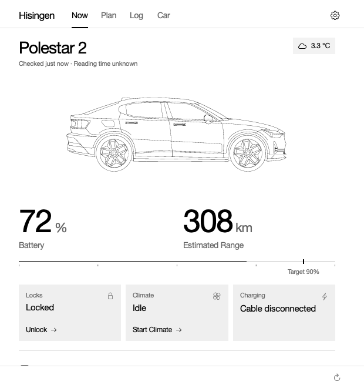
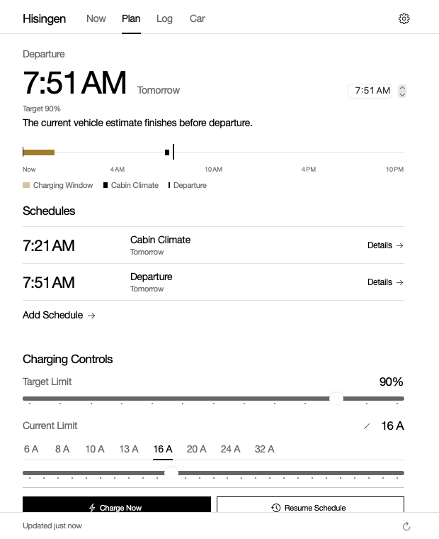
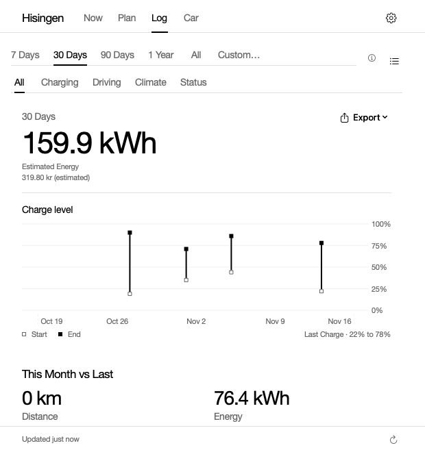
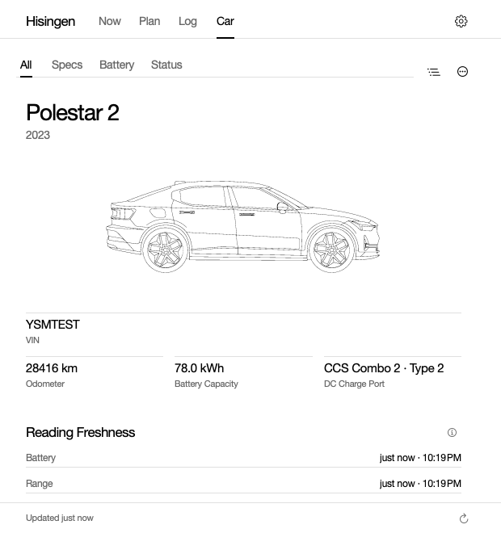
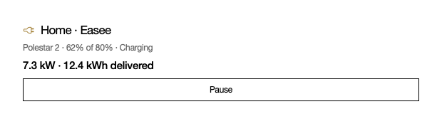
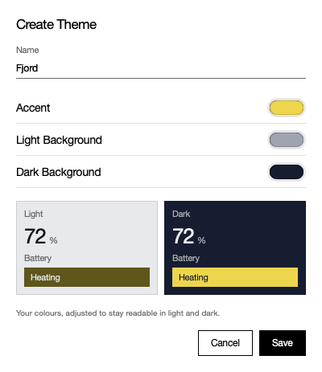

# Hisingen

[](https://www.apple.com/macos/)
[](https://github.com/nicolaskheirallah/homebrew-tap)
[](https://github.com/NicolasKheirallah/Hisingen/actions/workflows/ci.yml)
[](https://github.com/NicolasKheirallah/Hisingen/releases/latest)
[](LICENSE)

Check how much charge your car has, see whether it's locked, or warm the cabin before you leave. Hisingen puts Polestar and Volvo readings and controls in the macOS menu bar.

[Download Hisingen](https://github.com/NicolasKheirallah/Hisingen/releases/latest/download/Hisingen.dmg) · [Features](#features) · [Product tour](#product-tour) · [Documentation](docs/README.md) · [Changelog](CHANGELOG.md)

<p align="center">
  
</p>

## Quick start

Hisingen runs on macOS 15 or later on Apple Silicon and Intel Macs.

```sh
brew install --cask nicolaskheirallah/tap/hisingen
```

You can also download the signed DMG and drag Hisingen into Applications. Open the app and go to **Settings** to connect your Polestar account or sign in with Volvo ID. Hisingen checks its signed update feed automatically.

[Download DMG](https://github.com/NicolasKheirallah/Hisingen/releases/latest/download/Hisingen.dmg) · [Installation and account setup](docs/install.md)

## Features

Readings and controls vary by vehicle, region and account. [Supported models](docs/vehicle-features.md#vehicle-support)

### Vehicle status

- Check battery charge, fuel level, estimated range, charging power and time remaining. Show the status you want in the menu bar.
- See which doors or windows are open, whether the car is locked, and where it last parked. Open the location in Maps or check the weather there.
- Review tyre pressure and warnings, service intervals, software status, battery diagnostics and reading timestamps.
- Switch between Polestar and Volvo cars in one garage.

### Remote controls and schedules

- Opt in to start or stop cabin climate, lock or unlock, honk or flash the lights. Compatible Volvos also support remote engine start and stop.
- On supported Polestars, operate windows and the tailgate, start cabin cleaning or schedule a software install. Software controls are experimental.
- Set charging and cabin climate timers, check readiness for departure, and manage charge targets, current limits and saved charging locations where supported.
- Save a sequence of commands as a routine. Check whether the car confirmed an action, retry eligible failures or undo a reversible command.

[Command matrix and authorization](docs/remote-controls.md)

### Home charging and electricity

- Pair NexBlue, Easee or Zaptec directly, or connect through Home Assistant. See wall power and delivered energy, use Charge Now or Pause, and import completed sessions.
- Find a cheaper charging window using Swedish spot prices. Save a one-time overnight timer to a compatible NexBlue charger or run a plan through the Home Assistant component while the Mac sleeps.
- Price sessions with a fixed or night tariff, Swedish spot prices, or a connected Tibber home.

[Charger setup and electricity pricing](docs/home-charging.md)

### History and exports

- Review charging curves, energy and costs by month or location. Record fuel fill-ups and compare fuel economy over time.
- See detected trips, split business and private mileage, and track odometer, estimated battery health, tyre pressures, cabin conditions, warnings and commands.
- Export CSVs, a monthly mileage report or a JSON backup. Create a handover pack when you sell the car.

### macOS and customisation

- Get notifications with quick actions, use Apple Shortcuts and Spotlight, and precondition the cabin before calendar events.
- Keep an optional charging panel above other windows. Use keyboard shortcuts to navigate or switch cars.
- Choose which tabs and cards appear, create a light and dark theme, and adjust units, panel size and language.
- Keep vehicle history on your Mac and credentials in Keychain. Use Screenshot Privacy Mode to hide vehicle identifiers and locations when sharing captures.

[macOS features, layout and privacy](docs/using-hisingen.md)

## Product tour

The screenshots use sample vehicles and charger data. [Now](docs/product-tour.md#now) · [Plan](docs/product-tour.md#plan) · [Log](docs/product-tour.md#log) · [Car](docs/product-tour.md#car) · [Home charging](docs/product-tour.md#home-charging) · [Settings](docs/product-tour.md#settings)

<details>
<summary>See Plan, Log, Car, home charging and the theme editor</summary>

**Plan**



**Log**



**Car**



**Home charging**



**Create Theme**



</details>

[Open the full screenshot tour](docs/product-tour.md)

## Vehicle support

Hisingen supports Polestar and Volvo battery EVs, plus fuel readings for compatible Volvo plug-in hybrids and combustion cars. The Car tab shows the capabilities reported for the selected vehicle. [Supported models and readings](docs/vehicle-features.md)

## Documentation

- [Home charging and electricity prices](docs/home-charging.md) covers charger pairing, overnight schedules, session imports and tariffs.
- [Help and limitations](docs/help.md) covers stale readings, vehicle access and sign-in.
- [Documentation index](docs/README.md) has the user guides, API field mappings and developer docs.

[Build from source](docs/operations/build.md) · [Contribute](CONTRIBUTING.md) · [Report a bug](https://github.com/NicolasKheirallah/Hisingen/issues/new?template=bug_report.md) · [Project history and credits](docs/project.md)

## Disclaimer

Hisingen is independent open-source software. Polestar and Volvo Car Corporation do not sponsor, endorse or maintain the project. Their names are trademarks of their respective owners.

Volvo connectivity uses official developer APIs. Polestar's consumer integration uses undocumented interfaces that can change without notice. Vehicle accounts and services remain subject to the providers' terms and availability.

[MIT License](LICENSE) · [Third-party notices](THIRD_PARTY_NOTICES.md) · [Terms and conditions](TERMS.md) · [Privacy policy](PRIVACY.md)
