# Hisingen

[](https://www.apple.com/macos/)
[](https://github.com/nicolaskheirallah/homebrew-tap)
[](https://github.com/NicolasKheirallah/Hisingen/actions/workflows/ci.yml)
[](https://github.com/NicolasKheirallah/Hisingen/releases/latest)
[](LICENSE)

**Polestar and Volvo vehicle telemetry and remote controls, native in the macOS menu bar.**

Hisingen brings battery state of charge, range, charging speeds, latch states, climate preconditioning, and diagnostic history to your Mac.

Built with AppKit and SwiftUI. No Electron, no telemetry middlemen, and no third-party cloud database sitting between you and your vehicle.

[Download DMG](https://github.com/NicolasKheirallah/Hisingen/releases/latest/download/Hisingen.dmg) · [Changelog](CHANGELOG.md) · [FAQ](#faq) · [Documentation](docs/README.md) · [Contributing](CONTRIBUTING.md)

<p align="center">
  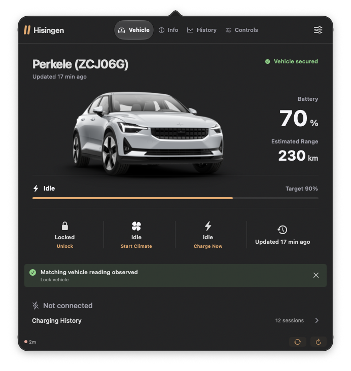
</p>

> [!IMPORTANT]
> Hisingen is an independent open-source project and is **not affiliated with, endorsed by, or sponsored by Polestar or Volvo Car Corporation**. Volvo connectivity uses official developer APIs. Polestar integration communicates directly with mobile endpoints, which may change without notice.

---

## Quick start

### Install via Homebrew

```bash
brew install --cask nicolaskheirallah/tap/hisingen
```

To update: `brew upgrade --cask hisingen`

### Manual installation

Download the latest universal DMG: [**Hisingen.dmg**](https://github.com/NicolasKheirallah/Hisingen/releases/latest/download/Hisingen.dmg) (supports Apple Silicon & Intel). Both the DMG and the app inside are Developer ID signed, notarized and stapled by Apple.

1. Open `Hisingen.dmg` and drag **Hisingen.app** to your `/Applications` folder.
2. Launch Hisingen and open **Settings** (`⌘,`).
3. Connect your car:
   - **Polestar**: Sign in with your Polestar account.
   - **Volvo**: Select **Sign In with Volvo ID** for direct OAuth2 PKCE login.

Apps installed from the DMG check Hisingen's signed update feed automatically. Choose
**Hisingen → Check for Updates…** at any time; updates download, verify, install, and relaunch
without opening GitHub.

---

## Table of contents

**Quick links:** [Quick start](#quick-start) · [Installation](#installation) · [Download DMG](https://github.com/NicolasKheirallah/Hisingen/releases/latest/download/Hisingen.dmg)

**Features:** [Why Hisingen?](#why-hisingen) · [Polestar and Volvo](#polestar-and-volvo) · [What Hisingen can show](#what-hisingen-can-show) · [Remote controls](#remote-controls) · [Vehicle support](#vehicle-support) · [Product tour](#product-tour) · [Data sources & field mappings](#data-sources-and-field-mappings)

**Using Hisingen:** [Multiple vehicles](#multiple-vehicles) · [Notifications](#notifications) · [macOS integration](#macos-integration) · [Make it yours](#make-it-yours) · [Your data](#your-data) · [Privacy](#privacy)

**Getting started:** [Installation](#installation) · [Polestar setup](#polestar-setup) · [Volvo setup](#volvo-setup)

**Help:** [FAQ](#faq) · [Troubleshooting](#troubleshooting) · [Known limitations](#known-limitations) · [Roadmap & non-goals](#roadmap--non-goals)

**Project:** [Build from source](#build-from-source) · [Documentation](#documentation) · [Contributing](#contributing) · [Support](#support) · [Project history](#project-history) · [Credits](#credits) · [License](#license) · [Disclaimer](#disclaimer)

---

## Why Hisingen?

Sometimes you just want to know whether the car is charged, locked or ready to go.

You shouldn't always have to find your phone, unlock it, open another app and wait for it to connect just to check something simple.

Hisingen keeps that information close by on the Mac you're already using.

With Hisingen you can:

* check battery, range, fuel and charging status
* see whether doors, windows and the car itself are locked
* keep an eye on vehicle health and service information
* view trips, odometer and consumption data
* explore grouped trip, charging and command history with charts and CSV export
* check climate and cabin information
* see your car's latest reported location
* keep a local history of charging sessions
* receive useful macOS notifications
* manage multiple vehicles
* use supported remote controls without picking up your phone
* bring vehicle information into Apple Shortcuts
* monitor a real multi-provider garage in one place
* manage saved Polestar charge locations: rename, per-location current limit,
  minimum charge level, optimised-charging mode, delete
* log fuel fill-ups so hybrid and petrol costs count toward lifetime cost-per-distance
* keep an optional always-on-top charging mini-panel on screen while plugged in
* surface vehicle state in system Spotlight and act on banners with quick actions
* price charging from Swedish spot prices and see the cheapest window to reach your target
* retry a command that provably did not run, undo a reversible one for 30 seconds, and save
  command routines
* hand over a clean data pack when you sell the car, or back everything up as JSON

What appears in Hisingen depends on what your individual car actually supports.

---

## Polestar and Volvo

Hisingen supports both Polestar and Volvo, but the two integrations work differently.

|                         | Polestar                                | Volvo                                                                |
| ----------------------- | --------------------------------------- | -------------------------------------------------------------------- |
| **Setup**               | Sign in with your Polestar account      | Sign in with your Volvo ID, ready out of the box (own developer application optional) |
| **Battery EVs**         | Yes                                     | Yes                                                                  |
| **Plug-in hybrids**     | No                                      | Yes                                                                  |
| **Combustion vehicles** | No                                      | Yes                                                                  |
| **Multiple vehicles**   | Yes                                     | Yes                                                                  |
| **Vehicle location**    | Where available                         | Where available                                                      |
| **Remote controls**     | Experimental and vehicle-dependent      | API and vehicle-dependent                                            |
| **Vehicle images**      | Multiple exterior views where available | Volvo-provided imagery where available                               |

### Polestar

Polestar doesn't currently provide a supported public vehicle API for third-party applications like Hisingen.

The Polestar integration therefore uses interfaces based on the services used by Polestar's own applications and real-world vehicle testing.

<table>
<tr>
<td width="50%" align="center">
<strong>Vehicle overview</strong><br><br>

</td>
<td width="50%" align="center">
<strong>Charging history</strong><br><br>
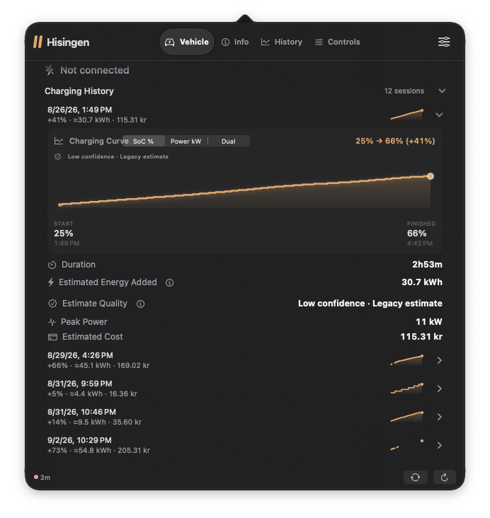
</td>
</tr>
<tr>
<td width="50%" align="center">
<strong>Doors &amp; openings</strong><br><br>
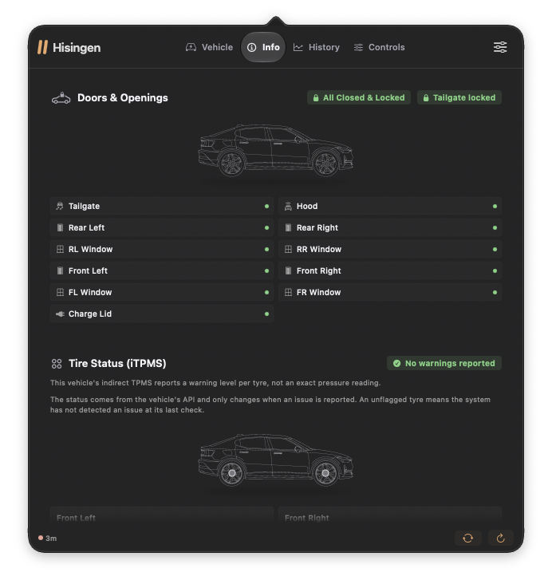
</td>
<td width="50%" align="center">
<strong>Remote controls</strong><br><br>
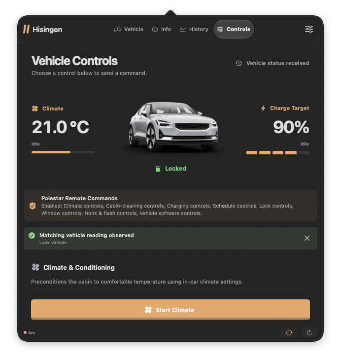
</td>
</tr>
</table>

### Volvo

Volvo provides official developer APIs, and Hisingen ships with default developer application credentials, so most people can simply sign in with their Volvo ID, no registration needed.

If you prefer, you can use your own Volvo Cars Developer application and credentials instead. See [Volvo setup](#volvo-setup).


---

## What Hisingen can show

The exact information varies by car, but Hisingen can work with much more than just battery percentage.

### Battery & range

For electric and plug-in hybrid vehicles, Hisingen can show information such as:

* state of charge
* electric range
* charging state
* charger connection
* AC or DC charging
* charging power
* current and voltage
* charge target
* charging-current limit
* estimated charging completion
* energy consumption
* energy used by driving, climate, battery conditioning and other loads, for manual trips,
  automatic trips and since the last charge (Polestar)
* battery discharge power limit and available energy, manual preconditioning and cold-battery
  status, when the car reports them (Polestar)
* one-tap amp presets (6/8/10/13/16 A) beside the current-limit slider
* saved charge location settings (Polestar): rename, per-location current limit,
  minimum charge level, optimised-charging mode, delete

The interface only shows values that make sense for the selected vehicle.

If a completed session at a known location peaks far below its usual level,
Hisingen flags it, often the first sign of a failing cable or derated charger.

Hisingen can also calculate an experimental battery State of Health estimate
from the telemetry it has observed. This is always labelled as a calculated
estimate, includes its input signals and confidence, and must not be confused
with a battery-management-system measurement or a warranty diagnosis. Exact
usable capacity and WLTP references can be entered per VIN in Settings.

The estimate uses two methods: the range shown at 100% charge, and high-confidence charging
sessions. When both agree within tolerance Hisingen shows a fused value, and when they disagree
it shows the conflict instead of hiding it behind one number. The uncapped range-based figure is
kept next to the displayed value, which is capped at 100%, so an understated WLTP reference stays
visible. The trend is fitted with a median-based slope that ignores a single bad range reading.
The range-based method applies only to battery-electric cars with a known model reference or a
reference you set for that VIN, never to plug-in hybrids scored against a borrowed WLTP figure.

### Fuel & hybrid information

Volvo support isn't limited to electric cars.

On compatible hybrid and combustion vehicles, Hisingen can also show:

* fuel level
* remaining fuel
* distance to empty
* fuel consumption
* combined battery and fuel information on plug-in hybrids

A combustion Volvo won't be shown a meaningless EV battery interface, and an EV won't be shown fuel information it doesn't have.

### Charging history

Hisingen can keep a local record of charging sessions.

Depending on the telemetry available, a session can include:

* starting battery level
* ending battery level
* estimated energy added
* charging duration
* peak charging power
* the calculation source and confidence
* the electricity tariff saved when charging began
* estimated charging cost

Charging data can also be exported for your own analysis.

The history dashboard shows detected trips five at a time with navigation to older pages. Charge
curves preserve the real observation timeline: rounded SoC is drawn as steps, missing intervals
are visibly broken, and the source/confidence badge explains how the energy total was derived.

Energy is integrated from observed charging power when coverage is sufficiently complete;
otherwise Hisingen falls back to the change in battery percentage and configured usable
capacity. The session shows which method was used. Costs retain the session's day/night tariff
and currency instead of being recalculated when today's settings change. These remain estimates
based on vehicle telemetry rather than utility-grade metering.

Detected trips can be tagged **Business** or **Private**, and a Monthly Mileage Report totals
the business/private distance split per month with CSV export. Tags are stored locally per
vehicle.

A few more things that follow from the same history:

* scheduled charging says whether it will finish, including "cannot complete" and "smart
  charging will not finish", instead of collapsing every plan to "Scheduled"
* when the car is within 150 m of a saved charge location, the card reads "At <location> since
  <time>"
* History has a per-location charging cost table, grouped by currency
* the trip computer shows distance and average speed since the last charge, taken from the C3
  odometer reading

### Electricity prices & the Charging Planner

**Settings → Electricity** sets the country, either Sweden or another country.

* **Sweden, Automatic rate.** Charging is priced from the spot price for your zone (SE1 to SE4)
  plus your provider's markup, with optional tax and grid fee in öre/kWh and a VAT toggle. You
  choose the contract type: 15-minute price, as the market publishes it, or hourly price, which
  averages the four quarters in each hour. The provider list (Vattenfall, Fortum, E.ON, Tibber,
  Bixia, Greenely, Göteborg Energi, Skellefteå Kraft, Telge Energi, Jämtkraft, or other) only
  names the contract. It carries no prices, because markups differ per agreement. The price your
  settings produce is shown next to the controls.
* **Every other country.** A typed-in rate and the optional night tariff.

The rate you pick drives every cost in the app: the charge-to-target estimate on the charging
card, session costs, History totals, monthly and per-location breakdowns, cost per distance and
the CSV export. Changing the markup re-prices past sessions that have a stored market cost.
Sessions the market prices do not cover keep their saved cost or your fixed rate.

The **Charging Planner** needs Sweden and its feature switch. It shows an hourly price curve and
the cheapest window to reach your target. Automatic charging commands are bound to the vehicle
the plan was calculated for. Choosing another country stops the planner and
keeps its settings for when Sweden is selected again. Spot prices come from
[Elpriset just nu.se](https://www.elprisetjustnu.se/), are fetched once a day after 14:15 and
exclude taxes and grid fees, so the markup you enter matters. Missing history is fetched, and
each zone refreshes on its own schedule.

### Doors, windows & locks

Hisingen can show the state reported for things such as:

* central locking
* individual doors
* windows
* hood
* tailgate
* charge flap
* fuel filler
* sunroof
* alarm

If the car doesn't report something, Hisingen doesn't quietly turn that missing information into “closed” or “locked”.

### Vehicle health

Depending on the car, Hisingen can surface:

* tyre warnings
* individual tyre-pressure information
* exterior-light warnings
* fluid warnings
* 12 V battery warnings
* service information
* service countdown
* odometer
* trip meters
* average speed
* consumption data
* battery and powertrain health information

Different vehicle platforms expose different levels of detail.

On top of the live readings Hisingen keeps some local context:

* **Tyres.** A local pressure history with a four-tyre chart and a possible-slow-leak hint.
  Measured pressures are compared with the car's own reported reference pressures.
* **Warnings.** A timeline records when each warning first appeared and when a report that
  covers it cleared it. Failed exterior lamps are named individually under the lighting row.
* **Service.** The next service date is estimated from the last 30 days of driving.
* **Usage mode.** The reported vehicle usage mode shows in the connectivity details, including on
  vehicles without separate network diagnostics.
* **Weight.** The reported gross vehicle weight shows on the Info specs card (Polestar).

### Climate

Hisingen can show climate information and, where supported, control climatization remotely.

Depending on the vehicle this can include:

* current climate state
* heating or cooling activity
* cabin-temperature information
* remaining runtime
* climate timers
* seat-heating capabilities
* steering-wheel heating
* cabin cleaning

Climate is a good example of why Hisingen adapts to the individual car.

A Polestar 2, for example, may allow climatization to be started without exposing the same temperature controls available on newer platforms.

Instead of presenting controls that won't work, Hisingen adjusts the interface to what's actually available.

On Polestar the climate card shows the climatization type and the maximum preconditioning
runtime the car reports, instead of one claim that fits every model. When a session starts or
fails, Hisingen explains why, including the reported error reasons. Seat and steering-wheel
heating are shown as requests, and an unspecified request is kept apart from an explicit off,
because automatic heating may differ from what was asked for.

Climate timers show whether they repeat weekly. Hisingen reads that flag back for the timers it
writes itself, instead of guessing from the weekday list. The climate card also names the heater
type the car reports and whether the car heats the seats and steering wheel on its own in cold
weather.

Before a scheduled departure, Hisingen can hint at frost or a cold battery using an hourly
forecast. A notice appears once per climate session when the run time is nearly used up or the
battery is too low.

### Location

When enabled and available from the vehicle provider, Hisingen can show the car's latest reported location as a street **address** (with precise coordinates below), open it in Apple Maps, and chart cabin temperature trends where the vehicle reports them.

Vehicle location should be treated as the **latest location reported by the car**, not as guaranteed real-time tracking.

A parked or sleeping vehicle may report an older position.

### Weather at the car

Vehicle weather is optional.

When enabled, Hisingen can use the vehicle's reported location to show local weather around the car.

Weather data comes from [Open-Meteo](https://open-meteo.com/).

Because coordinates are needed to retrieve local weather, the vehicle's latitude and longitude are sent to Open-Meteo while this feature is enabled.

The hourly forecast that drives the pre-departure frost hint is fetched in the same request as the
current weather.

### Vehicle software

Where the provider exposes it, Hisingen can show vehicle software and update-related information.

Polestar currently exposes more software information to Hisingen than Volvo's developer APIs do, so this section can look different between the two brands.

When a car does not report update status at all, the card says "Not reported by this vehicle"
instead of claiming that no update is available.

### Info tab and the capabilities inspector

The Info tab is the car's technical passport: identity and specifications on top, then the
capabilities the backend reports for this exact vehicle.

* **Specifications.** Model, year, battery capacity, charge port, reported gross vehicle weight
  and, on Polestar, the readable groups of the `visual_id` string (vehicle type, front grille
  variant, model year). Groups whose code table is not verified stay positional.
* **Service date.** "Due around <day> at your current driving rate" appears when the car reports
  a distance to service and the local store holds at least a week of odometer samples from the last
  30 days. It is a planning hint, shown as day and month only.
* **Export Factory Passport (CSV)** writes the specifications to a file.
* **Export Handover Pack…** is described under [Your data](#your-data).

The capabilities card lists what the provider says the car supports. Three disclosure groups sit
under it, and each row appears only when the backend actually sent the field:

* **Backend Control Settings:** charging locations, timers per location, departure times per
  location and climate timers the car allows, plus whether it supports per-location departure
  times, current limits and optimised charging.
* **Backend Reporting:** statements the car makes about itself, such as reporting flags,
  notification settings, end-of-ownership actions, account linking, parking-assistance type, trip
  reporting, device pairing, bidirectional charging and the preconditioning duration. These are
  not controls.
* **Unwired Backend Fields:** wire fields the backend sends that no control uses yet, shown raw so
  new backend data stays visible. Most `GetMyCars` tags now have a name, so this list is short.
  Unknown fields on the air-quality, charge-target and charging-current reads are kept the same
  way.

Plug and charge is claimed only when the backend also sends the plug-and-charge identifier,
because the wire flag and the REST value disagree on the car this was tested on.

---

## Remote controls

Hisingen can control supported vehicle functions directly from your Mac.

The controls you see depend on the selected vehicle rather than on a fixed list that is shown to everyone.

Examples include:

* start or stop climate
* lock or unlock the car
* horn and lights
* windows
* tailgate
* cabin cleaning
* charging settings
* charging schedules
* climate schedules
* supported OTA functions
* engine start or stop on compatible Volvo vehicles

### Supported commands

This table describes the commands currently implemented in Hisingen itself.

It does **not** mean every car supports every command.

| Function               |    Polestar   | Volvo |
| ---------------------- | :-----------: | :---: |
| Climate start / stop   |       ✓*      |   ✓*  |
| Lock / unlock          |       ✓*      |   ✓*  |
| Horn / lights          |       ✓*      |   ✓*  |
| Window controls        |       ✓*      |   —   |
| Tailgate controls      |       ✓*      |   —   |
| Cabin cleaning         |       ✓*      |   —   |
| Charge target          |       ✓*      |   —   |
| Charging-current limit |       ✓*      |   —   |
| Charging override      |       ✓*      |   —   |
| Charging schedules     |       ✓*      |   —   |
| Climate schedules      |       ✓*      |   —   |
| OTA controls           | Experimental* |   —   |
| Engine start / stop    |       —       |   ✓*  |

\* Availability still depends on the vehicle, account and services available for that car.

For sensitive commands such as unlocking the car, Hisingen can require device-owner authentication through Touch ID, Apple Watch, or the Mac password, depending on what macOS makes available.

### What the car reports decides what you see

On Polestar, Hisingen reads the car's own capability record (`GetMyCars`) and gates controls on
it, not on a model table:

* central locking and reduced-guard locking follow the reported lock type; reduced-guard locking
  is reported where the car advertises it, but the control is Volvo-only because the Polestar
  transport has no such command
* remote unlock follows the reported unlock type. A trunk-only car keeps the tailgate control, and
  a disabled Unlock on a car whose unlock type is none says why
* preconditioning follows the reported climatization type, and charge timers and saved charge
  locations follow the reported charging capabilities
* honk and flash follows the per-vehicle mode the car reports. A car that reports none gets no
  honk or flash control

On Volvo, controls follow the command list the API returns for that VIN, and the Approved
permissions scope is required for lock, honk and engine start and stop. EX30, EX90 and ES90 are not
offered climate setpoints, windows, trunk or charging controls that the public API cannot perform.

### Retry, Undo and routines

* **Retry** is offered on a failed command only when the failure proves it did not run.
* **Undo** is offered for 30 seconds on a reversible command.
* **Routines** (Controls tab) are saved sequences of commands. Each step goes through the same
  capability check and authorization as a single command, steps run in order, and a routine stops
  at the first failure.

### When a command's outcome is uncertain

A Polestar command waits up to 15 seconds for the car's reply. Polestar's backend keeps some
streams open after it has answered, so a complete reply followed by that deadline counts as
success. A deadline inside a reply, or before any reply, is reported as an unknown outcome ("The
command may have reached the vehicle"), because Hisingen cannot tell whether it ran. A deadline is
reported as a deadline and never as you cancelling.

### Authorizing remote commands (Polestar)

Polestar commands need a second sign-in grant beside your Polestar ID session. The step is in
**Settings → Accounts**, under Remote Controls, and on the banner that appears when a command is
blocked for a missing grant. It needs a working Polestar ID session first: the browser step is
refused up front when that session cannot be refreshed, and every failure of the flow shows an
alert that names the step and the fix. The table of which grant each command uses is in
[Data sources & field mappings](#data-sources-and-field-mappings).

### About Polestar remote controls

Polestar remote commands use undocumented interfaces and should be considered experimental.

They can change independently of Hisingen if Polestar changes its backend.

Hisingen tries to distinguish between a command being accepted by the server and the vehicle actually completing it whenever the available service makes that possible.

---

## Vehicle support

A model appearing here means Hisingen knows how to identify and handle that vehicle family.

It does **not** mean every feature has been tested on every model year, region and software version.

### Recognized Polestar models

* Polestar 1
* Polestar 2
* Polestar 3
* Polestar 4
* Polestar 5

Support differs between platforms.

For example, a Polestar 2 and Polestar 4 may expose different climate, charging and remote-control capabilities even though both appear in the same app.

### Recognized Volvo models

* XC40
* EX40
* C40
* EC40
* XC60
* XC90
* S60
* S90
* V60
* V90
* EX30
* EX90
* ES90

Other vehicles may still be discovered through Volvo's API, but Hisingen won't assume a complete capability profile until enough is known about that model.

Real-world testing across different model years, regions and vehicle configurations is extremely useful.

If you're using Hisingen with a car or configuration that hasn't been tested before, please [share it with the vehicle compatibility template](https://github.com/NicolasKheirallah/Hisingen/issues/new?template=vehicle_compatibility.md).

---

## Product tour

The screenshots below show the main views of the app.

<details open>
<summary><strong>Vehicle</strong></summary>

<br>

<table>
<tr>
<td colspan="2" align="center">
<strong>Vehicle overview with factory render</strong><br><br>

</td>
</tr>
<tr>
<td width="50%" align="center">
<strong>Charging history &amp; session curve</strong><br><br>

</td>
<td width="50%" align="center">
<strong>Charging planner &amp; spot prices</strong><br><br>
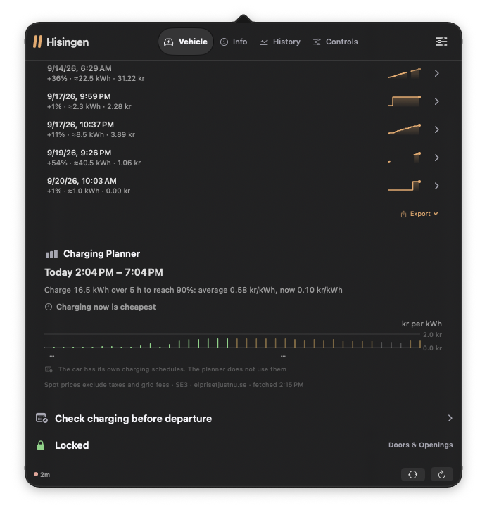
</td>
</tr>
</table>

</details>

<details>
<summary><strong>Remote Controls</strong></summary>

<br>

<table>
<tr>
<td width="50%" align="center">
<strong>Controls overview &amp; command confirmation</strong><br><br>

</td>
<td width="50%" align="center">
<strong>Climate &amp; charging controls</strong><br><br>
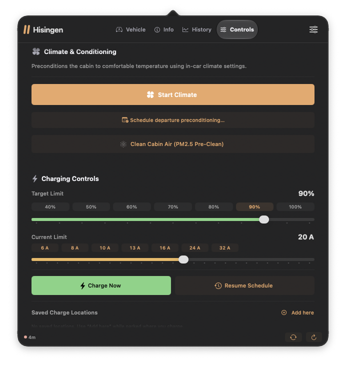
</td>
</tr>
</table>

</details>

<details>
<summary><strong>History &amp; Energy Analytics</strong></summary>

<br>

<table>
<tr>
<td colspan="2" align="center">
<strong>History overview &amp; observed changes</strong><br><br>
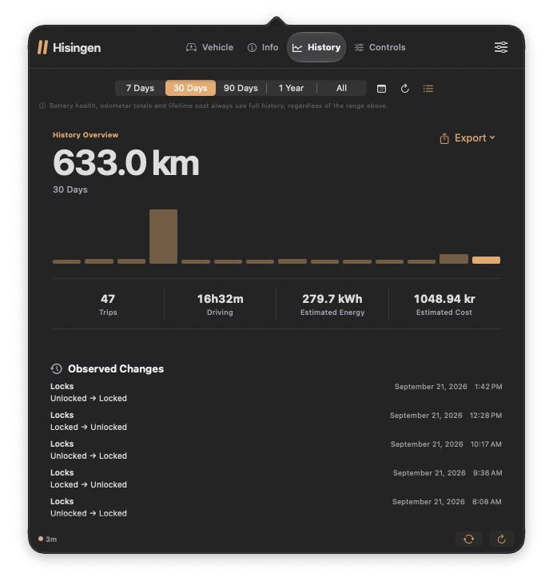
</td>
</tr>
<tr>
<td width="50%" align="center">
<strong>Monthly mileage &amp; detected trips</strong><br><br>
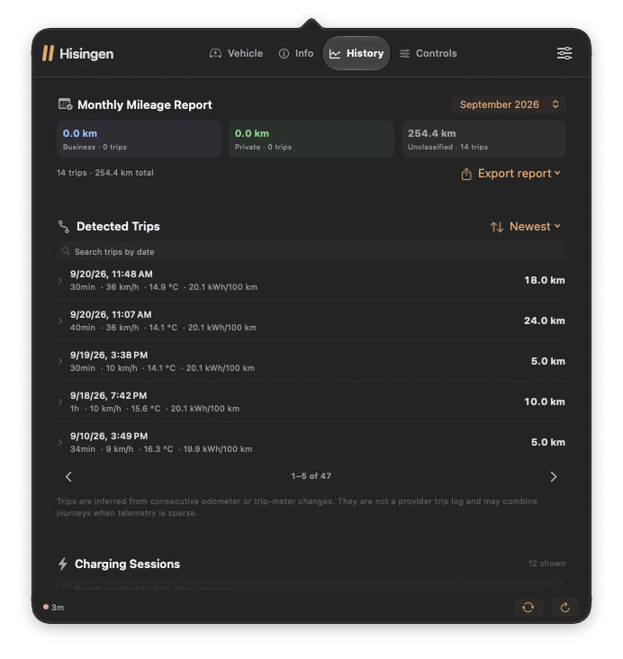
</td>
<td width="50%" align="center">
<strong>Charging &amp; consumption trends</strong><br><br>
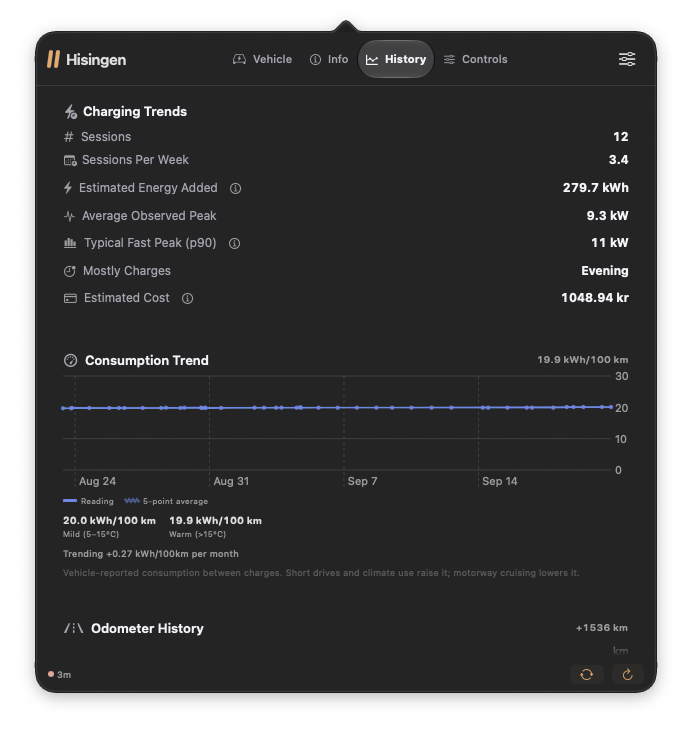
</td>
</tr>
<tr>
<td width="50%" align="center">
<strong>Odometer &amp; battery health trends</strong><br><br>
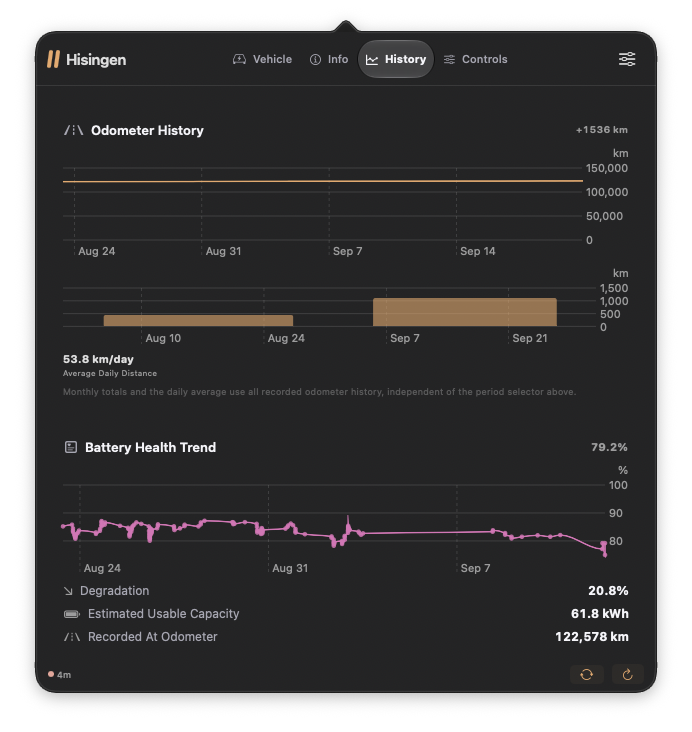
</td>
<td width="50%" align="center">
<strong>Usage insights &amp; driving patterns</strong><br><br>
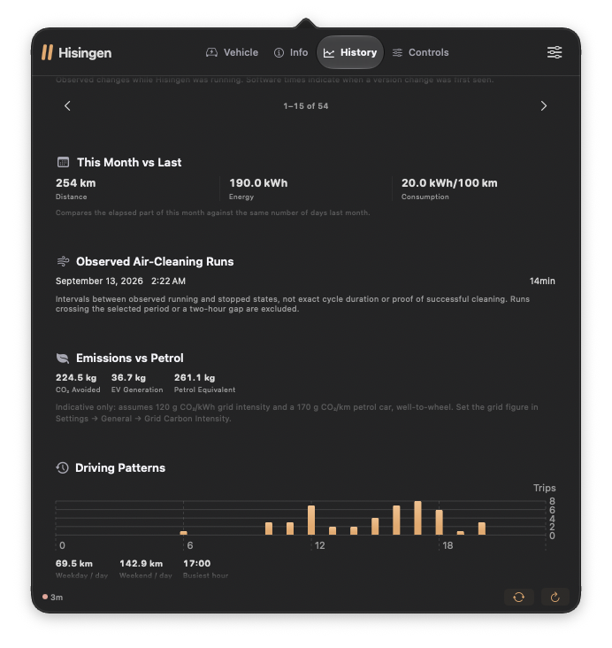
</td>
</tr>
</table>

</details>

<details>
<summary><strong>Vehicle Info</strong></summary>

<br>

<table>
<tr>
<td width="50%" align="center">
<strong>Vehicle identity &amp; reading freshness</strong><br><br>
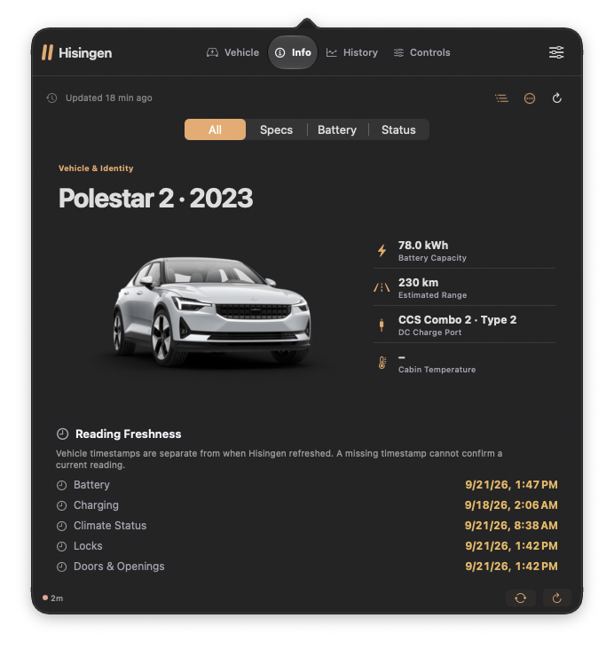
</td>
<td width="50%" align="center">
<strong>Doors, openings &amp; tyre status</strong><br><br>

</td>
</tr>
</table>

</details>

<details>
<summary><strong>Preferences &amp; Customization</strong></summary>

<br>

<table>
<tr>
<td colspan="2" align="center">
<strong>Appearance, themes &amp; vehicle perspective</strong><br><br>
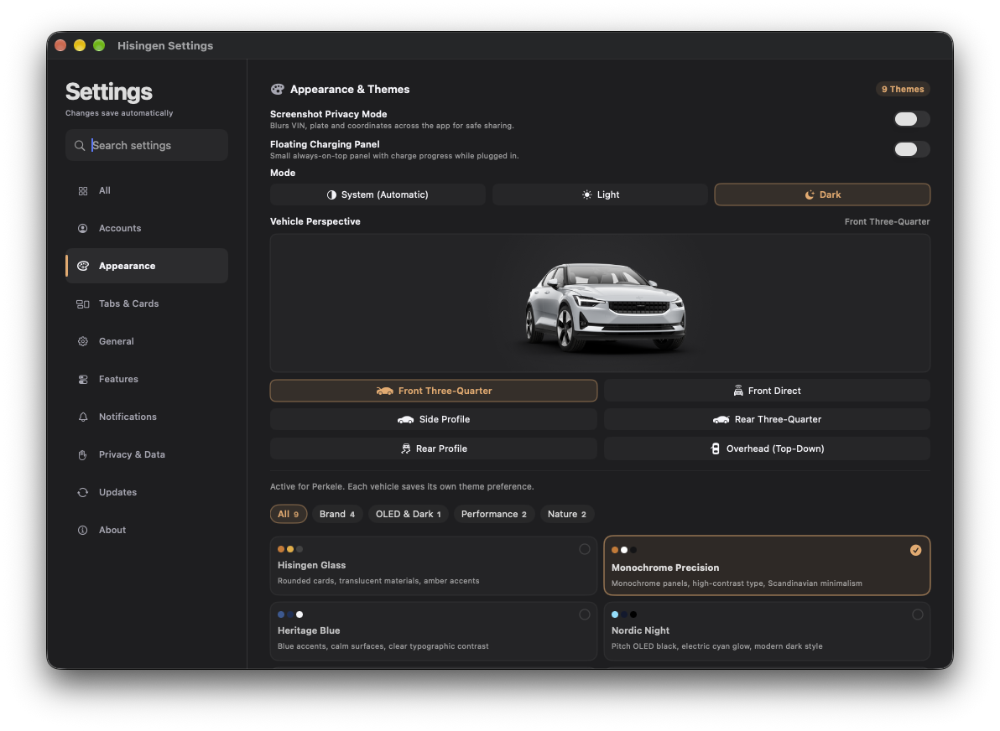
</td>
</tr>
</table>

</details>

---

## Data sources and field mappings

This section shows where each part of the app gets its data and which backend call carries each
command. Volvo uses documented developer APIs. Everything Polestar-side below was reverse
engineered, can change without notice, and is not endorsed by Polestar. Where a mapping is not
confirmed, the table says so.

<details>
<summary><strong>Hosts</strong></summary>

<br>

| Brand | Host | Used for |
| --- | --- | --- |
| Polestar | `polestarid.eu.polestar.com` | Sign-in (OpenID Connect) |
| Polestar | `pc-api.polestar.com/eu-north-1/mystar-v2/` | Vehicle discovery and telematics (GraphQL), session grant only |
| Polestar | `pc-api.polestar.com/eu-north-1/app-backend/api/graphql` | Second discovery source (VDMS), command grant only |
| Polestar | `pc-api.polestar.com/eu-north-1/mystar-public/` | Car renders, API key, no sign-in |
| Polestar | `pc-api.polestar.com/eu-north-1/data-portal/m2m/` | Developer Portal REST (EU Data Act) |
| Polestar | `cnepmob.volvocars.com` | Returns the C3 gRPC host. Looked up again every 12 hours, keeping the last working host if the lookup fails |
| Polestar | C3 host from discovery | Vehicle-state reads, remote commands, software updates |
| Polestar | `api.pccs-prod.plstr.io` | Charging settings: reads and writes |
| Volvo | `volvoid.eu.volvocars.com` | Sign-in (OAuth 2 with PKCE) |
| Volvo | `api.volvocars.com` | Connected Vehicle, Energy and Location APIs |

Weather comes from Open-Meteo and Swedish spot prices from Elpriset just nu.se. See
[Privacy](#privacy).

</details>

<details>
<summary><strong>Polestar: what is read, and from where</strong></summary>

<br>

| Service and call | Shown in Hisingen as |
| --- | --- |
| `BatteryService/GetLatestBattery` | State of charge, range, charging state, power, current, voltage, energy breakdown, discharge info |
| `AvailabilityService/GetLatestAvailability` | Whether the car is reachable, and its usage mode |
| `ExteriorService/GetLatestExterior` | Locks, doors, windows, hood, tailgate |
| `HealthService/GetHealth` | Tyre pressures, lamp, fluid and service warnings |
| `OdometerService/GetOdometer`, `DashboardService/GetLatestDashboard` | Odometer |
| `ParkingClimatizationService/GetLatestParkingClimatization` | Climate state, seat and wheel requests, climate errors and warnings |
| `PreCleaningService/GetPreCleaning` | Cabin cleaning status and air quality |
| `DtlInternetService/GetLastKnownLocation` | Last reported location |
| `OtaDiscoveryService/GetSoftwareInfo`, `SchedulerService/GetSchedule` | Software version, update state and a scheduled install |
| `TargetSocService/GetTargetSoc`, `AmpLimitService/GetAmpLimit` | Charge target and charging-current limit |
| `ChargeLocationService/GetChargeLocations` | Saved charge locations |
| `GlobalChargeTimerService/GetGlobalChargeTimerStream`, `ParkingClimateTimerService/GetTimers` | Charging schedule and climate timers |
| `CarInformation/GetMyCars` | The car's capability record, which gates controls (see [Remote controls](#what-the-car-reports-decides-what-you-see)) |
| GraphQL `getConsumerCarsV2`, `carTelematicsV2` | Vehicle discovery and the telematics fallback |
| GraphQL `getCarImages` | Car renders |
| GraphQL app-backend `vdms.getVehiclesInformation` | Extra discovery data for the garage |

The charging-settings services run on the PCCS host. The rest run on the C3 host. The
`charging/is-at-charge-location` read is no longer used: the backend answered
`DATA_NOT_AVAILABLE` on every call.

**Developer Portal REST.** `POST /token` issues a client-credentials token. `GET /v1/vehicles`
discovers vehicles. Under `/v1/vehicles/{vin}/telemetry/`: `availability`, `battery`, `odometer`,
`location`, `exterior`, `health`, `parking-climatization` and `pre-cleaning`. Under
`/v1/vehicles/{vin}/charging/`: `target-soc`, `amp-limit`, `charge-locations`,
`global-charge-timer`, `charge-now` and `parking-climate-timer`. The portal reports odometer and
trip meters to the metre and adds reference tyre pressures, which the consumer interface does not.

</details>

<details>
<summary><strong>Polestar: which call carries each command</strong></summary>

<br>

| Command | Service | Method | Grant |
| --- | --- | --- | --- |
| Lock | `invocation.InvocationService` | `Lock` | Command |
| Unlock, unlock trunk | `invocation.InvocationService` | `Unlock` | Command |
| Tailgate open, close | `invocation.InvocationService` | `TailgateControl` | Command |
| Windows open, close | `invocation.InvocationService` | `WindowControl` | Command |
| Climate start, stop | `invocation.InvocationService` | `ClimatizationStart`, `ClimatizationStop` | Command |
| Horn, lights, both | `invocation.InvocationService` | `HonkFlash` | Command |
| Cabin pre-cleaning | `invocation.InvocationService` | `PreCleaning` | Command |
| Charge target | `TargetSocService` | `SetTargetSoc` | Session |
| Charging-current limit | `AmpLimitService` | `SetAmpLimit` | Session |
| Charge now, resume schedule | `ChargeNowService` | `StartOverrideChargeTimer`, `StopOverrideChargeTimer` | Session |
| Charging schedule | `GlobalChargeTimerService` (v2) | `SetGlobalChargeTimer` | Session |
| Climate timers | `ParkingClimateTimerService` | `SetTimer`, `DeleteTimer` | Session |
| Saved charge locations | `ChargeLocationService` | `CreateAtTheCarLocation`, `UpdateAlias`, `UpdateAmpLimit`, `UpdateMinimumSoc`, `UpdateOptimizedSetting`, `DeleteLocation` | Session |
| Software install | `ota_mobcache.SchedulerService` | `Schedule`, `InstallNow`, `CancelSchedule` | Session or command |

Polestar gates remote commands on a list of approved OAuth client IDs that is separate from the
sign-in scope. Neither client Hisingen can use is enough alone. The web client can list vehicles
and change charging settings but cannot send invocation commands. The app client can send
invocation commands but its token is rejected for reads. Hisingen therefore holds two grants, the
**Session** grant and the **Command** grant, and picks one per call. That is why remote commands
need the separate authorization step. The charging services use the `pccs.chronos` prefix on the
PCCS host. Invocation commands go through the C3 host, because the PCCS invocation service
refuses both clients.

An invocation moves through queued in the cloud, acknowledged by the car, then finished.
Rejections come back as privacy mode on, an invalid vehicle mode or a conflicting command. A
command accepted by the server is not the same as a finished one, and Hisingen reports which one
it knows.

</details>

<details>
<summary><strong>Polestar: decoded protobuf fields</strong></summary>

<br>

The field numbers come from the descriptors published for Polestar's own app, checked against
captured frames and the Developer Portal's official schema. Nested notation `35.5` means field 5
inside field 35. Anything Hisingen cannot name is kept as a raw field.

| Message | Field | Meaning | Status |
| --- | --- | --- | --- |
| Battery | 4, 8 | Range in km, and range in miles used only when field 4 is absent | Confirmed |
| Battery | 12 | Average consumption, kWh/100 km, automatic | Confirmed |
| Battery | 14, 15, 16 | Total energy used: manual trip, automatic trip, since charge (Wh) | Confirmed |
| Battery | 20, 21, 22 | The same three periods split into other, driving, climate and battery (Wh) | Confirmed, absent on the test car |
| Battery | 23, 24, 25 | The same split as percentages | Confirmed, absent on the test car |
| Battery | 27 | Discharge info: energy available, increase, power limit | Confirmed |
| Battery | 28 | Charging status: 1 charging, 5 idle, 15 error, 16 done (0 to 16) | Confirmed |
| Battery | 29, 30 | Manual preconditioning, cold-battery status | Confirmed in the app, never seen on the test car |
| Availability | 5 | Usage mode: 1 abandoned, 2 inactive, 3 convenience, 4 active, 5 driving, 6 engine on, 7 engine off | Confirmed |
| Climate | 4 | Errors: fuel low, battery low, not connected to power, no start needed, service required, temporarily unavailable, persistent error, reached max runtime | Numbering confirmed, never observed |
| Climate | 5 | Warnings: battery low, run time nearing limit | Numbering confirmed, never observed |
| Climate | 6 | Ventilation: 1 cooling, 2 heating, 3 neutral | Confirmed |
| Climate | 9, 10, 11, 12, 13 | Requested seat heat: front left, front right, rear left, rear right, and steering wheel (0 unspecified, 1 off, 2 low, 3 medium, 4 high) | Confirmed |
| Climate | 17 | Main climate running status | Likely, never seen on the wire |
| Car (`GetMyCars`) | 16 | Honk and flash mode: 1 none, 2 combined, 3 independent, 4 flash only, 5 horn only | Confirmed, gates the control |
| Car | 36.1, 36.2 | Lock type and unlock type, gating locking and unlocking | Confirmed, in use |
| Car | 35.10 | Charge timers and saved locations supported | Confirmed, in use |
| Car | 35.13, 35.17, 35.18 | Per-location charge limits shown in the capabilities inspector | Confirmed, in use |
| Car | 35.20 | Plug and charge identifier | Confirmed, in use |
| Car | 37.1, 37.3 | Climatization type and maximum runtime | Confirmed, in use |
| Car | 44 | Gross vehicle weight rating | Confirmed, in use |
| Car | 47 | `visual_id`: groups for vehicle type, front grille variant and model year are named | Other 13 groups unverified |
| Charging | 35.29 | Plug and charge supported | Conflicts with the REST value, so the app waits for the identifier |
| Charging | 35.43 | Unknown | Unresolved: the server sends 3, the app's schema has no such tag |

Legacy charging status values 7 and 8 mean smart charging paused and done, and field 28 is
preferred when present. Seat intensities use a different scale from the Developer Portal's 0 to 3
levels, and Hisingen converts between them. Unknown enum values and unsupported wire types stay
raw instead of becoming a known value. Decoded tags that no control uses appear on the Info tab under
"Unwired Backend Fields", and most `GetMyCars` tags now show under "Backend Reporting" instead.

</details>

<details>
<summary><strong>Volvo: what is read</strong></summary>

<br>

| Endpoint | Shown in Hisingen as |
| --- | --- |
| `GET /connected-vehicle/v2/vehicles` and `/{vin}` | Vehicle list, model, year, colour, gearbox, fuel type, battery capacity, car renders |
| `GET /energy/v2/vehicles/{vin}/state` | State of charge, range, charging status and type, connector state, power, current limit, target, time to target |
| `GET /energy/v2/vehicles/{vin}/capabilities` | Which energy fields the car supports. Cached for one hour |
| `GET /connected-vehicle/v2/vehicles/{vin}/doors`, `/windows` | Central lock, doors, hood, tailgate, charge lid, windows, sunroof |
| `.../tyres` | Per-wheel tyre warnings. The API gives no pressure values |
| `.../diagnostics`, `.../engine`, `.../brakes` | Service warning, days and distance to service, fluid warnings, brake fluid warning |
| `.../warnings` | Individual lamp warnings, combined into one exterior-light warning |
| `.../odometer`, `.../statistics` | Odometer, trip meters, average consumption and speed, distance to empty |
| `.../engine-status` | Whether the engine is running |
| `.../command-accessibility` | Whether commands can be delivered now, and why not (no internet, power saving, car in use) |
| `.../commands` | The exact commands this VIN supports |
| `GET /location/v1/vehicles/{vin}/location` | Position and heading. Needs the Location API product and approved permissions on your developer application |

Fuel is read for combustion and hybrid cars. Energy endpoints are read for any car that reports
charging data, even when `fuelType` is `NONE`.

</details>

<details>
<summary><strong>Volvo: which call carries each command</strong></summary>

<br>

All commands are `POST /connected-vehicle/v2/vehicles/{vin}/commands/{action}`.

| Command | Action |
| --- | --- |
| Lock | `lock` |
| Lock, reduced guard | `lock-reduced-guard` |
| Unlock | `unlock` |
| Start, stop climate | `climatization-start`, `climatization-stop` |
| Honk and flash | `honk-flash` |
| Flash | `flash` |
| Honk | `honk` |
| Start engine | `engine-start` (a runtime of 1 to 15 minutes) |
| Stop engine | `engine-stop` |

Commands are throttled to one every 6 seconds to stay inside Volvo's limit of 10 requests a
minute. Every documented failure value maps to a specific message, and a sleeping car is described
as retryable. Everything not in this table is not available through the public API.

</details>

<details>
<summary><strong>How a control gets enabled</strong></summary>

<br>

Hisingen separates what it knows how to request, what a model is expected to support, and what
the provider reports for this exact car. A control appears only when all three allow it. The
per-VIN signal is the `GetMyCars` record on Polestar and the `/commands` and energy capability
lists on Volvo. Missing information is never turned into "closed", "locked" or "no update".

</details>

---

## Multiple vehicles

Hisingen supports accounts with more than one vehicle.

Each vehicle keeps its own:

* current cached state
* charging history
* charging baselines
* capability observations
* local nickname
* vehicle-specific settings

Polestar and Volvo authentication are also kept separate.

Switching cars doesn't mean mixing their histories or cached information together.

---

## Notifications

Hisingen can let you know about useful vehicle events without requiring the app to stay open in front of you.

Depending on the vehicle and the features you've enabled, notifications can include:

* charging started
* charging completed
* charging interrupted
* low battery
* tyre warnings
* service or vehicle-health warnings
* software-update information
* authentication issues
* an unlocked parked vehicle
* weather-related warnings when openings are detected
* unusually slow charging vs a location's own history
* service due soon, when the car shows a service warning or reports 30 days or 1,000 km or less
  to the next service
* a car left in convenience mode for 30 minutes (opt-in), since convenience mode keeps systems on
  and can drain the 12 V battery
* a daily summary (opt-in)
* a climate session whose run time is nearly used up, or whose battery is too low
* interactive banners: Lock and Mute This Vehicle on vehicle alerts, Resume Schedule
  from an interrupted-charging alert

Charging anomaly alerts are deduplicated per vehicle and respect the mute setting, notification
permission and quiet hours. Sustained alerts keep their elapsed warning time across an app restart. A dead session is shown as
signed out and asks you to sign in again even when notifications are off.

Notification behaviour can be configured in Settings.

---

## macOS integration

Hisingen is built as a native Mac application rather than a wrapped web app.

### Menu bar

The menu bar can show useful information without even opening the Hisingen window.

Depending on your preferences this can include:

* battery level
* range
* charging time
* charging power
* lock state
* compact status
* icon-only status

**Quick Controls** in the menu bar panel include windows, Charge Now / Resume Schedule and
pre-cleaning, where the car supports them. The menu bar item has VoiceOver actions,
custom tab icons have descriptive labels in every language, and the price curve reads out the hour
and price.

### Launch at Login

Hisingen can start automatically using the normal macOS Login Items system.

### Keyboard shortcuts

Keyboard shortcuts are available for common actions such as navigating the app or switching between vehicles.

Global shortcuts can require macOS Accessibility permission.

### System Spotlight

Search your car's nickname and see battery, range and charging state right in Spotlight
results. Entirely local, and the VIN is kept out of the index.

### Screenshot Privacy Mode

One toggle blurs VIN, registration plate, coordinates and addresses across the app so shared
screenshots stay safe.

### Floating charging panel

Optional tiny always-on-top panel with SoC→target, power and ETA while charging. It never
steals focus; drag it anywhere and the position is remembered.

### Calendar preconditioning

Hisingen can start cabin climate a set number of minutes before timed events in the calendars
you choose (Settings → Features). It reads events through macOS Calendar (EventKit); the
events stay on your Mac and are never sent anywhere. It schedules a single timer for the next one,
and re-checks after sleep and when the calendar changes. The climate command targets the active
vehicle and passes the same capability and feature checks as the manual control; because it is a
preconfigured automation with nobody at the Mac to answer a prompt, it does not raise the
device-owner confirmation even when that is required for the manual controls.

### Apple Shortcuts

Hisingen exposes cached vehicle information and command handoffs to Apple Shortcuts using
App Intents. The actions are:

| Group | Actions |
| --- | --- |
| Status | Get Vehicle Battery, Get Vehicle Status, Get Garage Status, Get Charging Status, Get Recent Trip Summary, Get Energy Breakdown, Get Tire Pressures, Where Is My Car, Refresh Vehicle Data |
| Charging | Set Charge Target, Set Charging Current, Charge Now, Resume Charging Schedule |
| Climate | Start Cabin Climate, Stop Cabin Climate, Start Cabin Pre-Cleaning, Stop Cabin Pre-Cleaning, Start Engine, Stop Engine |
| Security | Lock Vehicle, Unlock Vehicle (authenticated), Flash Vehicle Lights, Honk and Flash Vehicle |

That makes it possible to use this information and these commands inside your own macOS
automations.

Command intents never announce that the car changed state merely because the shortcut ran.
They hand the request to Hisingen, apply the same capability and authentication gates as the
normal controls, and let the app report the provider result. Volvo lock/location permissions
must first be approved for the developer application and enabled in Hisingen Settings.

### URL scheme

Hisingen also registers:

```text
hisingen://
```

for local application navigation and automation. Recognized routes:

| Route | Action | Brand |
| --- | --- | --- |
| `hisingen://lock` | Lock vehicle | Volvo, Polestar |
| `hisingen://unlock` | Unlock vehicle (confirmation first) | Volvo, Polestar |
| `hisingen://climate/start?temp=21` | Start climate (temp optional, clamped to 16–30 °C) | Volvo, Polestar |
| `hisingen://climate/stop` | Stop climate | Volvo, Polestar |
| `hisingen://flash` | Flash lights | Volvo, Polestar |
| `hisingen://honk-flash` | Honk + flash | Volvo, Polestar |
| `hisingen://engine/start?minutes=15` | Start engine (`5`, `10` or `15` minutes, confirmation first) | Volvo |
| `hisingen://engine/stop` | Stop engine | Volvo |
| `hisingen://precleaning/start` | Start cabin pre-cleaning | Polestar |
| `hisingen://precleaning/stop` | Stop cabin pre-cleaning | Polestar |
| `hisingen://windows/open` | Open all windows (confirmation first) | Polestar |
| `hisingen://windows/close` | Close all windows | Polestar |
| `hisingen://tailgate/open` | Open tailgate (confirmation first) | Polestar |
| `hisingen://tailgate/close` | Close tailgate | Polestar |
| `hisingen://trunk/unlock` | Unlock trunk (confirmation first) | Polestar |
| `hisingen://charge-target?percent=80` | Set charge target (clamped to 40–100%) | Polestar |
| `hisingen://charge-limit?amps=16` | Set charging current (clamped to 6–32 A) | Polestar |
| `hisingen://charging/override-start` | Charge now, overriding the schedule | Polestar |
| `hisingen://charging/override-stop` | Resume the charging schedule | Polestar |
| `hisingen://ota/schedule?delay=120` | Schedule software installation (`120`, `480` or `720` minutes) | Polestar |
| `hisingen://ota/install` | Install vehicle software now (confirmation first) | Polestar |
| `hisingen://ota/cancel` | Cancel software installation | Polestar |

Links accept an optional `vin=` query to target a vehicle other than the selected one.

Commands follow the same capability gates and confirmations as the in-app controls. A link
never sends a command the active brand or the vehicle does not offer: it gets a local notice
instead. Polestar commands also need a Polestar ID or Augmented connection; the Developer Portal
connection is read-only. Engine runtime and schedule delay must be one of the listed options,
or the link is refused with a notice. Temperature, charge target and charging current are
clamped to their ranges instead.

---

## Make it yours

Hisingen doesn't need to look identical on every Mac.

Settings has a **Search settings** field that finds sections by what you type, for example
"authorize" or "remote command" finds the Polestar authorization step. **Export Settings** and
**Import Settings** move your presentation, feature, update and notification preferences to
another Mac as one archive of up to 1 MB. Accounts, sessions, vehicles and history are not part of
it. **Reset Preferences** returns those preferences to defaults and keeps accounts, sessions,
vehicles and history.

### Themes

Nine themes are currently included:

* Hisingen Glass
* Monochrome Precision
* Heritage Blue
* Nordic Night
* Aurora Borealis
* Swedish Gold
* Cyan Racing
* Gothenburg Forest
* Sand Dune

Monochrome Precision and Heritage Blue are independent themes based on publicly documented
design principles from Polestar and Volvo Cars. They don't imply affiliation or endorsement.

### Tabs & Cards

Every card, section and banner in Hisingen is yours to place. **Settings → Tabs &
Cards** lists them per tab, and each one can be switched off, moved up or down, dragged
into a new position, or removed. The layout is stored once and read by the tabs
themselves, so what that pane shows is what the panel draws.

Hiding a card also stops Hisingen asking the vehicle for the data behind it — the
provider request is gated on the same setting. Switching the card back on resumes the
fetch. An install that predates this pane reads its existing feature toggles once as a
starting layout, so a card that was already off does not reappear.

**Tabs of your own.** *New tab* in the same pane creates a tab, names it and gives it an
icon; *Add Cards…* places anything you want on it, from any of the shipped tabs. Cards
are drawn by the same views the shipped tabs use, so the charging card behaves the same
whether it is on Vehicle or on a tab you built. Cards that own a tab's own state — the
History charts and the Info section bars — stay on the tab that gives them that state,
and the pane names them rather than leaving them out silently.

Any of Vehicle, Info, History and Controls can also be hidden from the tab bar.
Settings is always there: it is where the list is managed.

### Panel size & content density

The menu bar dropdown adapts to how you use it. In
**Settings → General → Panel Size** you can pick one of five presets:
Compact, Standard, Large (tall), Wide, and Grand (wide & tall). **Custom Size**
enables independent width and height sliders. On Wide and Grand panels, mid-size
cards flow two per row and the vehicle render grows to use the extra room.

**Content Density** zooms everything inside the panel independently of its
window size: Compact (85%) shows more content before scrolling, Relaxed (115%)
enlarges text and controls. The right-click menu on the status icon offers both
settings for quick switching, every change applies live to an open panel, and
the panel never grows taller than the screen it opens on. The floating charging
panel follows the same density choice.

### Units

Units are selectable in **Settings → General**. Choosing miles as the distance
unit pre-selects the matching North American defaults for the other units, and
each can still be overridden individually.

Hisingen supports:

* kilometers / miles
* Celsius (°C) / Fahrenheit (°F)
* kilopascals (kPa) / PSI
* liters / US gallons / Imperial gallons
* L/100 km / US MPG / Imperial MPG / km/L
* kWh/100 km / kWh/100 mi / mi/kWh

### Languages

Hisingen currently includes:

* English
* Swedish
* German
* Norwegian (Bokmål)
* Danish
* Dutch
* French
* Spanish
* Italian
* Finnish
* Portuguese
* Polish
* Simplified Chinese
* Korean

You can also let Hisingen follow the system language automatically.

---

## Your data

Everything Hisingen keeps lives on your Mac, in a local SQLite database plus the macOS Keychain
for credentials.

* **Exports.** Charging sessions, detected trips and the Monthly Mileage Report export to CSV.
  The export menu on the History tab also offers a **Full Backup (JSON)**, and Settings can export
  your settings (see [Make it yours](#make-it-yours)).
* **Handover pack.** **Info → Export Handover Pack…** writes a folder for a sale or trade: a
  summary, charging and trip CSVs without locations, an optional VIN (a checkbox in the save
  panel) and a checklist of the steps that still happen in the manufacturer app or in the car.
* **Erase.** **Settings → Privacy & Data → Erase This Vehicle’s Local Data** and **Erase All Local Vehicle Data**
  remove history, snapshots, activity and cached car artwork from memory, disk and SQLite.
  Recording stays paused for the affected vehicles until the cleanup finishes, so queued writes
  cannot bring erased data back. A failure in local erasure is reported separately from a
  failure to clear credential storage.
* **Sign out stays signed out.** Signing out clears the email, portal IDs, Volvo custom app, VIN
  and Keychain items for that brand and the memory cache. An explicit per-brand flag stops
  Hisingen from signing back in on relaunch from built-in developer credentials plus a lingering
  server-side grant. Saving credentials or signing in again lifts it. A cancelled or failed
  sign-in keeps your previous session.
* **Damaged or old data.** If a database migration fails, Hisingen keeps the legacy snapshots,
  charging baselines and command receipts and rolls back the partial write before retrying.

---

## Privacy

Hisingen doesn't operate a vehicle-data backend.

Your Mac communicates directly with the services needed for the features you use.

In practical terms:

|                                  |                                                           |
| -------------------------------- | --------------------------------------------------------- |
| **Hisingen account required**    | No                                                        |
| **Hisingen vehicle-data server** | No                                                        |
| **Analytics**                    | No                                                        |
| **Advertising**                  | No                                                        |
| **Credentials**                  | Stored using macOS Keychain where persistence is required |
| **Vehicle cache**                | Stored locally                                            |
| **Current vehicle coordinates**  | Not stored in the normal persistent vehicle-state cache   |
| **Vehicle weather**              | Coordinates are sent to Open-Meteo when enabled           |
| **Calendar events**              | Read locally from calendars you select; never sent anywhere |
| **Map integration**              | Uses Apple services where applicable                      |
| **Update checks**                | Uses Hisingen's signed Sparkle update feed                |

Your vehicle account, VIN, location and remote-control access are sensitive information, so Hisingen treats them accordingly.

For the full breakdown, see [Privacy](docs/security/privacy.md), [Data retention](docs/data-retention.md) and [Security](docs/security/overview.md).

---

## Installation

Hisingen requires **macOS 15 Sequoia or later**.

Releases are universal and support both:

* Apple Silicon
* Intel Macs

### Code signing

Both **Hisingen.app** and **Hisingen.dmg** are signed with a personal Apple Developer ID certificate, built with the hardened runtime enabled, and notarized and stapled by Apple.

This means macOS Gatekeeper recognizes the app as trusted software from an identified developer: no security warnings, no right-click-to-open workaround.

The same Developer ID signing is performed in the GitHub Actions release workflow: the certificate is imported into the CI runner's keychain, both the app bundle and the disk image are individually signed, submitted for notarization, stapled, and verified with `spctl` before publication. Every release also ships with SHA-256 checksums and GitHub build provenance attestations. Locally, `make app`/`make dmg` follow the same submit/staple/validate sequence through `Scripts/notarize.sh` whenever notarization credentials are configured.

### Install

**Option 1: Homebrew**

```bash
brew install --cask nicolaskheirallah/tap/hisingen
```

Updates are picked up with `brew upgrade --cask hisingen`. The cask is updated automatically on every release.

**Option 2: Manual download**

1. [Download the latest `Hisingen.dmg`](https://github.com/NicolasKheirallah/Hisingen/releases/latest/download/Hisingen.dmg).
2. Open the disk image.
3. Drag **Hisingen.app** into **Applications**.
4. Open Hisingen.
5. Open **Settings** and connect your vehicle account.

After the first installation, Hisingen handles its own signed in-app updates. It checks daily
by default and can be checked manually from **Hisingen → Check for Updates…**.

### Verify the download checksum

Every release publishes a `SHA256SUMS` file covering all artifacts. To verify:

```bash
shasum -a 256 -c SHA256SUMS
```

Run this in the folder containing the downloaded files. It should report `OK` for each one.

### Verify the signature

macOS checks the signature and notarization automatically at first launch. You can also verify it yourself; `codesign` and `spctl` ship with every Mac, no Xcode needed:

```bash
spctl -a -t exec -vv /Applications/Hisingen.app
```

This should report `accepted` with `source=Notarized Developer ID`. If macOS ever reports Hisingen as **"damaged"** or from an **unidentified developer**, re-download the DMG and check the checksum first; a corrupted or truncated download is almost always the cause. Don't strip the quarantine flag with `xattr` or work around Gatekeeper: a correctly notarized app opens without any workaround, and if the signature doesn't verify, the download itself is bad and should be replaced, not bypassed.

[View all releases](https://github.com/NicolasKheirallah/Hisingen/releases)

---

## Polestar setup

Hisingen supports three connection modes for Polestar vehicles:

### 1. Polestar ID (Consumer Account)

Standard setup for most users:

1. Open **Settings** → **Polestar**.
2. Keep the mode set to **Polestar ID**.
3. Sign in with your Polestar account email and password.
4. If an interactive challenge is presented, complete sign-in in the interactive window.

### 2. Developer Portal (EU Data Act M2M)

For developers and fleet managers with credentials from the official [Polestar Developer Portal](https://data-portal.polestar.com/):

1. Open **Settings** → **Polestar**.
2. Switch the segmented picker to **Developer Portal**.
3. Enter your **Account ID** (`x-client-id`), **Client ID**, and **Client Secret**.
4. Click **Test Connection** to verify OAuth token issuance and vehicle discovery.
5. Click **Save & Connect**.

> **Note on Developer Portal Mode:**
> * **Telemetry Only**: Provides read access to battery, charging, exterior status, vehicle health, odometer, and location.
> * **No Remote Controls**: Per the EU Data Act specification, the Developer Portal is strictly telemetry-only. Remote control cards are dimmed with an explanatory label.
> * **Rate Limits**: Polestar allows 10,000 API requests per day. Hisingen paces its polling so a day stays under 9,000 and shows the projected count in Settings.
> * **Your own credentials**: A custom client ID needs a custom secret. Hisingen never mixes your ID with built-in secrets.

### 3. Augmented

Pairs Developer Portal telemetry with your Polestar ID for interactive remote controls and gRPC
streaming. Set up both of the above. Telemetry comes from the portal, and the Polestar ID session
carries the commands and the live stream.

Remote commands also need the extra authorization step described under
[Remote controls](#authorizing-remote-commands-polestar).


---

## Volvo setup

Hisingen works with Volvo out of the box, no developer registration required.

### Just sign in

1. Open **Settings**.
2. Select **Volvo**.
3. Choose **Sign In with Volvo ID** and complete authentication in your browser.

That's it. Hisingen ships with default developer application credentials, shown in Settings as *“Developer access ready”*. You only need your Volvo ID account.

Sign-in happens in a system browser window, so Hisingen never sees your Volvo ID password directly. Credentials and long-lived session material that need to persist are stored using macOS Keychain.

### Optional: use your own developer application

If you'd rather use your own free [Volvo Cars Developer Platform](https://developer.volvocars.com/) application, for example to bill API usage against your own quota, click **Custom App** in the Volvo section of Settings and:

1. Create an application in the [Volvo Developer Portal](https://developer.volvocars.com/) and enable the API products you want (Connected Vehicle and Energy as a baseline; add Location if you want vehicle location).
2. Add this exact OAuth callback URL to your application:

   ```text
   https://nicolaskheirallah.github.io/Hisingen/oauth-callback.html
   ```

   Volvo requires an HTTP(S) OAuth callback. The small Hisingen GitHub Pages callback passes the authorization result back to the installed app through the local `hisingen://` URL scheme. It isn't a Hisingen login service and doesn't act as a vehicle-data backend.
3. Enter your **Client ID**, **Client Secret** and **VCC API Key** in Settings, then sign in.

You can switch back to the built-in credentials at any time with **Use Default Developer Keys**.

Some features, particularly location and remote operations, depend on the permissions approved for whichever developer application is in use.

For the technical details, see [Authentication](docs/api/authentication.md).

---

## FAQ

**Do I need a Hisingen account?**
No. There is no Hisingen account, no subscription and no middleman server.

**Does Volvo setup really need nothing but my Volvo ID?**
Correct. Hisingen ships with default developer application credentials, so you can just sign in. Creating your own Volvo developer application is entirely optional.

**Is Hisingen affiliated with Polestar or Volvo?**
No. It's independent open-source software. See the [Disclaimer](#disclaimer).

**Can using Hisingen affect my vehicle account?**
The Volvo integration uses APIs designed for third-party developers. The Polestar integration uses undocumented interfaces, which means it can break without notice and may be viewed by the provider as a terms-of-service matter. Treat Polestar remote controls as experimental and use at your own discretion.

**How fresh is the vehicle data?**
It reflects what the car last reported. Parked or sleeping vehicles can stop sending telemetry; Hisingen keeps the last useful values rather than showing zeroes. Check the last-updated time in the app.

**Does Hisingen update while my Mac is asleep?**
No. Like any menu bar app, it refreshes while your Mac is awake.

**Where is my data stored?**
Locally on your Mac. Credentials live in the macOS Keychain. There is no Hisingen backend; see [Privacy](#privacy).

**Can I mix Polestar and Volvo cars in one garage?**
Yes, and their histories, caches and authentication stay separate per vehicle.

**Is Hisingen free?**
Yes, MIT-licensed open source. [Build it yourself](#build-from-source) if you prefer.

---

## Troubleshooting

### The car is showing old information

Parked cars can enter low-power or sleep states and stop sending fresh telemetry.

Hisingen keeps the last useful information rather than replacing missing values with zeroes.

Check the last-updated time in Hisingen to see how fresh the displayed data is.

### A feature is missing

Not every model exposes the same online functionality.

Availability can depend on:

* vehicle model
* model year
* vehicle software
* region
* account
* provider service
* API permissions (mainly relevant when using your own Volvo developer application)

### Polestar suddenly stopped updating

The interfaces used by the Polestar integration aren't a supported public third-party API and can change.

Check the [latest release](https://github.com/NicolasKheirallah/Hisingen/releases/latest) and [existing issues](https://github.com/NicolasKheirallah/Hisingen/issues) first.

### Volvo sign-in isn't working

If you're using the built-in default credentials:

* make sure you're running the [latest release](https://github.com/NicolasKheirallah/Hisingen/releases/latest)
* complete sign-in in the browser window that opens; allow pop-ups if your default browser blocks them
* try again later; temporary gateway issues on Volvo's side do happen

If you're using your own developer application, check that:

* Client ID is correct
* Client Secret is correct
* VCC API Key is correct
* the required API products are enabled
* the callback URL matches exactly
* the application has the permissions required for the feature you're trying to use

### A remote control isn't available

The command has to be supported by Hisingen **and** available for your individual vehicle.

If it isn't, Hisingen keeps the control unavailable rather than showing something that looks like it should work.

---

## Known limitations

Hisingen depends on vehicle services it doesn't control.

A few things are worth keeping in mind:

* Polestar's vehicle interfaces can change without notice.
* Volvo API availability varies between vehicles, regions and Developer applications.
* A recognized vehicle model doesn't mean every feature has been tested on every model year.
* Parked or sleeping vehicles can report older data.
* Some information simply isn't exposed by every vehicle.
* Location is the latest reported position, not guaranteed live tracking.
* Charging energy and cost are estimates.
* Some Polestar fields are decoded from the app's published protobuf schema and captured frames,
  not from documentation. A few are unconfirmed, and anything Hisingen cannot name is kept as a
  raw field you can inspect on the Info tab under Unwired Backend Fields.
* The Polestar Android app version Hisingen reports to the app-backend endpoint has to stay
  current, or that discovery source answers 426. Hisingen then stands down for a day and falls
  back to the main discovery source.
* A cloud service can accept a remote command before the physical vehicle completes it.
* Experimental remote functionality shouldn't be relied on for safety-critical or time-critical use.

---

## Roadmap & non-goals

Development direction is driven by real-world testing feedback; see [open issues](https://github.com/NicolasKheirallah/Hisingen/issues) and propose features with the [feature request template](https://github.com/NicolasKheirallah/Hisingen/issues/new?template=feature_request.md).

Things Hisingen deliberately will not do:

* run any Hisingen cloud service, account or middleman server
* include analytics or advertising SDKs
* provide live tracking; location is the latest reported position only
* ship iOS or Android companions; this is a macOS menu bar app
* present controls a vehicle cannot actually perform

---

## Build from source

### Requirements

* macOS 15 or later
* Xcode 16 or a compatible Apple development toolchain
* Git

Clone the repository:

```bash
git clone https://github.com/NicolasKheirallah/Hisingen.git
cd Hisingen
```

Useful targets:

| Command        | What it does                                    |
| -------------- | ----------------------------------------------- |
| `make doctor`  | Check your development environment               |
| `make ci`      | Run the CI job set locally (`Scripts/ci-local.sh`) |
| `make test`    | Run the deterministic test suite                 |
| `make app`     | Build `releases/Hisingen.app`                    |
| `make dmg`     | Build the app if needed, then package `releases/Hisingen.dmg` |
| `make package-dmg` | Package an already built and notarized app without rebuilding |
| `make release` | Prepare the release pull request (`VERSION=patch`, `minor`, `major` or a number) |
| `make notarize`| Notarize and staple the built app and dmg        |
| `make run`     | Build, sign and launch a debug build             |
| `make clean`   | Remove build artifacts                           |

Then open the app:

```bash
make app
open releases/Hisingen.app
```

When the app is signed with a **Developer ID** certificate, the build also submits it to Apple's notary service and staples the ticket, matching what the release workflow does in CI. Credentials are read from a notarytool keychain profile (set up once with `xcrun notarytool store-credentials hisingen-notary --apple-id <APPLE_ID> --team-id <TEAM_ID> --password <APP_PASSWORD>`) or from the `NOTARY_APPLE_ID`, `NOTARY_TEAM_ID` and `NOTARY_APP_PASSWORD` environment variables. Without credentials the step skips automatically so development builds keep working; `make notarize` notarizes an already-built app, and `NOTARIZE=never make app` disables the step.

Normal CI sets `HISINGEN_BUILD_CONFIGURATION=fixture` and ignores production API variables and local environment files. It tests credential-free builds on arm64/macOS 15 and x86_64/macOS 26, using the pinned Xcode version in `.github/ci-toolchain.json`. `make ci` checks the working tree; `sh Scripts/ci-local.sh --committed` checks an isolated snapshot of HEAD. Live integration tests remain separate and manual.

See [Getting Started](docs/development/getting-started.md) for the development setup.

---

## Documentation

This README is meant for people who want to understand, install or try Hisingen.

The deeper engineering material lives under [`docs/`](docs/README.md).

Useful places to start:

* [Documentation Index](docs/README.md)
* [Architecture](docs/architecture/overview.md)
* [Architecture Decision Records](docs/adr/README.md)
* [Vehicle Capabilities](docs/domain/capability-matrix.md)
* [Glossary](docs/glossary.md)
* [API Overview](docs/api/overview.md)
* [Polestar Integration](docs/api/polestar.md)
* [Volvo Integration](docs/api/volvo.md)
* [Authentication](docs/api/authentication.md)
* [Privacy](docs/security/privacy.md)
* [Data Retention](docs/data-retention.md)
* [Security](docs/security/overview.md)
* [Threat Model](docs/security/threat-model.md)
* [Testing](docs/testing/strategy.md)
* [Release Process](docs/operations/releases.md)

---

## Contributing

Bug reports, pull requests and real-world vehicle testing are welcome.

Different cars, model years, regions and software versions don't always behave the same way, so testing on vehicles that aren't already well covered is especially useful.

See [CONTRIBUTING.md](CONTRIBUTING.md) for the development guide and pull-request checklist.

Security vulnerabilities should be reported privately through [SECURITY.md](SECURITY.md), not through a public issue.

---

## Support

* Found a bug? → [bug report template](https://github.com/NicolasKheirallah/Hisingen/issues/new?template=bug_report.md)
* Missing a feature? → [feature request template](https://github.com/NicolasKheirallah/Hisingen/issues/new?template=feature_request.md)
* Tested Hisingen with an unusual model, year or region? → [vehicle compatibility template](https://github.com/NicolasKheirallah/Hisingen/issues/new?template=vehicle_compatibility.md); this is one of the most useful contributions there is
* Security issue? → [responsible disclosure via SECURITY.md](SECURITY.md)

Please check the [Troubleshooting](#troubleshooting) section and [existing issues](https://github.com/NicolasKheirallah/Hisingen/issues) before opening a new one.

---

## Project history

Hisingen started from a pretty simple frustration: I was sitting at my Mac and wanted to check or control something on the car without having to reach for my phone.

The name **Hisingen** comes from Gothenburg, where both Volvo and Polestar have strong roots, and reflects where the project itself comes from as well.

---

## Credits

Hisingen is maintained by [Nicolas Kheirallah](https://github.com/NicolasKheirallah).

Thanks as well to everyone testing the app on different cars and configurations. Real-world feedback is one of the most useful ways to improve Hisingen, especially when vehicle behaviour differs between models in ways that aren't obvious from documentation alone.

### Functionality adapted from other projects

* **[Polaris](https://github.com/simonbusborg/polaris)** by Simon Busborg. Early Polestar code
  came from Polaris through an AI coding assistant, and the small protobuf helper set is still
  identical to it. Thank you to Simon for raising it in
  [#33](https://github.com/NicolasKheirallah/Hisingen/issues/33).
* **[pypolestar](https://github.com/pypolestar/pypolestar)** and
  **[polestar_api](https://github.com/pypolestar/polestar_api/)** by Tuen Lee and
  contributors. Their reverse engineering of the Polestar backend made much of this possible.
* **[unofficial-polestar-api](https://github.com/kildahldev/unofficial-polestar-api)** is an
  independent Polestar client. Hisingen cross-checked gRPC field meanings against it and uses the
  same app-version values.
* **[Sparkle](https://github.com/sparkle-project/Sparkle)** handles signed in-app updates.
* **[Open-Meteo](https://open-meteo.com/)** supplies the weather data (CC BY 4.0) and
  **[Elpriset just nu.se](https://www.elprisetjustnu.se/)** the Swedish spot prices.

Copyright notices and license texts are in [THIRD_PARTY_NOTICES.md](THIRD_PARTY_NOTICES.md),
which also ships inside the app bundle.

---

## License

Hisingen is released under the [MIT License](LICENSE). Code and services it builds on are
listed in [THIRD_PARTY_NOTICES.md](THIRD_PARTY_NOTICES.md).

---

## Disclaimer

Hisingen is independent open-source software.

It is **not affiliated with, endorsed by, sponsored by or maintained by Polestar or Volvo Car Corporation**.

Polestar and Volvo are trademarks of their respective owners and are referenced only to describe vehicle compatibility.

Vehicle accounts, APIs and cloud services remain subject to the terms, policies and availability of their respective providers.

See [Terms & Conditions](TERMS.md) for additional information.
