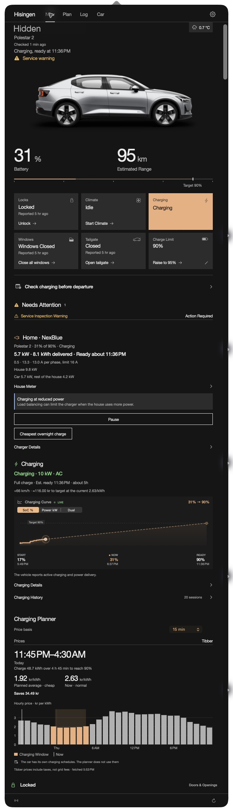
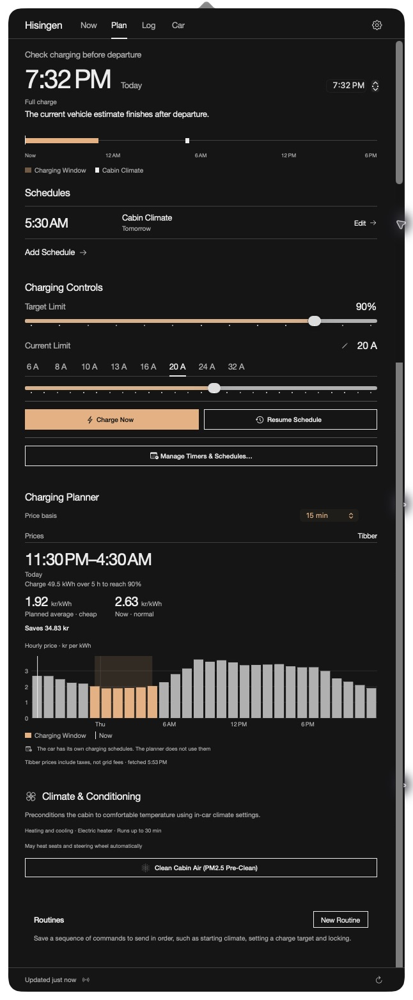
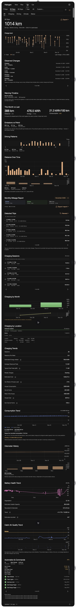
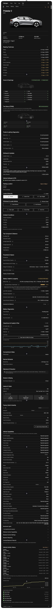

# Hisingen

[](https://www.apple.com/macos/)
[](https://github.com/nicolaskheirallah/homebrew-tap)
[](https://github.com/NicolasKheirallah/Hisingen/actions/workflows/ci.yml)
[](https://github.com/NicolasKheirallah/Hisingen/releases/latest)
[](LICENSE)

Check how much charge your car has, see whether it's locked, or warm the cabin before you leave. Hisingen puts Polestar and Volvo readings and controls in the macOS menu bar.

[Download Hisingen](https://github.com/NicolasKheirallah/Hisingen/releases/latest/download/Hisingen.dmg) · [Features](#features) · [Product tour](#product-tour) · [Documentation](docs/README.md) · [Changelog](CHANGELOG.md)

<p align="center">
  
</p>

## Quick start

Hisingen runs on macOS 15 or later on Apple Silicon and Intel Macs.

```sh
brew install --cask nicolaskheirallah/tap/hisingen
```

You can also download the signed DMG and drag Hisingen into Applications. Open the app and go to **Settings** to connect your Polestar account or sign in with Volvo ID. Hisingen checks its signed update feed automatically.

[Download DMG](https://github.com/NicolasKheirallah/Hisingen/releases/latest/download/Hisingen.dmg) · [Installation and account setup](docs/install.md)

## Features

Readings and controls vary by vehicle, region and account. [Supported models](docs/vehicle-features.md#vehicle-support)

### Vehicle status

- Check battery charge, fuel level, estimated range, charging power and time remaining. Show the status you want in the menu bar.
- Add the desktop widget (macOS 15 or later) to see battery, range, charging state and the next departure on your desktop, and add lock and climate buttons to Control Center on macOS 26 or later. Tapping either opens Hisingen with the command ready to confirm; the widget itself never sends a command.
- See which doors or windows are open, whether the car is locked, and where it last parked. Open the location in Maps or check the weather there.
- Review tyre pressure and warnings, service intervals, software status, battery diagnostics and reading timestamps.
- Switch between Polestar and Volvo cars in one garage.

### Remote controls and schedules

- Opt in to start or stop cabin climate, lock or unlock, honk or flash the lights. Compatible Volvos also support remote engine start and stop.
- On supported Polestars, operate windows and the tailgate, start cabin cleaning or schedule a software install. Software controls are experimental.
- Set charging and cabin climate timers, check readiness for departure, and manage charge targets, current limits and saved charging locations where supported.
- Save a sequence of commands as a routine. Check whether the car confirmed an action, retry eligible failures or undo a reversible command.

[Command matrix and authorization](docs/remote-controls.md)

### Home charging and electricity

- Pair NexBlue, Easee or Zaptec directly, or connect through Home Assistant. See wall power and delivered energy, use Charge Now or Pause, and import completed sessions.
- Find a cheaper charging window using Swedish spot prices, or the prices of a connected Tibber home in any country. Save a one-time overnight timer to a compatible NexBlue charger or run a plan through the Home Assistant component while the Mac sleeps.
- Price sessions with a fixed or night tariff, Swedish spot prices, or a connected Tibber home. Add your grid company's transfer fee for Sweden, Norway, Denmark, Germany or the Netherlands, with Vattenfall (Sweden) and Elvia (Norway) presets.
- Record idle and overstay fees for a charger or location, and get an alert when the electricity price crosses a level you set.

[Charger setup, supported countries and electricity pricing](docs/home-charging.md#what-works-where)

### History and exports

- Review charging curves, energy and costs by month or location. Record fuel fill-ups and compare fuel economy over time.
- See detected trips, split business and private mileage, and track odometer, estimated battery health, tyre pressures, cabin conditions, warnings and commands.
- Export CSVs or XLSX workbooks, a GPX track file for trips, a monthly mileage report or a JSON backup. Create a handover pack when you sell the car.

### macOS and customisation

- Get notifications with quick actions, use Apple Shortcuts and Spotlight, and precondition the cabin before calendar events.
- Keep an optional charging panel above other windows. Use keyboard shortcuts to navigate or switch cars.
- Choose which tabs and cards appear, create a light and dark theme, and adjust units, panel size and language.
- Keep vehicle history on your Mac and credentials in Keychain. Use Screenshot Privacy Mode to hide vehicle identifiers and locations when sharing captures.

[macOS features, layout and privacy](docs/using-hisingen.md)

## Product tour

The images come from a live Polestar and NexBlue installation with vehicle identifiers, account labels and precise location masked. Available readings and commands depend on the vehicle, account, region and connected services. The [sample screenshot tour](docs/product-tour.md) shows other configurations, including Volvo, alternate chargers and setup screens.

[Now](#now) · [Plan](#plan) · [Log](#log) · [Car](#car) · [Settings](#settings)

### Now

Open Now for the last check, battery or fuel level, estimated range and current vehicle state. The footer refreshes telemetry and indicates whether the live stream is connected. When Hisingen shows cached readings, check the reported age before relying on them. On compatible Volvos, Now shows fuel and distance to empty for combustion models or estimated combined range for plug-in hybrids.

<details>
<summary>Full Now screenshot and individual cards</summary>



| Card screenshot | What it does |
| --- | --- |
| [Vehicle overview](assets/screenshots/live/now/vehicle-overview.png) | Shows the car, reading age, weather at the parked car, battery or fuel and estimated range. The charge line marks the target while the car is plugged in. |
| [Vehicle controls](assets/screenshots/live/now/vehicle-controls.png) | Puts your chosen quick controls under the vehicle. Change the selection and order in Appearance. |
| [Locks](assets/screenshots/live/now/locks.png) | Shows the reported lock state and offers the available lock or unlock command. |
| [Climate](assets/screenshots/live/now/climate.png) | Starts or stops cabin preconditioning. Shows remaining time when the vehicle reports it. |
| [Charging tile](assets/screenshots/live/now/charging-tile.png) | Shows charging state and offers Charge Now or a schedule action when the vehicle can accept it. |
| [Windows](assets/screenshots/live/now/windows.png) | Shows window status and offers open or close actions on supported cars. |
| [Tailgate](assets/screenshots/live/now/tailgate.png) | Shows the tailgate state and offers the supported open or close action. |
| [Charge Limit](assets/screenshots/live/now/charge-limit.png) | Increases the target in the configured step. The pencil opens an exact value field. |
| [Check charging before departure](assets/screenshots/live/now/check-charging-before-departure.png) | Opens the departure check to compare the expected charge finish against the time you plan to leave. |
| [Needs Attention](assets/screenshots/live/now/needs-attention.png) | Surfaces active warnings, such as a service inspection the vehicle says is due. |
| [Home · NexBlue](assets/screenshots/live/now/home-nexblue.png) | Shows charger power, delivered energy, per-phase current and an estimated finish. Charge Now and Pause act on the charger. Charger Details shows available electrical readings. Cheapest overnight charge previews a one-time NexBlue timer. |
| [Charging](assets/screenshots/live/now/charging.png) | Shows the car's charging power, AC or DC state, estimated finish, cost estimate and available details such as current and voltage. Charging History lists recorded sessions. |
| [Charging Curve](assets/screenshots/live/now/charging-curve.png) | Switches between battery percentage, power or both for the active session. The chart distinguishes observed data from the projection to the target. |
| [Charging Planner](assets/screenshots/live/now/charging-planner.png) | Compares the current electricity price with the estimated cost of charging in the cheapest available window. |
| [Lock status](assets/screenshots/live/now/lock-status.png) | Restates the last reported lock state near the bottom of the tab. |

</details>

You can also put Current Limit, Air Cleaning or Honk & Flash on Now where supported. The floating charging panel keeps charge level, power and time remaining visible while you work in another app. [Now controls and macOS integration](docs/using-hisingen.md)

### Plan

Check whether charging will finish by departure, then adjust what the vehicle or charger should do. A time picked for the departure check is a planning input. Use the schedule editor to save an actual timer. The charger and the car can each have their own schedule, and either one can hold a charge.

<details>
<summary>Full Plan screenshot and individual cards</summary>



| Card screenshot | What it does |
| --- | --- |
| [Check charging before departure](assets/screenshots/live/plan/check-charging-before-departure.png) | Compares estimated charge completion with the next departure. The 24-hour ruler shows charging windows and climate timers. |
| [Schedules](assets/screenshots/live/plan/schedules.png) | Lists vehicle timers. Add or edit supported charging windows and cabin climate timers, including repeating days. |
| [Charging Controls](assets/screenshots/live/plan/charging-controls.png) | Sets the battery target and current limit. Use Charge Now to override an eligible schedule or Resume Schedule to return to it. Compatible cars can also manage saved charge locations. |
| [Charging Planner](assets/screenshots/live/plan/charging-planner.png) | Estimates the energy and time needed to reach the target. Compares charging now with a cheaper window and shows the price basis and electricity outlook. |
| [Climate & Conditioning](assets/screenshots/live/plan/climate-and-conditioning.png) | Shows compatible climate and air cleaning controls. Cars that expose settings can offer temperature and seat heating options. |
| [Routines](assets/screenshots/live/plan/routines.png) | Saves commands as an ordered sequence. Each step uses the same capability and authorization checks as a standalone command. A failure stops the sequence. |

</details>

The app reports when a request is pending or the vehicle confirms it. Hisingen offers Retry when it can confirm the command failed before execution. Reversible commands can offer Undo. Compatible Volvos can expose engine start and stop, while compatible Polestars can expose saved charging locations, cabin cleaning and experimental software commands. [Remote command matrix](docs/remote-controls.md)

The planner uses published Swedish spot prices or connected Tibber prices where available. A one-time NexBlue timer runs on the charger after you save it. The Home Assistant component can run its saved plan even when the Mac sleeps. With a shared charger, Hisingen can assign imported sessions by matching them against recorded charging activity for the selected car. [Charger schedules and electricity prices](docs/home-charging.md#plans)

### Log

Pick a period or a custom date range, then filter by Charging, Driving, Climate or Status. The overview and reports use readings stored on this Mac. A connected charger can supply measured session energy. Hisingen labels estimates derived from vehicle observations.

<details>
<summary>Full Log screenshot and individual cards</summary>



| Card screenshot | What it does |
| --- | --- |
| [Overview](assets/screenshots/live/log/overview.png) | Summarises the selected period and plots start and end battery levels for charge sessions. Use Export for the available period reports. |
| [Observed Changes](assets/screenshots/live/log/observed-changes.png) | Lists changes Hisingen observed while it was collecting data, such as charging starting or the locks changing state. |
| [Warning Timeline](assets/screenshots/live/log/warning-timeline.png) | Shows when a warning first appeared, cleared or was last still reported. |
| [This Month vs Last](assets/screenshots/live/log/this-month-vs-last.png) | Compares distance, energy and consumption for the elapsed part of this month against the same span last month. |
| [Emissions vs Petrol](assets/screenshots/live/log/emissions-vs-petrol.png) | Estimates EV charging emissions against a petrol reference using the displayed assumptions. |
| [Driving Patterns](assets/screenshots/live/log/driving-patterns.png) | Breaks detected driving down by time of day and compares weekday and weekend distance. |
| [Distance Over Time](assets/screenshots/live/log/distance-over-time.png) | Charts distance and surfaces trip statistics such as the longest trip and the highest daily distance in the period. |
| [Monthly Mileage Report](assets/screenshots/live/log/monthly-mileage-report.png) | Summarises business and private mileage for a month and exports a mileage report. |
| [Detected Trips](assets/screenshots/live/log/detected-trips.png) | Lists trips inferred from available vehicle readings. Review distance, duration and consumption, then classify trips for the mileage report. |
| [Charging Sessions](assets/screenshots/live/log/charging-sessions.png) | Search and open sessions for battery change, energy and power. A session can include its observed curve, cost basis and the start or stop reason reported by NexBlue. |
| [Charging by Month](assets/screenshots/live/log/charging-by-month.png) | Compares energy added and estimated costs by month. |
| [Charging by Location](assets/screenshots/live/log/charging-by-location.png) | Breaks down sessions, energy, power and estimated cost by recorded charging location. |
| [Charging Trends](assets/screenshots/live/log/charging-trends.png) | Summarises charging frequency, power and costs. A connected house meter can add an estimate of the car's share of home electricity use. |
| [Consumption Trend](assets/screenshots/live/log/consumption-trend.png) | Plots energy consumption and shows an estimated range based on recorded use. |
| [Odometer History](assets/screenshots/live/log/odometer-history.png) | Charts recorded odometer readings, monthly distance and daily average. |
| [Battery Health Trend](assets/screenshots/live/log/battery-health-trend.png) | Tracks estimated degradation and usable capacity with the mileage at which estimates were recorded. |
| [Cabin Air Quality Trend](assets/screenshots/live/log/cabin-air-quality-trend.png) | Charts observed CleanZone air quality across the selected period. |
| [Automation & Commands](assets/screenshots/live/log/automation-and-commands.png) | Lists remote command results, timing, confirmations and recent failures alongside command totals. |

</details>

With the relevant vehicle data, Log can also show tyre pressure trends, cabin temperature and air cleaning history. For compatible combustion and hybrid vehicles, record fill-ups and review fuel economy and running costs. [More Log screenshots](docs/product-tour.md#log)

### Car

Use the All, Specs, Battery and Status filters or the jump menu to find a reading. The report menu can export details for a vehicle handover. Reported capabilities and account permissions determine which remote controls appear.

<details>
<summary>Full Car screenshot and individual cards</summary>



| Card screenshot | What it does |
| --- | --- |
| [Vehicle overview](assets/screenshots/live/car/vehicle-overview.png) | Shows the model and year, VIN, registration, odometer, battery capacity and charge port where available. |
| [Reading Freshness](assets/screenshots/live/car/reading-freshness.png) | Gives each group of readings its own last report time, so a current battery reading can sit alongside older lock or location data. |
| [Doors & Openings](assets/screenshots/live/car/doors-and-openings.png) | Maps the reported doors, windows, tailgate and charge lid onto a vehicle diagram. |
| [Tire Status](assets/screenshots/live/car/tire-status.png) | Shows individual pressures when the car supplies them. This Polestar reports per-wheel warning states through indirect TPMS. |
| [Fluids & Lighting Diagnostics](assets/screenshots/live/car/fluids-and-lighting-diagnostics.png) | Lists reported fluid, coolant, lighting and tyre pressure warnings. |
| [Software & Updates](assets/screenshots/live/car/software-and-updates.png) | Shows installed firmware, reported update status and any release notes supplied by the car. |
| [Vehicle Software & OTA](assets/screenshots/live/car/vehicle-software-and-ota.png) | Shows the installation state. Compatible Polestars can offer experimental installation scheduling and cancellation. |
| [Parking Location](assets/screenshots/live/car/parking-location.png) | Shows the last reported position and offers to open it in Maps. Some models supply additional parking details. |
| [Locks & Security](assets/screenshots/live/car/locks-and-security.png) | Shows lock state and provides eligible lock, unlock and tailgate actions. Some Volvos support locking with reduced guard. |
| [Windows & Locate Vehicle](assets/screenshots/live/car/windows-and-locate-vehicle.png) | Operates supported windows and can flash the lights, honk or do both to help find the car. |
| [Ambient Conditions](assets/screenshots/live/car/ambient-conditions.png) | Shows the temperature, feels-like temperature, humidity, conditions and observation time at the parked vehicle. |
| [Trip Computer & Distance](assets/screenshots/live/car/trip-computer-and-distance.png) | Displays reported trip meters, average speed and total distance. |
| [Powertrain & Specs](assets/screenshots/live/car/powertrain-and-specs.png) | Lists drivetrain, battery capacity, reference range, charge port, weight and available factory codes. |
| [Battery Health & Longevity](assets/screenshots/live/car/battery-health-and-longevity.png) | Shows capacity and degradation estimates, reference values and recorded milestones. |
| [Battery Diagnostics](assets/screenshots/live/car/battery-diagnostics.png) | Shows available charging and battery diagnostics, such as power module status, time to full and average consumption. |
| [CleanZone Air Quality & Filter](assets/screenshots/live/car/cleanzone-air-quality-and-filter.png) | Shows air quality, particulate readings and filter or cleaning information the car supplies. Starts cleaning on eligible vehicles. |
| [Connectivity & Wake](assets/screenshots/live/car/connectivity-and-wake.png) | Shows reported connectivity and vehicle mode. |
| [Service Schedule](assets/screenshots/live/car/service-schedule.png) | Lists the service countdown and engine hours where the vehicle reports them. |
| [Warranty & Protection](assets/screenshots/live/car/warranty-and-protection.png) | Displays warranty information when supplied. Enter an in-service date under Vehicle Data if you want to record one yourself. |
| [Exterior & Styling](assets/screenshots/live/car/exterior-and-styling.png) | Shows reported exterior equipment and sensors. |
| [Interior & Cabin](assets/screenshots/live/car/interior-and-cabin.png) | Shows cabin climate, readiness and reported heating requests. |
| [Factory Build & Identity](assets/screenshots/live/car/factory-build-and-identity.png) | Shows factory build identifiers, build week, delivery market and reported software. Exports a factory passport CSV. |
| [Vehicle Capabilities](assets/screenshots/live/car/vehicle-capabilities.png) | Lists what the provider advertises, along with control capabilities, backend settings and other reported fields. Some features still need authorization or an enabled control. |
| [Vehicle Activity History](assets/screenshots/live/car/vehicle-activity-history.png) | Combines observed state changes, odometer history and recent remote commands for the selected car. |

</details>

On compatible Polestars, Saved Charge Locations shows place-specific minimum charge levels, current limits and charging options. [Vehicle readings and support](docs/vehicle-features.md)

### Settings

Open the gear button to sign in, set up charging or adjust what Hisingen shows. Search across all settings or choose a page in the sidebar. The Settings window saves changes as you make them.

<details>
<summary>Ten Settings pages and individual cards</summary>

| Full page screenshot | What you can configure |
| --- | --- |
| [Accounts](assets/screenshots/live/settings-accounts.png) | Connect Polestar or Volvo, authorize commands and switch cars in your garage. |
| [Appearance](assets/screenshots/live/settings-appearance.png) | Set the theme, light or dark appearance, vehicle image angle, panel size, density and controls on Now. |
| [Tabs & Cards](assets/screenshots/live/settings-tabs-and-cards.png) | Change which tabs and cards appear and drag them into order. |
| [General](assets/screenshots/live/settings-general.png) | Set language, labels, units, menu bar display, history and device authentication. |
| [Electricity](assets/screenshots/live/settings-electricity.png) | Set cost and planner inputs, pair a charger, and connect an electricity supplier or house meter. |
| [Features](assets/screenshots/live/settings-features.png) | Pick the data and remote commands you want Hisingen to use and inspect what the car supports. |
| [Notifications](assets/screenshots/live/settings-notifications.png) | Choose which events send a macOS alert, when to hold alerts and which details may appear on the lock screen. |
| [Privacy & Data](assets/screenshots/live/settings-privacy-and-data.png) | Review storage, retention and screenshot privacy. Manage local history and exports. |
| [Updates](assets/screenshots/live/settings-updates.png) | Set the frequency of signed update checks and choose whether to download updates automatically. |
| [About](assets/screenshots/live/settings-about.png) | Check the installed version, manage preferences and sign out or quit. |

| Card screenshot | What it does |
| --- | --- |
| [Account](assets/screenshots/live/settings/account.png) | Select Polestar or Volvo and sign in, test or reconnect the current session. |
| [Remote Controls authorization](assets/screenshots/live/settings/remote-controls-account.png) | Authorize or renew Polestar remote commands separately from vehicle readings. |
| [Garage & Fleet](assets/screenshots/live/settings/garage-and-fleet.png) | Switch between connected cars, reorder them and assign a nickname and theme to each one. |
| [Appearance & Themes](assets/screenshots/live/settings/appearance-and-themes.png) | Choose a built-in theme or create one with separate light and dark backgrounds. Set screenshot privacy, the floating panel, car perspective, readout order, quick controls and panel dimensions. |
| [Tabs & Cards](assets/screenshots/live/settings/tabs-and-cards.png) | Add, hide and reorder content by tab. The picker indicates when a capability is unavailable. |
| [Display, Units & Energy](assets/screenshots/live/settings/display-units-and-energy.png) | Adjust vehicle labels, charging history, menu bar and launch behaviour, measurement units, emissions assumptions and device-owner authentication. |
| [Charging Stat Order](assets/screenshots/live/settings/charging-stat-order.png) | Reorder the rows under Now's Charging Details. |
| [Electricity](assets/screenshots/live/settings/electricity.png) | Choose the country, rate and price area. Set a fixed or night rate, or the applicable Swedish spot-price contract, markup, tax and fees. Add idle and overstay fee rules for a charger or location. |
| [Charging Planner](assets/screenshots/live/settings/charging-planner.png) | Set the power estimate and price area. Choose lead time, price alerts and available automatic start behaviour. |
| [Home Charging](assets/screenshots/live/settings/home-charging.png) | Pair NexBlue, Easee or Zaptec directly or connect through Home Assistant. Choose the car and charger, inspect connection status and import available sessions. |
| [Electricity Supplier](assets/screenshots/live/settings/electricity-supplier.png) | Connect Tibber and pick the home whose prices Hisingen should use for planning and session costs. |
| [Grid Tariff](assets/screenshots/live/settings/grid-tariff.png) | Account for the grid provider's energy fee in charging and house-load calculations when a tariff is configured. Pick Sweden, Norway, Denmark, Germany or the Netherlands; Vattenfall (Sweden) and Elvia (Norway) have presets, and the other countries take your own figures. |
| [House Meter](assets/screenshots/live/settings/house-meter.png) | Read a Perific meter to show grid draw, voltage, per-phase current and imported energy. Perific manages its own load balancing. |
| [Feature presets](assets/screenshots/live/settings/feature-presets.png) | Apply the recommended selections, enable all available data features or clear the selections before choosing individually. |
| [Calendar Preconditioning](assets/screenshots/live/settings/calendar-preconditioning.png) | Start cabin preconditioning before eligible events on calendars you select. |
| [Vehicle Data](assets/screenshots/live/settings/vehicle-data.png) | Record a warranty start date and exact vehicle references for usable capacity or range calculations. |
| [Vehicle feature controls](assets/screenshots/live/settings/vehicle-feature-controls.png) | Enable groups of readings such as location, diagnostics, charging, trip meters or live updates. |
| [Remote Controls switches](assets/screenshots/live/settings/remote-controls-features.png) | Enable individual command groups including locks, climate, charging, windows, locate and software. |
| [Vehicle Capability Matrix](assets/screenshots/live/settings/vehicle-capability-matrix.png) | Filter and export the selected car's capability assessment and see where a feature is reported or available. |
| [Notifications](assets/screenshots/live/settings/notifications.png) | Set charging and vehicle alerts, quiet hours, sounds, badges, daily summaries and per-car muting. Send a test notification to check the setup. |
| [Privacy Dashboard](assets/screenshots/live/settings/privacy-dashboard.png) | Shows Keychain and local storage use, location retention, screenshot privacy and remote-command authentication settings. |
| [SQLite Storage & Data](assets/screenshots/live/settings/sqlite-storage-and-data.png) | Shows local record counts and retention settings. Export charging or trips as CSV, back up or restore history, inspect diagnostics and erase stored data. |
| [Hisingen Updates](assets/screenshots/live/settings/hisingen-updates.png) | Chooses when Hisingen checks its signed update feed and whether to download updates in the background. |
| [Settings Actions & About](assets/screenshots/live/settings/settings-actions-and-about.png) | Imports or exports preferences, resets settings, signs out and shows the installed version. |

</details>

Use keyboard shortcuts to navigate and switch cars, Spotlight to find a car, and Apple Shortcuts to read status or run compatible commands. Hisingen keeps vehicle history in a local SQLite database and account secrets in macOS Keychain. [macOS features, customisation and data](docs/using-hisingen.md)

## Vehicle support

Hisingen supports Polestar and Volvo battery EVs, plus fuel readings for compatible Volvo plug-in hybrids and combustion cars. The Car tab shows the capabilities reported for the selected vehicle. [Supported models and readings](docs/vehicle-features.md)

## Documentation

- [Home charging and electricity prices](docs/home-charging.md) covers charger pairing, overnight schedules, session imports and tariffs.
- [Help and limitations](docs/help.md) covers stale readings, vehicle access and sign-in.
- [Documentation index](docs/README.md) has the user guides, API field mappings and developer docs.

[Build from source](docs/operations/build.md) · [Contribute](CONTRIBUTING.md) · [Report a bug](https://github.com/NicolasKheirallah/Hisingen/issues/new?template=bug_report.md) · [Project history and credits](docs/project.md)

## Disclaimer

Hisingen is independent open-source software. Polestar and Volvo Car Corporation do not sponsor, endorse or maintain the project. Their names are trademarks of their respective owners.

Volvo connectivity uses official developer APIs. Polestar's consumer integration uses undocumented interfaces that can change without notice. Vehicle accounts and services remain subject to the providers' terms and availability.

[MIT License](LICENSE) · [Third-party notices](THIRD_PARTY_NOTICES.md) · [Terms and conditions](TERMS.md) · [Privacy policy](PRIVACY.md)
